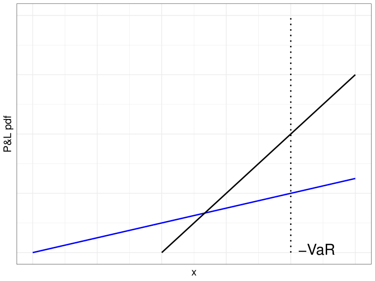
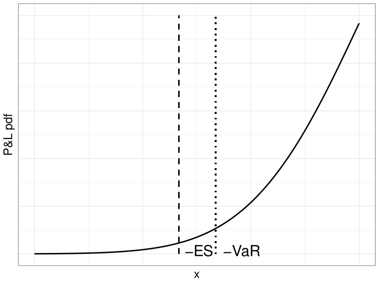

# 4.2 Expected Shortfall {.unnumbered}

[4장 개요](index.qmd) · [← 4.1 VaR의 정의와 성질](01-var.qmd) · [4.3 Portfolio VaR →](03-portfolio-var.qmd)

## Expected Shortfall

### VaR가 설명하지 못하는 꼬리위험

VaR는 손실분포의 특정 분위수를 통화 단위로 요약한다. 그러나 VaR를 초과하는 손실이 발생했을 때 그 손실이 얼마나 클 수 있는지는 알려 주지 않는다.

아래 그림의 두 손익(P&L) 분포는 같은 VaR를 가진다고 하자. VaR 왼쪽 영역의 확률은 같지만, 파란색 분포는 더 긴 왼쪽 꼬리를 가진다. 따라서 VaR를 초과하는 손실이 발생하면 파란색 분포에서 더 큰 손실이 나타날 가능성이 높다.

{#fig-tail-compare width="60%"}

그림(@fig-tail-compare)은 VaR가 꼬리 부분의 손실 규모를 충분히 설명하지 못할 수 있음을 보여 준다.

### Expected Shortfall의 정의

Expected Shortfall(ES)은 VaR 수준과 같거나 더 큰 손실이 발생했을 때의 평균 손실을 나타내는 위험 측도이다. 손익을 나타내는 확률변수 $X$가 연속분포를 따르면, 유의수준 $\alpha$에서 ES는 다음과 같이 정의한다.

$$
\mathrm{ES}_{\alpha}(X)
=
-\mathbb{E}
\left[
X
\mid
X\leq-\mathrm{VaR}_{\alpha}(X)
\right]
=
-\frac{1}{\alpha}
\int_{-\infty}^{-\mathrm{VaR}_{\alpha}}
x f(x)\,\mathrm{d}x.
$$ {#eq-es-continuous}

여기서 $f$는 $X$의 확률밀도함수이다. 즉, ES는 손실분포의 하위 $\alpha$ 영역에서 발생하는 손실의 평균을 측정한다.

이 정의는 연속분포에서는 직관적이지만, 이산형 분포에서는 경계점에 확률질량이 모여 하위 $\alpha$ 영역의 확률이 정확히 $\alpha$가 되지 않을 수 있다. 이 경우에도 사용할 수 있는 일반적 정의는 분위수 함수를 적분하는 방식이다.

$$
\mathrm{ES}_{\alpha}(X)
=
\frac{1}{\alpha}
\int_{0}^{\alpha}
\mathrm{VaR}_{\gamma}(X)\,\mathrm{d}\gamma.
$$ {#eq-es-general}

일반적 정의(@eq-es-general)는 연속분포뿐 아니라 이산형 분포에도 적용할 수 있다.[^index-4]

[^index-4]: 이산형 또는 비연속 분포에서 Expected Shortfall의 일반적 정의는 @Elliott2005 참고.

일반적으로 ES는 VaR보다 크다. ES가 VaR를 초과하는 손실들의 평균을 나타내기 때문이다.

{#fig-es-var width="60%"}

그림(@fig-es-var)에서 ES는 VaR보다 더 왼쪽, 즉 더 큰 손실이 발생하는 영역을 반영한다.

### 정규분포에서의 ES

손익 $X$가 정규분포 $N(\mu,\sigma^2)$를 따르고, $z_\alpha$가 표준정규분포의 상위 $\alpha$ 분위수라고 하자. 이때 ES는 다음과 같다.

$$
\mathrm{ES}_{\alpha}
=
-\mu
+
\sigma
\frac{\exp(-z_\alpha^2/2)}
{\alpha\sqrt{2\pi}}
=
-\mu
+
\sigma
\frac{\phi(z_\alpha)}{\alpha}.
$$ {#eq-normal-es}

여기서 $\phi(\cdot)$는 표준정규분포의 확률밀도함수이다.

### 예제: 표준정규분포의 VaR와 ES

손익이 표준정규분포를 따른다고 하자. 유의수준 $\alpha=0.01$에서는

$$
\mathrm{VaR}_{0.01}
=
z_{0.01}
\approx
2.3263
$$

이다. 같은 유의수준에서 ES는 식(@eq-normal-es)에 따라 다음과 같이 계산한다.

$$
\mathrm{ES}_{0.01}
=
\frac{\exp(-z_{0.01}^2/2)}
{0.01\sqrt{2\pi}}
\approx
2.6652.
$$

따라서 $\mathrm{ES}_{0.01}>\mathrm{VaR}_{0.01}$이다. VaR가 1% 분위수의 손실을 나타낸다면, ES는 그보다 더 나쁜 1% 상황에서의 평균 손실을 나타낸다.

### Coherent Risk Measure

손익 분포 확률변수 $X$, $Y$에 대해 위험 측도 $\rho$가 다음 성질을 만족하면 일관된 위험 측도(coherent risk measure)라고 한다.

-   $X=0$이면 $\rho(X)=0$이다.
-   $X\geq Y$이면 $\rho(X)\leq\rho(Y)$이다.
-   $\lambda\geq0$이면 $\rho(\lambda X)=\lambda\rho(X)$이다.
-   실수 $k$에 대해 $\rho(X+k)=\rho(X)-k$이다.
-   $\rho(X+Y)\leq\rho(X)+\rho(Y)$이다.

마지막 성질은 부가산성(subadditivity)이다. 포트폴리오를 결합했을 때의 위험이 각 포지션 위험의 합보다 커지지 않아야 한다는 뜻이다.

ES는 이 다섯 성질을 만족하는 일관된 위험 측도이다 [@artzner1999coherent]. 반면 VaR는 앞의 네 성질은 만족하지만, 이산형 분포에서는 부가산성을 만족하지 않을 수 있다.

### 예제: 분산 대출의 ES

앞의 VaR 예제와 같이 부도확률이 0.008인 대출을 생각하자. 유의수준은 $\alpha=0.01$이다.

#### 단일 대출

100,000달러를 한 기업에 대출하고, 부도하면 전액을 잃는다고 하자. 이산형 분포의 일반적 정의(@eq-es-general)를 이용하면 다음과 같다.

$$
\begin{aligned}
\mathrm{ES}_{0.01}
&=
\frac{1}{0.01}
\left(
\int_0^{0.008}
100{,}000\,\mathrm{d}\gamma
+
\int_{0.008}^{0.01}
0\,\mathrm{d}\gamma
\right) \\
&=
\frac{800}{0.01}
=
80{,}000.
\end{aligned}
$$

따라서 단일 대출의 ES는 80,000달러이다.

#### 두 기업에 나누어 대출

이제 서로 독립인 두 기업에 각각 50,000달러씩 대출한다고 하자. 손실 100,000달러가 발생할 확률은 $0.008^2=0.000064$이고, 손실 50,000달러가 발생할 확률은 $2\times0.008\times0.992=0.015872$이다.

$$
\begin{aligned}
\mathrm{ES}_{0.01}
&=
\frac{1}{0.01}
\left(
\int_0^{0.000064}
100{,}000\,\mathrm{d}\gamma
+
\int_{0.000064}^{0.01}
50{,}000\,\mathrm{d}\gamma
\right) \\
&=
\frac{6.4+496.8}{0.01}
=
50{,}320.
\end{aligned}
$$

분산 대출의 ES는 50,320달러로 단일 대출의 ES보다 작다. ES는 이처럼 분산투자로 인한 꼬리위험 감소를 반영하며, 부가산성을 만족한다.

::: {.callout-note}
VaR는 두 대출을 결합했을 때 0달러에서 50,000달러로 증가하는 모습을 보일 수 있었다. 그러나 ES는 극단적 손실까지 평균에 반영하므로, 분산 대출의 위험 감소를 더 일관되게 보여 준다.
:::

### 규제에서의 ES

VaR는 1996년 바젤위원회의 시장위험 규제에서 내부모형 기반 자본요건 산정에 사용되었다. 그러나 2007-2008년 금융위기에서는 VaR가 극단적 손실, 즉 꼬리위험을 충분히 반영하지 못한다는 한계가 드러났다.

이에 따라 바젤위원회는 거래계정의 근본적 검토(Fundamental Review of the Trading Book, FRTB)를 통해 VaR 대신 97.5% 신뢰수준의 ES를 도입하였다. FRTB에서는 자산의 유동성에 따라 보유 기간을 달리 적용하고, 내부모형의 사용 기준도 강화하였다.[^index-5]

[^index-5]: FRTB의 ES 도입 배경은 [@Basel2019] 참고.

---

[4장 개요](index.qmd) · [← 4.1 VaR의 정의와 성질](01-var.qmd) · [4.3 Portfolio VaR →](03-portfolio-var.qmd)
