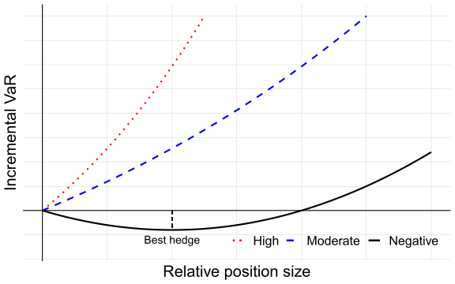

# 4.3 Portfolio VaR {.unnumbered}

[4장 개요](index.qmd) · [← 4.2 Expected Shortfall](02-es.qmd) · [4.4 Portfolio ES →](04-portfolio-es.qmd)

## Portfolio VaR

앞에서는 하나의 자산이나 대출의 손익 분포를 이용해 VaR와 ES를 계산하였다. 이제 여러 자산으로 이루어진 포트폴리오의 위험을 계산하고, 각 자산이 전체 위험에 얼마나 기여하는지 살펴본다.

이 절에서는 [현대 포트폴리오 이론](../02-modern-portfolio-theory/index.qmd)에서 사용한 수익률 벡터와 공분산 행렬을 다시 이용한다. 동일한 투자 기간에 대한 자산 수익률 벡터를

$$
\mathbf{R}
=
\begin{bmatrix}
R_1 \\
\vdots \\
R_N
\end{bmatrix}
$$

라고 하고, $\mathbf{R}$가 기대수익률 벡터 $\boldsymbol{\mu}$와 공분산 행렬 $\mathbf{C}$를 갖는 다변량 정규분포를 따른다고 가정한다.

초기 자본을 $W_0>0$, 투자 비중 벡터를 $\mathbf{w}$라고 하면, 각 자산의 투자 금액 벡터는 다음과 같다.

$$
\mathbf{x}
=
W_0\mathbf{w},
\qquad
x_i=W_0w_i.
$$

여기서 $\sum_{i=1}^N w_i=1$이며, 공매도를 허용하면 일부 $w_i$는 음수일 수 있다. 포트폴리오 수익률과 손익은 각각 다음과 같다.

$$
R_p=\mathbf{w}^{\top}\mathbf{R},
\qquad
X_p=W_0R_p=\mathbf{x}^{\top}\mathbf{R}.
$$

정규성 가정은 실제 금융 수익률의 두꺼운 꼬리를 충분히 설명하지 못할 수 있다. 그러나 포트폴리오 위험과 자산별 위험 기여도를 간결한 식으로 나타낼 수 있어, 분산투자의 효과를 이해하는 출발점이 된다.

### 포트폴리오 VaR와 분산효과

포트폴리오 수익률의 기대수익률과 분산은 다음과 같다.

$$
\mu_p=\mathbf{w}^{\top}\boldsymbol{\mu},
$$

$$
\begin{aligned}
\sigma_p^2
&=
\mathbf{w}^{\top}\mathbf{C}\mathbf{w} \\
&=
\sum_{i=1}^{N}w_i^2\sigma_i^2
+
2\sum_{i=1}^{N}\sum_{j<i}
w_iw_j\operatorname{Cov}(R_i,R_j).
\end{aligned}
$$ {#eq-portfolio-variance}

다변량 정규분포의 선형결합도 정규분포를 따르므로, 식 @eq-normal-var 에 따라 포트폴리오 VaR는 다음과 같다.

$$
\mathrm{VaR}_{p,\alpha}
=
\left(
-\mathbf{w}^{\top}\boldsymbol{\mu}
+
z_\alpha\sigma_p
\right)W_0.
$$

이하에서는 분산효과와 위험 기여도에 집중하기 위해 각 자산의 기대수익률을 0으로 가정한다. 또한 $0<\alpha<0.5$로 두고, 유의수준이 고정되어 있으면 아래첨자 $\alpha$를 생략한다.

::: {.callout-note}
기대수익률을 0으로 두면 변동성에 따른 위험만 남는다. 이는 미래 금액을 현재가치로 환산하는 할인과는 다른 단순화이다. 기대수익률을 포함하려면 위 식의 $-\mathbf{w}^{\top}\boldsymbol{\mu}W_0$ 항을 함께 사용해야 한다.
:::

이 가정 아래에서 포트폴리오 VaR는 다음과 같다.

$$
\begin{aligned}
\mathrm{VaR}_p
&=
z_\alpha\sigma_pW_0 \\
&=
z_\alpha
\sqrt{\mathbf{w}^{\top}\mathbf{C}\mathbf{w}}\,W_0 \\
&=
z_\alpha
\sqrt{\mathbf{x}^{\top}\mathbf{C}\mathbf{x}}.
\end{aligned}
$$ {#eq-portfolio-var}

이 값은 자산 사이의 공분산을 반영하므로 분산효과를 고려한 VaR, 즉 diversified VaR라고도 한다.

### Individual VaR와 undiversified VaR

Individual VaR는 포트폴리오의 구성 자산 하나를 따로 보유한다고 생각하고 계산한 VaR이다. 기대수익률을 0으로 둔 정규분포 모형에서 자산 $i$의 individual VaR는 다음과 같다.

$$
\mathrm{VaR}_i
=
z_\alpha\sigma_i|x_i|
=
z_\alpha\sigma_i|w_i|W_0.
$$ {#eq-individual-var}

절댓값은 공매도 포지션도 고려하기 위해 사용한다. 기대수익률이 0인 정규분포에서는 같은 크기의 매수 포지션과 공매도 포지션이 같은 individual VaR를 가진다.

Undiversified VaR는 individual VaR를 모두 더한 값이다.

$$
\mathrm{VaR}_{\mathrm{undiv}}
=
\sum_{i=1}^{N}\mathrm{VaR}_i.
$$

현재의 정규분포 가정 아래에서는 다음 관계가 성립한다.

$$
\mathrm{VaR}_p
\leq
\sum_{i=1}^{N}\mathrm{VaR}_i.
$$

따라서 분산투자로 얻는 위험 감소 효과를 다음 차이로 나타낼 수 있다.

$$
\text{분산효과}
=
\mathrm{VaR}_{\mathrm{undiv}}
-
\mathrm{VaR}_p.
$$

모든 포지션이 매수이고 자산 수익률 사이의 상관계수가 모두 1이면 두 VaR가 같아진다. 공매도를 포함할 때는 수익률의 상관관계뿐 아니라 포지션의 부호도 함께 고려해야 한다.

### 예제: 두 자산의 포트폴리오 VaR {#sec-example-portfolio-var}

두 자산의 수익률 표준편차와 상관계수가 다음과 같다고 하자.

$$
\sigma_1=0.05,
\qquad
\sigma_2=0.12,
\qquad
\rho_{12}=0.2.
$$

공분산 행렬은 다음과 같다.

$$
\mathbf{C}
=
\begin{bmatrix}
0.05^2 & 0.2\times0.05\times0.12 \\
0.2\times0.05\times0.12 & 0.12^2
\end{bmatrix}
=
\begin{bmatrix}
0.0025 & 0.0012 \\
0.0012 & 0.0144
\end{bmatrix}.
$$

자산 1과 자산 2에 각각 2,500달러와 7,500달러를 투자하면,

$$
W_0=10{,}000,
\qquad
\mathbf{w}
=
\begin{bmatrix}
0.25 \\
0.75
\end{bmatrix}
$$

이다. 포트폴리오 수익률의 분산과 표준편차는 다음과 같다.

$$
\begin{aligned}
\sigma_p^2
&=
0.25^2\times0.05^2
+
0.75^2\times0.12^2
+
2\times0.25\times0.75\times0.0012 \\
&=
0.00870625,
\end{aligned}
$$

$$
\sigma_p
=
\sqrt{0.00870625}
\approx
0.0933073.
$$

95% 신뢰수준에서는 $\alpha=0.05$이고 $z_{0.05}\approx1.6449$이므로,

$$
\mathrm{VaR}_p
=
z_{0.05}\sqrt{0.00870625}\times10{,}000
\approx
1{,}534.77
$$

이다. 각 자산의 individual VaR는 다음과 같다.

$$
\begin{aligned}
\mathrm{VaR}_1
&=
z_{0.05}\times0.05\times2{,}500
\approx205.61, \\
\mathrm{VaR}_2
&=
z_{0.05}\times0.12\times7{,}500
\approx1{,}480.37.
\end{aligned}
$$

따라서 undiversified VaR와 분산효과는 각각 다음과 같다.

$$
\mathrm{VaR}_{\mathrm{undiv}}
\approx
1{,}685.97,
$$

$$
\mathrm{VaR}_{\mathrm{undiv}}
-
\mathrm{VaR}_p
\approx
151.21.
$$

두 자산을 함께 보유하면 개별 위험의 합보다 포트폴리오 위험이 작아진다. 이는 두 자산이 항상 같은 방향과 비율로 움직이지 않기 때문이다.

::: {.callout-note}
이하 예제에서는 계산 중간에 충분한 자릿수를 유지하고 최종 결과를 반올림한다. 따라서 표시된 반올림값만 더하거나 곱하면 마지막 자릿수에 차이가 생길 수 있다. 금액의 단위는 달러이다.
:::

### Marginal VaR

포트폴리오 전체의 VaR를 아는 것만으로는 어떤 자산의 투자 금액을 조정해야 할지 판단하기 어렵다. 이를 위해 각 자산의 투자 금액 변화에 대한 VaR의 민감도를 살펴본다.

자산 $i$의 marginal VaR는 다른 자산의 투자 금액을 고정한 상태에서 $x_i$를 미소하게 변화시킬 때의 포트폴리오 VaR 변화율이다.

$$
\Delta\mathrm{VaR}_i
=
\frac{\partial\mathrm{VaR}_p}{\partial x_i}.
$$

식 @eq-portfolio-var 를 투자 금액 $x_i$에 대해 미분하면, $\sigma_p>0$일 때 다음을 얻는다.

$$
\Delta\mathrm{VaR}_i
=
z_\alpha
\frac{(\mathbf{C}\mathbf{x})_i}
{\sqrt{\mathbf{x}^{\top}\mathbf{C}\mathbf{x}}}.
$$

여기서 $(\mathbf{C}\mathbf{x})_i$는 벡터 $\mathbf{C}\mathbf{x}$의 $i$번째 원소이다.

$\mathbf{x}=W_0\mathbf{w}$이고

$$
(\mathbf{C}\mathbf{w})_i
=
\sum_{j=1}^{N}
w_j\operatorname{Cov}(R_i,R_j)
=
\operatorname{Cov}(R_i,R_p)
$$

이므로, marginal VaR는 다음과 같이 나타낼 수 있다.

$$
\Delta\mathrm{VaR}_i
=
z_\alpha
\frac{\operatorname{Cov}(R_i,R_p)}{\sigma_p}.
$$ {#eq-marginal-var}

투자 금액의 작은 변화 $\delta x_i$에 대해서는

$$
\text{포트폴리오 VaR의 변화}
\approx
\Delta\mathrm{VaR}_i\,\delta x_i
$$

이다. 따라서 marginal VaR가 양수이면 해당 자산의 투자 금액 증가가 VaR를 높이는 방향으로 작용하고, 음수이면 VaR를 낮추는 방향으로 작용한다.

::: {.callout-note}
Marginal VaR는 위험 금액 자체가 아니라 투자 금액 한 단위당 위험의 변화율이다. 예를 들어 marginal VaR가 0.03이면, 해당 자산에 1달러를 추가할 때 포트폴리오 VaR가 약 0.03달러 증가한다는 뜻이다.

총투자금을 유지하면서 자산 비중을 바꾸면 여러 투자 금액이 동시에 변하므로, 조정되는 모든 자산의 marginal VaR를 함께 사용해야 한다.
:::

포트폴리오 $p$에 대한 자산 $i$의 베타를 다음과 같이 정의하자.

$$
\beta_i
=
\frac{\operatorname{Cov}(R_i,R_p)}{\sigma_p^2}.
$$

그러면 식 @eq-marginal-var 는 다음과 같이 쓸 수 있다.

$$
\Delta\mathrm{VaR}_i
=
\frac{\mathrm{VaR}_p}{W_0}\beta_i.
$$ {#eq-marginal-var-beta}

여기서 $\beta_i$는 현재 분석하는 포트폴리오에 대한 민감도이다. CAPM에서 사용하는 시장 포트폴리오에 대한 베타와는 기준 포트폴리오가 다를 수 있다.

### 예제: 두 자산의 marginal VaR

앞의 두 자산 예제에서 각 자산 수익률과 포트폴리오 수익률의 공분산은 다음과 같다.

$$
\begin{aligned}
\operatorname{Cov}(R_1,R_p)
&=
0.25\times0.0025
+
0.75\times0.0012 \\
&=
0.001525, \\
\operatorname{Cov}(R_2,R_p)
&=
0.25\times0.0012
+
0.75\times0.0144 \\
&=
0.0111.
\end{aligned}
$$

Marginal VaR를 원소로 갖는 벡터를 $\Delta\boldsymbol{\mathrm{VaR}}$라고 하면,

$$
\Delta\boldsymbol{\mathrm{VaR}}
=
\frac{z_{0.05}}{\sqrt{0.00870625}}
\begin{bmatrix}
0.001525 \\
0.0111
\end{bmatrix}
\approx
\begin{bmatrix}
0.026883 \\
0.195675
\end{bmatrix}
$$

이다.

현재 포트폴리오에서는 자산 2의 투자 금액을 늘릴 때 VaR가 더 크게 증가한다. 이러한 차이는 각 자산의 변동성과 현재 포트폴리오와의 공분산을 함께 반영한 결과이다.

### Incremental VaR

Marginal VaR가 미소한 투자 금액 변화에 대한 민감도라면, incremental VaR는 실제 포지션 변경 전후의 VaR 차이이다.

추가 투자 금액 벡터를 $\mathbf{a}$라고 하자. $a_i>0$이면 자산 $i$의 투자 금액을 늘리고, $a_i<0$이면 줄인다는 뜻이다. 변경 후 투자 금액 벡터는 $\mathbf{x}+\mathbf{a}$이다.

Incremental VaR는 다음과 같이 정의한다.

$$
\mathrm{IVaR}(\mathbf{a})
=
\mathrm{VaR}(\mathbf{x}+\mathbf{a})
-
\mathrm{VaR}(\mathbf{x}).
$$ {#eq-incremental-var}

정규분포 모형에서 그 값은 다음과 같다.

$$
\mathrm{IVaR}(\mathbf{a})
=
z_\alpha
\left[
\sqrt{
(\mathbf{x}+\mathbf{a})^{\top}
\mathbf{C}
(\mathbf{x}+\mathbf{a})
}
-
\sqrt{
\mathbf{x}^{\top}\mathbf{C}\mathbf{x}
}
\right].
$$

포지션 변경 후의 위험을 매번 다시 계산하는 대신, 변경 규모가 작으면 테일러 전개의 일차항으로 근사할 수 있다.[^index-6]

[^index-6]: Marginal VaR를 이용한 incremental VaR의 일차 근사는 [@garman1996improving] 참고.

$$
\mathrm{IVaR}(\mathbf{a})
\approx
\mathbf{a}^{\top}
\Delta\boldsymbol{\mathrm{VaR}}
=
\sum_{i=1}^{N}
a_i\Delta\mathrm{VaR}_i.
$$ {#eq-incremental-var-approx}

이때 marginal VaR는 변경 전 포트폴리오에서 계산한 값이다.

### 예제: 두 자산의 투자 금액 조정

앞의 두 자산 예제에서 자산 1의 투자 금액을 500달러 늘리고, 자산 2의 투자 금액을 500달러 줄인다고 하자.

$$
\mathbf{a}
=
\begin{bmatrix}
500 \\
-500
\end{bmatrix}.
$$

총투자금은 10,000달러로 유지되며, 변경 후 투자 비중은 다음과 같다.

$$
\mathbf{w}_{\mathrm{new}}
=
\begin{bmatrix}
0.3 \\
0.7
\end{bmatrix}.
$$

변경 후 포트폴리오 분산은

$$
\begin{aligned}
\sigma_{\mathrm{new}}^2
&=
0.3^2\times0.0025
+
0.7^2\times0.0144
+
2\times0.3\times0.7\times0.0012 \\
&=
0.007785
\end{aligned}
$$

이므로, VaR를 다시 계산하면 다음과 같다.

$$
\mathrm{VaR}_{\mathrm{new}}
=
z_{0.05}\sqrt{0.007785}\times10{,}000
\approx
1{,}451.30.
$$

따라서 incremental VaR는

$$
\mathrm{IVaR}(\mathbf{a})
\approx
1{,}451.30-1{,}534.77
=
-83.47
$$

이다. 투자 비중 조정으로 포트폴리오 VaR가 약 83.47달러 감소하였다.

한편 marginal VaR를 이용한 일차 근사는 다음과 같다.

$$
\begin{aligned}
\mathrm{IVaR}(\mathbf{a})
&\approx
500\Delta\mathrm{VaR}_1
-
500\Delta\mathrm{VaR}_2 \\
&\approx
-84.40.
\end{aligned}
$$

이에 따른 변경 후 VaR의 근사값은 약 1,450.37달러로, 직접 다시 계산한 1,451.30달러와 가깝다.

### 헤지와 근사의 범위

Incremental VaR가 음수이면 해당 포지션 변경으로 전체 VaR가 감소했다는 뜻이다. 이 경우 추가된 포지션은 기존 포트폴리오에 대해 헤지 역할을 한다.

그러나 처음에 위험을 줄여 주는 방향이라도 포지션을 계속 확대하면 위험이 다시 증가할 수 있다. 특정 방향의 포지션 조정에서 VaR가 가장 작아지는 지점을 최적 헤지(best hedge)라고 한다.

{#fig-incremental-var width="80%"}

그림 @fig-incremental-var 는 포지션 추가에 따른 위험 변화가 추가 규모에 따라 달라질 수 있음을 보여 준다.

::: {.callout-warning}
Marginal VaR를 이용한 근사는 현재 포트폴리오 부근의 작은 변화에 대한 근사이다. 투자 금액을 크게 조정하거나 자산을 전부 제거하는 경우에는 변경 후 VaR를 다시 계산하여 확인해야 한다.
:::

### Component VaR

Individual VaR는 자산을 단독으로 보유할 때의 위험이다. 따라서 individual VaR의 합은 분산효과를 반영한 포트폴리오 VaR와 일반적으로 다르다.

전체 VaR를 각 자산의 기여분으로 나누기 위해 component VaR를 사용한다. 자산 $i$의 component VaR는 투자 금액과 marginal VaR의 곱으로 정의한다.

$$
\mathrm{CVaR}_i
=
x_i\Delta\mathrm{VaR}_i
=
w_iW_0\Delta\mathrm{VaR}_i.
$$ {#eq-component-var}

여기서 $\mathrm{CVaR}_i$는 component VaR를 뜻한다. 다른 문헌에서 ES의 이름으로 사용하는 conditional VaR와는 구분해야 한다.

식 @eq-marginal-var-beta 를 이용하면 다음과 같이 나타낼 수 있다.

$$
\mathrm{CVaR}_i
=
w_i\beta_i\mathrm{VaR}_p.
$$ {#eq-component-var-beta}

Component VaR는 현재 포지션의 크기와 위험 민감도를 함께 반영한다. 해당 포지션을 현재 방향으로 조금 확대하면, component VaR가 양수일 때는 VaR가 증가하고 음수일 때는 감소한다.

#### 합산 성질

Component VaR를 모두 더하면 포트폴리오 VaR가 된다.

$$
\begin{aligned}
\sum_{i=1}^{N}\mathrm{CVaR}_i
&=
\frac{z_\alpha W_0}{\sigma_p}
\sum_{i=1}^{N}
w_i\operatorname{Cov}(R_i,R_p) \\
&=
\frac{z_\alpha W_0}{\sigma_p}
\operatorname{Cov}
\left(
\sum_{i=1}^{N}w_iR_i,
R_p
\right) \\
&=
\frac{z_\alpha W_0}{\sigma_p}\sigma_p^2 \\
&=
\mathrm{VaR}_p.
\end{aligned}
$$ {#eq-component-var-sum}

이 성질 덕분에 component VaR를 이용해 전체 위험을 자산별로 배분할 수 있다. 각 자산의 위험 기여 비율은 다음과 같다.

$$
\frac{\mathrm{CVaR}_i}{\mathrm{VaR}_p}
=
w_i\beta_i.
$$

기여 비율의 합은 1이다. 다만 헤지 포지션이 있으면 일부 기여 비율이 음수가 되고, 다른 자산의 기여 비율은 100%를 넘을 수도 있다.

#### Individual VaR와의 관계

자산 $i$와 포트폴리오의 상관계수를

$$
\rho_i
=
\frac{\operatorname{Cov}(R_i,R_p)}
{\sigma_i\sigma_p}
$$

라고 하면,

$$
\begin{aligned}
\mathrm{CVaR}_i
&=
z_\alpha\sigma_iw_iW_0\rho_i \\
&=
\operatorname{sign}(w_i)\rho_i\mathrm{VaR}_i.
\end{aligned}
$$ {#eq-component-individual-var}

즉, component VaR는 individual VaR에 포트폴리오와의 상관관계 및 포지션의 방향을 반영한 값이다.

::: {.callout-note}
자산 $i$를 전부 제거하는 변화는 $a_i=-x_i$이다. 일차 근사를 적용하면

$$
\mathrm{VaR}_{\mathrm{제거\ 후}}
-
\mathrm{VaR}_p
\approx
-\mathrm{CVaR}_i
$$

이다. 따라서 component VaR는 자산 제거에 따른 VaR 감소액의 근사값으로 볼 수 있다. 다만 전체 포지션 제거는 큰 변화일 수 있으므로, 이 근사가 항상 정확한 것은 아니다.
:::

### 예제: 두 자산의 component VaR

앞의 두 자산 예제에서 component VaR는 다음과 같다.

$$
\begin{aligned}
\mathrm{CVaR}_1
&=
2{,}500\Delta\mathrm{VaR}_1
\approx67.21, \\
\mathrm{CVaR}_2
&=
7{,}500\Delta\mathrm{VaR}_2
\approx1{,}467.56.
\end{aligned}
$$

두 기여분의 합은 포트폴리오 VaR와 같다.

$$
\mathrm{CVaR}_1+\mathrm{CVaR}_2
=
\mathrm{VaR}_p
\approx
1{,}534.77.
$$

| 자산   | 투자 금액 | Individual VaR | Component VaR | 위험 기여 비율 |
|:-------|----------:|---------------:|--------------:|---------------:|
| 자산 1 |     2,500 |         205.61 |         67.21 |          4.38% |
| 자산 2 |     7,500 |       1,480.37 |      1,467.56 |         95.62% |

: 두 자산의 개별 위험과 포트폴리오 위험 기여도

자산 1은 전체 투자금의 25%를 차지하지만 VaR 기여 비율은 약 4.38%이다. 투자 비중과 위험 기여 비율은 서로 다르며, 위험 기여 비율은 변동성과 자산 사이의 관계도 반영한다.

### 예제: 공매도를 포함한 포트폴리오

같은 공분산 행렬을 사용하되, 초기 자본 10,000달러를 다음 비중으로 투자한다고 하자.

$$
\mathbf{w}
=
\begin{bmatrix}
1.5 \\
-0.5
\end{bmatrix},
\qquad
\mathbf{x}
=
\begin{bmatrix}
15{,}000 \\
-5{,}000
\end{bmatrix}.
$$

자산 2를 5,000달러만큼 공매도하고, 그 대금을 초기 자본과 함께 자산 1에 투자한 경우이다.

포트폴리오의 분산과 VaR는 다음과 같다.

$$
\sigma_p^2
=
\mathbf{w}^{\top}\mathbf{C}\mathbf{w}
=
0.007425,
$$

$$
\mathrm{VaR}_p
=
z_{0.05}\sqrt{0.007425}\times10{,}000
\approx
1{,}417.34.
$$

각 자산과 포트폴리오의 공분산은

$$
\mathbf{C}\mathbf{w}
=
\begin{bmatrix}
0.00315 \\
-0.0054
\end{bmatrix}
$$

이므로, marginal VaR는 다음과 같다.

$$
\Delta\boldsymbol{\mathrm{VaR}}
=
\frac{z_{0.05}}{\sqrt{0.007425}}
\begin{bmatrix}
0.00315 \\
-0.0054
\end{bmatrix}
\approx
\begin{bmatrix}
0.060130 \\
-0.103080
\end{bmatrix}.
$$

Component VaR는 각 투자 금액을 곱하여 계산한다.

$$
\begin{aligned}
\mathrm{CVaR}_1
&=
15{,}000\Delta\mathrm{VaR}_1
\approx901.95, \\
\mathrm{CVaR}_2
&=
(-5{,}000)\Delta\mathrm{VaR}_2
\approx515.40.
\end{aligned}
$$

반올림 전 값으로 계산하면 두 component VaR의 합은 포트폴리오 VaR와 정확히 같다.

상관계수와 individual VaR를 이용해도 같은 결과를 얻는다.

$$
\begin{aligned}
\rho_1
&=
\frac{0.00315}{0.05\sqrt{0.007425}}
\approx0.7311, \\
\rho_2
&=
\frac{-0.0054}{0.12\sqrt{0.007425}}
\approx-0.5222.
\end{aligned}
$$

$$
\mathrm{VaR}_1\approx1{,}233.64,
\qquad
\mathrm{VaR}_2\approx986.91.
$$

따라서 식 @eq-component-individual-var 에 의해

$$
\mathrm{CVaR}_1
=
\rho_1\mathrm{VaR}_1,
\qquad
\mathrm{CVaR}_2
=
-\rho_2\mathrm{VaR}_2
$$

이다.

::: {.callout-warning}
자산 2의 marginal VaR는 음수이지만 component VaR는 양수이다.

Marginal VaR가 음수라는 것은 $x_2$를 증가시키면, 즉 현재의 공매도 규모를 줄이면 VaR가 감소한다는 뜻이다. 반대로 공매도 규모를 더 늘리면 $x_2$는 더 작아지므로 VaR가 증가한다. 위험 기여도를 해석할 때는 marginal VaR의 부호와 포지션의 부호를 함께 보아야 한다.
:::

### 예제: 세 자산의 VaR와 위험 기여도

세 자산의 연간 수익률이 다변량 정규분포를 따르고, 기대수익률은 모두 0이라고 하자. 표준편차와 상관계수는 다음과 같다.

$$
\sigma_1=0.1,
\qquad
\sigma_2=0.3,
\qquad
\sigma_3=0.4,
$$

$$
\rho_{12}=0.7,
\qquad
\rho_{13}=-0.2,
\qquad
\rho_{23}=-0.3.
$$

이에 따른 공분산 행렬은 다음과 같다.

$$
\mathbf{C}
=
\begin{bmatrix}
0.01 & 0.021 & -0.008 \\
0.021 & 0.09 & -0.036 \\
-0.008 & -0.036 & 0.16
\end{bmatrix}.
$$

초기 자본 1,000달러를 $4:4:2$의 비율로 투자하면,

$$
\mathbf{w}
=
\begin{bmatrix}
0.4 \\
0.4 \\
0.2
\end{bmatrix}
$$

이다.

#### 포트폴리오 VaR

포트폴리오 분산은

$$
\sigma_p^2
=
\mathbf{w}^{\top}\mathbf{C}\mathbf{w}
=
0.02208
$$

이므로, 1년 95% VaR는 다음과 같다.

$$
\mathrm{VaR}_p
=
z_{0.05}\sqrt{0.02208}\times1{,}000
\approx
244.41.
$$

#### Marginal VaR

각 자산과 포트폴리오 사이의 공분산은 다음과 같다.

$$
\mathbf{C}\mathbf{w}
=
\begin{bmatrix}
0.01\times0.4+0.021\times0.4-0.008\times0.2 \\
0.021\times0.4+0.09\times0.4-0.036\times0.2 \\
-0.008\times0.4-0.036\times0.4+0.16\times0.2
\end{bmatrix}
=
\begin{bmatrix}
0.0108 \\
0.0372 \\
0.0144
\end{bmatrix}.
$$

따라서 marginal VaR는 다음과 같다.

$$
\Delta\boldsymbol{\mathrm{VaR}}
=
\frac{z_{0.05}}{\sqrt{0.02208}}
\begin{bmatrix}
0.0108 \\
0.0372 \\
0.0144
\end{bmatrix}
\approx
\begin{bmatrix}
0.119551 \\
0.411785 \\
0.159401
\end{bmatrix}.
$$

#### 투자 비중 변경과 incremental VaR

자산 1의 투자 금액을 50달러 늘리고, 자산 2와 자산 3의 투자 금액을 각각 25달러 줄인다고 하자.

$$
\mathbf{a}
=
\begin{bmatrix}
50 \\
-25 \\
-25
\end{bmatrix},
\qquad
\mathbf{w}_{\mathrm{new}}
=
\begin{bmatrix}
0.45 \\
0.375 \\
0.175
\end{bmatrix}.
$$

변경 후 분산과 VaR는 다음과 같다.

$$
\sigma_{\mathrm{new}}^2
=
\mathbf{w}_{\mathrm{new}}^{\top}
\mathbf{C}
\mathbf{w}_{\mathrm{new}}
=
0.02068375,
$$

$$
\mathrm{VaR}_{\mathrm{new}}
=
z_{0.05}\sqrt{0.02068375}\times1{,}000
\approx
236.56.
$$

따라서 실제 incremental VaR는 약 $-7.85$달러이다.

한편 marginal VaR를 이용하면,

$$
\begin{aligned}
\mathrm{IVaR}(\mathbf{a})
&\approx
50\Delta\mathrm{VaR}_1
-
25\Delta\mathrm{VaR}_2
-
25\Delta\mathrm{VaR}_3 \\
&\approx
-8.30
\end{aligned}
$$

이다. 변경 후 VaR의 일차 근사값은 약 236.11달러로, 직접 계산한 236.56달러와 약 0.45달러 차이가 난다.

#### Component VaR

변경 전 $4:4:2$ 포트폴리오의 component VaR는 다음과 같다.

$$
\begin{aligned}
\mathrm{CVaR}_1
&=
400\Delta\mathrm{VaR}_1
\approx47.82, \\
\mathrm{CVaR}_2
&=
400\Delta\mathrm{VaR}_2
\approx164.71, \\
\mathrm{CVaR}_3
&=
200\Delta\mathrm{VaR}_3
\approx31.88.
\end{aligned}
$$

이들의 합은 포트폴리오 VaR인 약 244.41달러이다. 자산 1과 자산 2의 투자 금액은 같지만, 전체 VaR에 대한 기여도는 자산 2가 훨씬 크다.

---

[4장 개요](index.qmd) · [← 4.2 Expected Shortfall](02-es.qmd) · [4.4 Portfolio ES →](04-portfolio-es.qmd)
