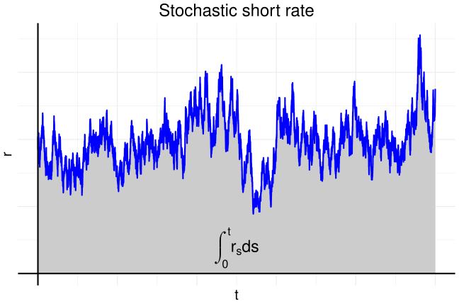
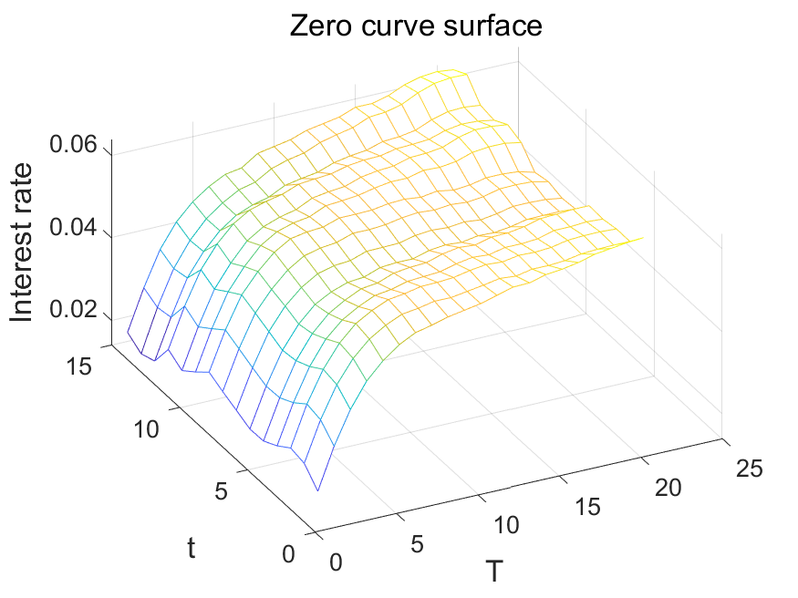
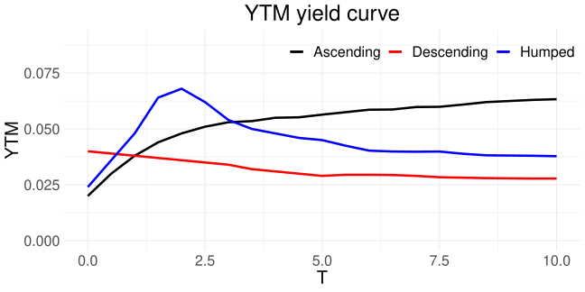

# 이자율과 채권

## 개요

이자율, 할인계수, 채권 가격, 수익률 곡선을 다룬다.

## 학습 목표

- 할인계수와 무이표채 가격의 관계를 이해한다.
- 이표채 가격과 수익률의 관계를 설명한다.
- 수익률 곡선을 해석한다.

## 이자율과 예금

이 장에서는 설명을 단순화하기 위해 이자율이 음이 아니라고 가정하며, 0인 경우도 포함한다. 이는 이 장의 모형 가정이며, 실제 금리가 항상 음이 아니라는 뜻은 아니다.

이 절에서는 예금의 원금(principal)과 이자(interest)에 복합적으로 이자가 적용되어 함께 계산되는 **복리 이자**(compounding interest)를 알아본다. [현대 포트폴리오 이론](../02-modern-portfolio-theory/index.qmd) 장에서 살펴본 간단한 금융시장 모형에는 0과 $T$라는 두 시점만 있었으며, 이자율은 이 기간 동안 무위험자산의 수익률로 표현되었다. 이러한 간단한 모형에서는 복리 이자와 단리 이자가 구분 없이 쓰인다.

실제 세상에서 이자율은 보다 복잡한 양상을 띤다. 다양한 종류의 이자율을 이해하려면 예금의 시작 시점 0과 마지막 시점 $T$뿐만 아니라, 이자가 지급되는 **복리 빈도**(compounding frequency)도 살펴보아야 한다. 이 절에서는 은행 예금의 복리 이자에 따른 자산의 가치 변화와 이자의 지급 방법을 자세히 알아본다.

### 이산 복리와 연속 복리

먼저 **이산 복리 이자**(discrete or periodic compounding interest)를 알아본다.

::: {.callout-note title="명제: 이산 복리 이자"}

원금 $P$를 0 시점에 은행에 예금하였다고 하자. 연이율 $r$의 이자가 1년에 $m$번으로 나누어 지급된다고 하면, $t$년 후의 시점에서 예금의 가치 $V_t$는 다음과 같다.

$$
V_t = \left( 1 + \frac{r}{m} \right)^{mt} P
$$ {#eq-dcr}

여기서 $t$의 단위는 년(year)이다.
:::

편의상 이자가 지급되는 시점 $t$에서만 위 예금의 가치를 계산하는 것으로 하자. 예를 들어 $m = 4$라면 계산되는 시점은 $t = 0.25, 0.5, 0.75, 1, 1.25, \cdots$ 등이 된다.

::: {.callout-tip}
## 예제: 6개월마다 이자를 지급하는 예금

6개월에 한 번씩 이자를 지급하는 연 5% 예금에 \$100를 예금하였다. 5%의 이자를 1년에 두 번 나누어 지급하므로 한 번에 지급되는 이자율은 2.5%인 셈이다. 이 예금의 2년 후 가치는 2.5%의 이자가 6개월 간격의 복리로 총 4번 지급되는 것과 같으므로

$$
\$100 \times 1.025 \times 1.025 \times 1.025 \times 1.025 \approx \$110.38
$$

이다. 위 계산을 @eq-dcr 과 비교해 볼 수 있다. 만약 5%의 이자를 1년에 한 번씩만 지급한다면, 예금의 2년 후 가치는

$$
\$100 \times 1.05 \times 1.05 \approx \$110.25
$$

이다.
:::

다음은 **연속 복리 이자**(continuous compounding interest)를 알아본다. 연속 복리는 이산 복리의 복리 빈도 $m$이 무한대로 증가하는 극한을 취한 개념으로, 이산 복리보다는 이론적인 개념이다. @eq-dcr 을 다시 쓰면 다음과 같이 나타낼 수 있다.

$$
V_t = \left[ \left( 1 + \frac{r}{m} \right)^{\frac{m}{r}} \right]^{tr} P
$$

여기서 $m \rightarrow \infty$로 가는 극한을 취하면,

$$
\mathrm{e} = \lim_{x \rightarrow \infty} \left( 1 + \frac{1}{x} \right)^x
$$

의 정의^[실제로 상수 $\mathrm{e}$는 스위스 수학자 Jacob Bernoulli가 복리를 연구하면서 도입되었다.]에 따라 $r > 0$일 때 $x = m/r$로 놓으면

$$
V_t = \mathrm{e}^{tr} P
$$ {#eq-ccr}

이다. $r = 0$이면 이자가 발생하지 않아 $V_t = P$이며, @eq-ccr 도 그대로 성립한다.

이론적으로 보면 연속 복리 이자는 매 순간 이자를 지급하여 예금의 가치를 매 순간 업데이트하는 개념이라고 볼 수 있다. 실제로 매 순간 연속적으로 이자를 지급하기는 불가능하지만, 실무적으로 보면 일별 복리 계산이 연속 복리 이자와 가장 비슷하다. 실제 세상의 이자 계산과는 다르지만, 연속 복리 개념은 수학적 이론을 전개할 때 매우 유용하며 이 자료에서도 종종 사용한다.

::: {.callout-tip}
## 예제: 복리 빈도에 따른 1년 후 가치

이자율이 연 10%라고 하자. 같은 이자율이라도 복리 빈도에 따라 1년 후 예금의 가치가 조금씩 다르다. @tbl-compounding 은 투자 금액 \$100의 1년 후 가치를 비교한 것이다.

| 복리 빈도 | 1년 후 가치 |
|:---|---:|
| 연별 $(m=1)$ | \$110.0000 |
| 반년별 $(m=2)$ | \$110.2500 |
| 분기별 $(m=4)$ | \$110.3813 |
| 월별 $(m=12)$ | \$110.4713 |
| 주별 $(m=52)$ | \$110.5065 |
| 일별 $(m=365)$ | \$110.5156 |
| 연속 $(m=\infty)$ | \$110.5171 |

: 복리 빈도에 따른 \$100의 1년 후 가치 {#tbl-compounding}

일별 복리 빈도로 계산한 가치와 연속 복리 빈도로 계산한 가치가 거의 같기 때문에, 앞에서 언급한 것처럼 실무적 관점에서는 연속 복리 이자를 일별 복리 이자와 거의 같은 것으로 간주할 수 있다. 연속 복리 이자는 수학적 계산이 편리한 경우가 많아 이론적 측면에서 많이 활용된다.
:::

{#fig-compound width=65%}

연속 복리 이자율을 $r_c$라고 하고, 연간 $m$번 지급하는 이산 복리 이자율을 $r_m$이라고 하자. @eq-dcr 과 @eq-ccr 를 이용하여 각각의 방식으로 계산한 예금의 가치를 같게 하는 이자율 사이의 관계식을 유도할 수 있다. 즉,

$$
\left( 1 + \frac{r_m}{m} \right)^{mt} = \mathrm{e}^{t r_c}
$$

로부터

$$
r_c = m \log \left( 1 + \frac{r_m}{m} \right)
$$

을 얻을 수 있다. 예를 들어 $r_m = 10\%$이고 $m = 2$일 때, 이와 동등한 연속 복리 이자율은

$$
r_c = 2 \log(1 + 0.1/2) \approx 9.758\%
$$

이다. 각 이자율에 따른 예금의 가치 변화를 그래프로 나타내면 @fig-compound 과 같다. 그림에서 계단 모양의 선은 이산 복리 이자에 따른 예금의 가치 변화를, 연속인 곡선은 연속 복리 이자에 따른 예금의 가치 변화를 나타낸다.

### 미래 이자율의 랜덤성 {#sec-random-interest-rates}

앞 절에서는 시점 0부터 $t$까지 일정하게 유지되는 고정 금리 $r$을 가정하였다. 그러나 실제 금융시장에서 미래 이자율은 현재 시점(0)에서는 알려져 있지 않고, 무작위적으로 결정된다. 미래 시점 $T_1$부터 $T_2$까지의 예금에 적용되는 이자율을 $r(T_1, T_2)$라고 하자. 이 값은 $T_1$ 이전 시점에서는 확률분포로만 알 수 있는 확률변수이며, 실제 값은 $T_1$ 시점에 이르러 확정된다. 수학적으로 $r(T_1, T_2)$는 확률공간 $(\Omega, \mathbb{P})$에서 정의된 확률변수로

$$
r(T_1, T_2) : \Omega \rightarrow [0, \infty)
$$

이다.

중앙은행의 기준금리는 정책위원회가 변화하는 경제 여건을 고려하여 결정하는데, 물가, 경기, 고용률, 환율과 같은 거시 변수들이 모두 불확실한 확률변수이므로 이를 바탕으로 결정되는 기준금리 또한 확률적이다. 나아가 금융시장에서 참조하는 벤치마크 금리들도 중앙은행 기준금리, 유동성, 자금조달 여건, 국제 금융시장 상황 등에 의해 변동하기 때문에 본질적으로 확률적인 특성을 지닌다.

**선도 이자율**(forward interest rate)이란 미래의 기간 $[T_1, T_2]$에 적용하기로 현재 시점(0)에 미리 약정하는 이자율이다. 현재 관찰되는 현물 이자율(또는 이에 대응하는 무이표채 가격)을 이용하여 무차익 조건으로 계산하며, 미래에 실제로 관찰될 현물 이자율 $r(T_1, T_2)$의 기댓값과 일반적으로 같지 않다. 먼저 $[0, T_1]$ 기간과 $[0, T_2]$ 기간의 이자율이 알려져 있다고 하자. 현재 시점(0)부터 시작하는 기간에 대한 이 이자율들을 현물 이자율이라고도 부른다. 기간 $[T_1, T_2]$에 대한 선도 이자율은 다음과 같이 계산되며, 계산의 편의를 위해 연속 복리 방법을 적용하였다.

::: {.callout-note}
## 선도 이자율

기간 $[0, T_1]$과 $[0, T_2]$에 대한 이자율을 각각 $r(0, T_1)$과 $r(0, T_2)$라고 하자. 미래의 기간 $[T_1, T_2]$의 선도 이자율 $f(0; T_1, T_2)$는 연속 복리 기준으로 다음과 같다.

$$
f(0; T_1, T_2) = \frac{r(0, T_2) T_2 - r(0, T_1) T_1}{T_2 - T_1}
$$ {#eq-forward-rate}
:::

위 선도 이자율의 계산은 다음의 논리로 설명할 수 있다. 두 가지 시나리오를 생각해 보자. 하나는 0 시점부터 $T_2$까지 $r(0, T_2)$의 이자율로 예금을 하는 것이다. 연속 복리 기준으로 원금 1에 대해 $T_2$ 시점의 예금의 가치는 $\mathrm{e}^{r(0, T_2) T_2}$이다. 다른 하나는 0 시점부터 $T_1$까지 $r(0, T_1)$의 이자율로 원금 1을 예금하고, $T_1$부터 $T_2$까지 적용할 이자율을 현재 시점(0)에 $f(0; T_1, T_2)$로 미리 약정하는 것이다. $T_1$ 시점에 얻은 원금과 이자를 이 약정 이자율로 다시 예금하면, $T_2$ 시점의 예금 가치는 다음과 같이 확정된다.

$$
\mathrm{e}^{r(0, T_1) T_1} \mathrm{e}^{f(0; T_1, T_2)(T_2 - T_1)}
$$

차익거래가 불가능하려면 두 방법의 최종 가치가 같아야 한다. 즉,

$$
\mathrm{e}^{r(0, T_2) T_2} = \mathrm{e}^{r(0, T_1) T_1} \mathrm{e}^{f(0; T_1, T_2)(T_2 - T_1)}
$$

이며, 이것을 정리하면 @eq-forward-rate 을 얻는다.

### 단기 이자율 {#sec-short-rate}

예금의 아주 짧은 기간 동안에 대한 이자율을 **단기 이자율**(short rate, short-term interest rate)이라고 한다. 수학적으로 보았을 때는 극소(infinitesimal) 시간인 $dt$ 동안의 예금에 대한 이자를 말한다. 현실적으로는 $dt$와 같은 극소 시간 간격을 이자율을 계산하는 데에 사용할 수 없기 때문에 하루와 같은 짧은 시간 동안의 이자율을 말하며, 실제 금융 시장에서 단기 이자율은 금융기관 사이의 단기 차입금에서 발생하는 이자율을 지칭한다.

앞 절에서 구간 $[t, T]$에 대한 이자율을 $r(t, T)$로 표현하였다. 단기 이자율 $r_t$는 수학적으로 다음과 같이 표현할 수 있다.

$$
r_t = \lim_{T \to t+} r(t, T)
$$

예를 들어 $t$ 시점에 $M_t$의 금액이 예금으로 있다고 하자. 앞으로 $dt$의 시간 동안 쌓이는 이자는 단기 이자율 $r_t$를 이용하여 $r_t M_t \, dt$로 표현된다. 단기 이자율 $r_t$가 시간에 따라 변할 수 있기 때문에 아래첨자 $t$를 쓴다. 예를 들어 $M_t = 10{,}000$이고 단기 이자율 $r_t = 0.05$라고 할 때, $0.0001$이라는 짧은 시간 동안의 이자는

$$
0.05 \times 10{,}000 \times 0.0001 = 0.05
$$

로 근사할 수 있다. 따라서 단기 이자율에 따른 예금의 순간 변화량은

$$
dM_t = r_t M_t \, dt
$$

이다. 이와 동치로

$$
M_t = M_0 \exp\left( \int_0^t r_s \, ds \right)
$$ {#eq-mt}

로 표현하기도 한다. @eq-mt 의 양변을 $t$에 대해 미분하고, 미적분학의 기본 정리인

$$
r_t = \frac{d}{dt} \left( \int_0^t r_s \, ds \right)
$$

를 이용하면

$$
\frac{dM_t}{dt} = M_0 \frac{d}{dt} \exp\left( \int_0^t r_s \, ds \right) = M_0 \exp\left( \int_0^t r_s \, ds \right) \frac{d}{dt} \left( \int_0^t r_s \, ds \right) = r_t M_t
$$

임을 확인할 수 있다. 이러한 예금 $M$을 **단기금융시장계좌**(MMA, money market account)라고도 부르며, 이론적으로는 은행에 예금한 무위험자산을 나타낸다.

@fig-mma 왼쪽의 파란 선처럼, 단기 이자율은 시간에 따라 랜덤하게 변하는 확률과정으로 모형화한다. 즉, 확률공간 $\Omega$에 대해 $r_t$는 각 시점 $t$에서

$$
r_t : \Omega \rightarrow [0, \infty)
$$

로 정의되는 확률변수이다. 특정 단기 이자율 모형을 따로 다루지는 않지만, $r_t$에 대한 정교한 모형은 이후에 다룰 채권 가격 결정 이론에 유용하게 활용될 수 있다.

그림의 파란 선을 시간 $t$까지 적분한 값, 즉 회색 음영의 넓이 $\int_0^t r_s \, ds$는 계좌가치 비율의 로그 $\log(M_t / M_0)$이다. 계좌가치 $M_t$는 이 적분을 지수함수에 넣어 @eq-mt 와 같이 계산한다. 예금 가치의 변화를 그래프로 나타내면 @fig-mma 의 오른쪽과 같다. @fig-compound 에서 본 연속 복리 이자에 따른 예금의 지수적 증가 함수의 형태와 매우 비슷하나, 단기 이자율의 랜덤한 변화에 따라 예금의 가치 변화에 굴곡이 있음을 확인할 수 있다.

만약 $r_t$를 시간에 따라 변하지 않는 고정된 상수 $r$이라고 가정하면, MMA의 계좌가치는

$$
M_t = M_0 \mathrm{e}^{rt}
$$

이며, @eq-ccr 에서 살펴본 고정된 이율을 이용한 연속 복리 이자에서의 예금의 가치 변화와 같다.

::: {#fig-mma layout-ncol=2}

{width=100%}

{width=100%}

가상의 랜덤한 단기 이자율 과정과 그에 따른 MMA의 가치 변화

:::

## 채권

**채권**(bond)은 채권 발행자가 채권 보유자에게 미래의 특정 시점에 미리 정해진 고정된 금액을 지급하는 금융 상품을 말한다. 일반적으로 자금을 조달하기 위한 목적으로 발행되며, 미래의 현금흐름이 채권 발행 시점에 이미 결정되기 때문에 **고정수익증권**(fixed income security)이라고도 불린다. 비교적 안정적인 수익을 제공하는 점에서 예금의 구조와 매우 비슷하나, 채권 가격은 채권 시장을 통해 결정되며 금리 변동성과 시장 조건에 따라 변할 수 있다. 기준 금리가 상승하면 채권 가격은 하락할 수 있기 때문에 시장 위험의 요소를 가지고 있고, 채무불이행 위험 등 신용 위험의 요소 또한 가지고 있다. 이 자료에서는 채권의 가격과 수익률 및 이자율 간의 수학적 관계를 알아본다.

::: {.callout-note}
## 안전 자산 채권의 위험

신용도가 높은 정부가 발행한 채권은 보통 안전 자산으로 간주되나, 만기 불일치 혹은 이자율 변화에 따른 채권의 리스크를 간과해서는 안 된다. 2023년 3월 미국의 Silicon Valley Bank는 급격한 뱅크런에 따라 파산하였는데, 파산한 이유 중 하나로서 다음과 같은 채권 관련 리스크들로 설명된다. Silicon Valley Bank는 기술 회사들에 대한 대출 등을 통해 많은 수익을 올리면서 성공을 거둔 은행으로, 자신들의 성공으로 얻은 자금을 가장 안전한 투자 중 하나인 미국 정부 채권에 투자하였다.

Silicon Valley Bank는 투자의 대부분을 10년 만기의 장기 채권에 투자하였는데, 2023년 초반 미연방준비제도 이사회에서 금리 인상을 결정하면서 채권 가격이 하락하였다. 은행의 재무 구조가 악화되었다는 소문이 돌자 고객들이 돈을 인출하기 시작하였고, 이들 중 일부는 수백만 달러에서 수십억 달러의 계좌를 동시에 인출하였다. 고객들의 불안으로 인해 은행은 많은 현금이 필요했고, Silicon Valley Bank는 시장에 채권을 급하게 매각하려 시도하였으나 마땅치 않았다. 결국 Silicon Valley Bank는 큰 손실을 입고 파산하게 되었다.
:::

실제 금융 시장에서 거래되는 채권의 종류는 매우 다양하나, 먼저 **무이표채**(zero-coupon bond)와 **이표채**(coupon bond)로 나누어 살펴본다.

### 무이표채 {#sec-zero-coupon-bond}

앞서도 종종 등장했던 무이표채와 이자율의 관계를 더 자세히 살펴본다. 무이표채 혹은 제로 쿠폰채는 채권의 발행 주체가 정해진 미래 시점인 **만기일**(maturity date) $T$에 채권 투자자에게 **액면 가격**(face value, principal, nominal, par) $F$를 지급하는 채권을 의미한다. 무이표채는 만기일 이전에 별도의 이자를 지급하지 않으며, 단기물뿐 아니라 장기물도 존재한다. 이 자료에서는 임의의 $T > 0$을 가정한다.

제로 쿠폰채의 가격은 다른 금융상품과 마찬가지로 시장에서 수요-공급 법칙에 의해 결정된다. 이 장의 비음수 금리 가정 아래에서는 액면가 $F$ 이하이며, 이자율이 0이면 액면가와 같을 수 있다. 그리고 발행 주체의 신용도에 따라 가격이 다르며, 부도 위험이 적은 정부채의 가격이 부도 위험이 있는 회사채의 가격보다 높다.

시점 0에서 만기가 $T$인 제로 쿠폰채의 가격을 $B(0, T)$라고 하자. 임의의 시점 $0 \leq t < T$에서도 제로 쿠폰채는 거래될 수 있으며, 이때의 가격을 $B(t, T)$라고 하자. 이때 만기일은 미리 정해진 날 $T$로 고정되어 있으나, **만기까지의 시간**(time-to-maturity, tenor, term) $T - t$는 시간이 지남에 따라 줄어든다. 제로 쿠폰채의 액면가는 임의의 실수값 $F$를 가질 수 있으며, 이것은 액면가 1인 제로 쿠폰채 $F$개와 수학적으로 같다. 따라서 앞으로 특별한 언급이 없을 때는 제로 쿠폰채의 액면가를 1이라고 가정한다. 즉, 이 경우 $B(T, T) = 1$이다. 또한 특별한 언급이 없는 한 채권의 부도 위험은 없다고 하자. 이 장의 비음수 금리 가정에 따라 $0 \leq t < T$에서 $0 < B(t, T) \leq 1$이다.

제로 쿠폰채의 가격은 다른 금융 자산 혹은 **현금 흐름**(cash flow)의 가격에 대한 결정 기준으로 사용될 수 있다. 예를 들어, $t$ 시점에서 부도 위험이 없는 상대에게 $V_t$만큼의 원금을 빌려준 후 $T$ 시점에 이자와 원금을 같이 받기로 하였다면, $T$ 시점에서 받아야 할 원리금의 합계는

$$
V_T = \frac{V_t}{B(t, T)}
$$

이며, 혹은

$$
V_t = B(t, T) V_T
$$

와 같이 나타낼 수 있다. 위 논의에서 $B(t, T)$는 미래 시점의 수입 $V_T$에 대한 **현재 가치**(present value) $V_t$를 계산하는 데 있어 할인계수(discount factor)의 역할을 한다. 한편, 미래의 수입이 여러 날에 걸쳐 이루어질 경우 이를 현금 흐름(cash flow)이라고도 부른다.

제로 쿠폰채에 투자하는 것은 해당 기간 동안 은행에 예금하고 만기 시점에 이자와 원금을 돌려받는 것과 같다. 따라서 할인계수 $B(t, T)$는 이해하기 쉬운 이자율을 통해 표현되기도 한다. 하지만 복리의 측정 방법에 따라 공식이 조금씩 다르므로 주의한다. 1년에 한 번 이자를 지급하는 복리 계산에서의 이자율이라면

$$
B(t, T) = (1 + r(t, T))^{-(T - t)}
$$

를 만족하는 $r(t, T)$가 $B(t, T)$의 이자율이며, 여기서 $r(t, T)$의 $t$는 이자율 측정의 시작 시간, $T$는 측정의 마지막 시간이다. 또한 1년에 $m$번 이자를 지급하는 방식으로 계산한 복리 이자율이라면

$$
B(t, T) = \left( 1 + \frac{r(t, T)}{m} \right)^{-m(T - t)}
$$

를 만족하는 $r(t, T)$가 해당 무이표채의 이자율이다. 마지막으로 연속 복리 이자율을 사용하면

$$
B(t, T) = \mathrm{e}^{-r(t, T)(T - t)}
$$ {#eq-ber}

이며, 위 세 식에서 계산한 $r$의 값들은 조금씩 다르다. 계산상의 편리함 때문에 @eq-ber 가 자주 이용되며, 이 경우

$$
r(t, T) = -\frac{1}{T - t} \log B(t, T)
$$

이다.

제로 쿠폰채의 이율 $r(0, T)$를 만기일 $T$의 **무이표 이자율**(zero-coupon interest rate, zero rate)이라고도 부른다. 앞에서 언급하였듯이 계산에 적용된 복리 빈도에 따라 조금씩 값이 다르다. 혹은 $T$년 만기의 **현물 이자율**($T$-year spot rate)이라고 불리기도 한다. 여기서 현물이라는 단어는 미래 기간에 적용하기로 현재 미리 약정하는 선도 이자율과 대비되는 표현이다. 선도 이자율은 앞의 [미래 이자율의 랜덤성](#sec-random-interest-rates) 절에서 살펴보았다.

::: {.callout-tip}
## 예제: 복리 빈도에 따른 무이표 이자율

액면가 \$1, 만기 $T = 1$년인 무이표채의 현재 0 시점 가격이 \$0.95라고 한다. 만기 1년의 무이표 이자율을 복리 빈도에 따라 계산하면 @tbl-zero-rate 와 같다.

| 빈도 | 무이표 이자율 |
|:---|---:|
| $m=1$ | 5.2632% |
| $m=2$ | 5.1957% |
| $m=4$ | 5.1624% |
| $m=12$ | 5.1403% |
| $m=52$ | 5.1319% |
| $m=365$ | 5.1297% |
| 연속 | 5.1293% |

: 복리 빈도에 따른 만기 1년 무이표 이자율 (가격 \$0.95) {#tbl-zero-rate}
:::

@eq-ber 등에서 무이표 이자율을 $r(t, T)$로 두 시점 $t$와 $T$의 함수로 표현하였는데, 이는 이자율이 이자율을 관찰하는 현재 시점 $t$와 해당되는 대출 혹은 채권의 만기 $T$의 두 시점으로 정해짐을 뜻한다. 같은 시점 $t$에 관찰된 이자율이더라도 만기 $T$가 다르면 다른 값을 지닌다.

고정된 $t = 0$에 대해 $r(0, T)$를 만기일 $T$에 대한 함수로 나타낸 것을 **무이표 이자율 곡선**(zero-coupon yield curve, zero curve)^[Spot yield curve라고도 부른다.]이라고 부른다. 이처럼 만기에 따라 달라지는 이자율의 표현을 이자율의 **만기 구조**(term structure)라고 한다. @fig-zero-curve 은 가상의 무이표 이자율 곡선의 만기 구조를 나타낸 것이다. 그림의 $x$축이 만기 $T$라는 점에 유의한다.

{#fig-zero-curve width=60%}

또한 실제 세상에서는 고정된 만기일 $T$에 대한 이자율도 시간 $t$가 변함에 따라 변동하며, 기준 금리^[우리나라에서는 한국은행 금융통화위원회에서 결정하는 정책금리이다.]와 시장의 상황에 따라 움직일 것이다. 이자율이 시간에 따라 변한다는 변동 금리의 관점에서 보면, 앞의 [미래 이자율의 랜덤성](#sec-random-interest-rates) 절에서 살펴본 것처럼 미래 시점 $t$에 대한 $r(t, T)$ 또한 확률변수로 간주된다. 이는 무이표 이자율 $r(t, T)$를 결정하는 채권의 가격 $B(t, T)$가 시장에서 수요-공급 법칙에 의해 랜덤하게 결정되기 때문이다. 즉,

$$
B(t, T) : \Omega \rightarrow (0, 1], \quad r(t, T) : \Omega \rightarrow [0, \infty)
$$

이며, 여기서 $\Omega$는 확률공간(probability space)이다. 채권의 가격 $B$와 이자율 $r$은 $\Omega$의 원소인 $\omega$에 대한 함수이기도 하여 $B(\omega, t, T)$, $r(\omega, t, T)$로 나타내기도 하지만, 편의상 $\omega$와 관련된 부분은 생략하고 사용한다. 이 자료에서는 보통 고정된 이자율을 통해 금융 이론들을 살펴볼 것이나, 이자율이 $t$에 대한 함수로 나타날 때는 시간에 따라 랜덤하게 변하는 이자율일 수도 있음을 함축한다.

따라서 무이표 이자율 곡선은 시간에 따라 랜덤하게 변하여, 시간에 따라 관찰한다면 랜덤한 표면을 그릴 수 있을 것이다. @fig-zero-surface 에서 $t$축을 따라 곡선 자체가 위아래로 랜덤하게 변동하며 진행하는 상황을 상상해 볼 수 있다. 곡선의 평균 레벨이나 기울기, 곡률 등도 시간에 따라 변해간다. 그림에서 $T$축은 시점 $t$로부터 만기일까지 남아 있는 기한인 time-to-maturity를 말한다.

{#fig-zero-surface width=60%}

또한 $r(t, T)$에서 $T$를 $t$로 극한을 취하면, [단기 이자율](#sec-short-rate) 절에서 공부한 단기 이자율을 얻는다. 즉,

$$
r_t = \lim_{T \rightarrow t+} r(t, T)
$$

이다. @fig-zero-curve 에서 무이표 이자율 곡선의 $y$절편이 0 시점에서의 단기 이자율 $r_0$이며, @fig-zero-surface 에서 $T = 0$인 지점에서 추출한 경로가 $r_t$이다.

::: {.callout-note}
## 이자율 위험과 듀레이션

이전에 살펴봤듯이 신용도가 높은 정부 채권이더라도 (특히 만기가 길수록) 이자율 위험에 노출된다. 시장 금리가 상승하면 채권의 가격이 하락하고, 시장 금리가 하락하면 채권의 가격은 상승한다. 만기가 길수록 이자율 위험이 크며, 채권의 이자율 민감도를 측정할 때는 **듀레이션**(duration)이라는 지표를 활용한다.
:::

### 이표채 {#sec-coupon-bond}

**이표채**(coupon bond)는 만기 이전과 만기일의 정해진 시점 $T_1, \cdots, T_N$에 미리 약속한 고정된 현금 흐름 $c_1, \cdots, c_N$을 채권 투자자에게 지급한다. 정기적으로 지급하는 이자를 **이표**(coupon)라고 하며, 액수는 보통 채권 발행자가 결정한다. 마지막 현금 흐름 $c_N$에는 만기일 $T_N$에 상환하는 액면가도 포함된다. 이표채의 가치는 무이표채들의 선형 조합으로 표현할 수 있다.

::: {.callout-note title="명제: 이표채의 가격"}

이표채의 지급일 $T_1, \cdots, T_N$을 만기일로 가지는 제로 쿠폰채들이 존재한다고 할 때, $t < T_1$ 시점에서의 이표채 가격은 다음과 같다.

$$
B_c(t) = \sum_{j=1}^{N} c_j B(t, T_j)
$$

즉, 이표채의 가격은 이표채의 현금 흐름을 현재 가치로 할인한 뒤 합하여 결정되며, 할인계수는 해당 지급일을 만기로 가지는 무이표채의 현재 가격이다.
:::

실제 채권 시장에서 주로 거래되는 채권들은 일반적으로 같은 액수의 쿠폰을 지급한다. 즉, $j = 1, \cdots, N-1$에 대해 $c_j = c$이고, 마지막 $T_N$ 시점의 현금 흐름은 쿠폰과 액면가의 합인 $c_N = c + F$이다. 이 경우

$$
B_c(t) = \sum_{j=1}^{N} c B(t, T_j) + F B(t, T_N)
$$ {#eq-bc1}

로 표현할 수 있다. 때때로 쿠폰의 지급액은 액면가에 대한 **이표율**(coupon rate) $c_r$로 정의되며, 만약 쿠폰이 1년에 $m$번 지급된다면 $c = \dfrac{c_r}{m} F$이다. 이 경우에 이표채의 가치는

$$
B_c(t) = \sum_{j=1}^{N} \frac{c_r}{m} F B(t, T_j) + F B(t, T_N)
$$ {#eq-bc2}

이다.

::: {.callout-note title="따름정리: 무이표 이자율로 나타낸 이표채의 가격"}

현재 시점을 0으로 두고, 연간 $m$회 쿠폰을 지급하는 이표채의 지급 시점이 $T_j = j/m$, $j = 1, \cdots, N$이라고 하자. 각 지급 시점의 현금 흐름을 $c_j$라고 하며, 마지막 $c_N$에는 액면가 상환액을 포함한다. 복리 빈도 $m$으로 계산한 무이표 이자율 $r(0, T_j)$로 표현된 0 시점의 이표채 가격은

$$
B_c(0) = \sum_{j=1}^{N} \frac{c_j}{\left( 1 + \frac{r(0, T_j)}{m} \right)^{j}}
$$

이다. 고정된 쿠폰 지급액 $c$와 액면가 $F$를 이용하여 표현하면

$$
B_c(0) = \sum_{j=1}^{N} \frac{c}{\left( 1 + \frac{r(0, T_j)}{m} \right)^{j}} + \frac{F}{\left( 1 + \frac{r(0, T_N)}{m} \right)^{N}}
$$ {#eq-cbond1}

이다.
:::

::: {.callout-tip}
## 예제: 무이표 이자율로 계산한 이표채 가격

6개월 간격으로(semi-annually) 계산한 복리 이자로 나타낸 무이표채의 이자율이 @tbl-zero-rates-semi 에 있다.

| 만기 $T_j$(년) | 무이표 이자율 $r(0, T_j)$(6개월 복리) |
|:---:|:---:|
| 0.5 | 3.0% |
| 1.0 | 3.8% |
| 1.5 | 4.4% |
| 2.0 | 4.8% |
| 2.5 | 5.1% |
| 3.0 | 5.3% |

: 만기별 무이표 이자율(6개월 복리) {#tbl-zero-rates-semi}

액면가가 \$100인 3년 만기 이표채를 생각해 보자. 이표율은 6%이며 6개월에 한 번씩 지급된다고 하자. 즉, 한 번에 지급되는 이표의 가치는 \$3이다. 이표채의 가격 공식을 이용하면, 이 이표채의 첫 번째 현금 흐름의 현재 가치는 다음과 같다.

$$
3 \times \left( 1 + \frac{0.03}{2} \right)^{-2 \times 0.5} = 2.9557
$$

또한 두 번째 현금 흐름의 현재 가치는

$$
3 \times \left( 1 + \frac{0.038}{2} \right)^{-2 \times 1} = 2.8892
$$

와 같이 나타낼 수 있으며, 같은 방법으로 모든 현금 흐름의 현재 가치를 계산할 수 있다. 즉, 이표채의 현재 가치는

$$
\sum_{j=1}^{6} 3 \times \left( 1 + \frac{r(0, T_j)}{2} \right)^{-2 \times j \times 0.5} + 100 \times \left( 1 + \frac{r(0, T_6)}{2} \right)^{-2 \times 3} = 102.0695
$$

이다. 여기서 $r(0, T_j)$는 만기가 $T_j$인 무이표 이자율(zero rate)이다. 이표채의 가격은 액면가인 \$100보다 높은데, 이는 이표율이 이자율보다 높기 때문이다. 위 상황을 정리하면 다음 표와 같다.

| 시점(년) | 현금 흐름 | 할인계수 | 현재 가치 |
|:---:|:---:|:---:|---:|
| 0.5 | 3 | 0.9852 | 2.9557 |
| 1.0 | 3 | 0.9631 | 2.8892 |
| 1.5 | 3 | 0.9368 | 2.8104 |
| 2.0 | 3 | 0.9095 | 2.7285 |
| 2.5 | 3 | 0.8817 | 2.6451 |
| 3.0 | 103 | 0.8548 | 88.0407 |
| 합계 | | | 102.0695 |

: 이표채 현금 흐름의 현재 가치 {#tbl-coupon-bond-pv}
:::

금융 퀀트들이 종종 하는 일은 @fig-zero-curve 과 같은 무이표 이자율을 시장에서 거래되는 다양한 채권 상품으로부터 결정하는 일이다. 장기 무이표채도 존재하지만 모든 만기의 무이표채 가격을 시장에서 직접 관찰할 수 있는 것은 아니다. 따라서 이표채를 포함한 여러 채권의 가격으로부터 만기별 할인계수와 무이표 이자율을 순차적으로 구하는 부트스트래핑(bootstrapping)을 이용한다. 이 채권 상품들의 가격은 시장에서 수요-공급 법칙에 따라 결정된다. 이렇게 만들어진 무이표 이자율 곡선은 제3의 상품의 가치를 평가하는 데에 활용할 수 있다. 단, 실제로 모든 실수값의 만기 $T$에 해당하는 무이표 이자율을 구할 수는 없기 때문에, 선형 보간법 등을 적용하여 빈 곳을 연결한다.

### 만기 수익률 {#sec-ytm}

이표채는 쿠폰 구조가 있어 한눈에 이표채의 수익률을 이해하기 힘들다. 예를 들어, 6개월 간격으로 이표율 3.5%를 6번 지급하는 액면가 102의 채권과 3개월 간격으로 이표율 4.7%를 16번 지급하는 액면가 98의 채권이 같은 가격으로 거래될 때, 어떤 채권의 수익률이 높다고 할 수 있을지 가늠하기가 쉽지 않다. 주의할 점은 채권의 수익률이 높다고 항상 더 좋은 투자처라는 것은 아니며, 부도 위험이 존재하기 때문에 이러한 리스크를 따져 보아야 한다는 것이다.

**만기 수익률**(YTM, yield-to-maturity)^[채권 수익률이라고도 한다.]은 하나의 숫자로 채권의 수익률을 가늠할 수 있게 한다. 만기 수익률(YTM)은 채권에서 제공되는 현금 흐름의 현재 가치를 채권의 시장 가격과 같게 하는 할인율이다. 채권의 현재 가치는 @eq-bc1 에서처럼 무이표채 가격으로 할인하여 구할 수 있다. 그러나 무이표채의 이자율 $r(0, T_j)$는 이표 지급 시기 $T_j$에 따라 모두 다르다. 각기 다른 이자율 $r(0, T)$ 대신 같은 수익률 값 $Y$를 이용하여 채권의 현금 흐름을 할인하였을 때, 그 값이 채권의 실제 거래 가격과 같게 되면 $Y$를 해당 채권의 만기 수익률이라 한다.

앞에서 측정 방법에 따라 무이표채의 이자율이 달리 계산되었던 것처럼, 채권 수익률 또한 복리 계산 방법에 따라 조금씩 다르다.

::: {.callout-note}
## 만기 수익률

1년에 $m$번 이표를 지급하는 채권 $B_c$의 YTM을 이산 복리 방식^[같은 복리 빈도 $m$을 이용했다고 볼 수 있다.]으로 계산하면, 다음을 만족하는 $Y$이다.

$$
B_c(0) = \sum_{j=1}^{N} \frac{c}{\left( 1 + \frac{Y}{m} \right)^{j}} + \frac{F}{\left( 1 + \frac{Y}{m} \right)^{N}}
$$ {#eq-ytm1}

채권의 이표는 비록 이산적으로 지급되지만, 때로는 연속 복리 방법으로 만기 수익률을 측정할 수 있다. 연속 복리 기준으로 계산하면 다음을 만족하는 $Y$를 YTM이라 한다.

$$
B_c(0) = \sum_{j=1}^{N} c \mathrm{e}^{-Y \frac{j}{m}} + F \mathrm{e}^{-Y \frac{N}{m}}
$$

이표율 $c_r$로 표현할 경우 위 두 식에 대응되는 식들은 각각

$$
B_c(0) = \sum_{j=1}^{N} \frac{\frac{c_r}{m} F}{\left( 1 + \frac{Y}{m} \right)^{j}} + \frac{F}{\left( 1 + \frac{Y}{m} \right)^{N}}
$$

와

$$
B_c(0) = \sum_{j=1}^{N} \frac{c_r}{m} F \mathrm{e}^{-Y \frac{j}{m}} + F \mathrm{e}^{-Y \frac{N}{m}}
$$

이다.
:::

위 식들을 만족하는 $Y$를 구하기 위한 닫힌 해(closed-form solution)는 없기 때문에 수치적 방법으로 계산한다. 이표채의 가격을 무이표 이자율로 표현한 @eq-cbond1 과 비교해 볼 수 있다.

::: {.callout-tip}
## 예제: 채권 가격에 따른 만기 수익률

3년 만기의 반년별로 이표를 지급하는 액면가 \$100의 채권이 있고, 이 채권의 시장 가격이 아래 표와 같이 알려져 있다고 가정해 보자. 이표율을 5%라고 할 때, 채권의 여러 현재 가격에 따른 만기 수익률을 계산하면 다음과 같다.

| $B_c(0)$ | 이산 복리 YTM | 연속 복리 YTM |
|:---:|:---:|:---:|
| \$96 | 6.4888% | 6.3857% |
| \$98 | 5.7352% | 5.6545% |
| \$100 | 5.0000% | 4.9385% |
| \$102 | 4.2825% | 4.2373% |
| \$104 | 3.5819% | 3.5502% |

위 값을 계산할 때 다음의 R 코드를 활용하였다.

```r
# Y: 만기 수익률, m: 연간 이표 지급 횟수
diff_sq <- function(Y, m, N, cr, Bc, FV, type){

  if(type == "discrete") {

    (Bc - sum(cr/m * FV / (1 + Y/m)^(1:N)) - FV / (1 + Y/m)^N)^2

  } else if (type == "continuous"){

    (Bc - sum(cr/m * FV * exp(-Y*(1:N)/m)) - FV * exp(-Y/m*N))^2

  }

}
res <- optimise(diff_sq, interval = c(0,1), tol=1e-10, # setting
                m=2, N=6, cr=0.05, Bc=96, FV=100, type="discrete")
res$minimum  # YTM
```
:::

::: {.callout-tip}
## 예제: 만기 수익률과 만기 시점의 무이표 이자율

이표채의 현금 흐름은 만기에 집중되어 있기 때문에, YTM은 만기 시점의 무이표 이자율에 가장 큰 영향을 받는다. 먼저 아래의 무이표 이자율을 가정해 보자.

| 만기(년) | 무이표 이자율(연속 복리 기준) |
|:---:|:---:|
| 0.5 | 4% |
| 1.0 | 4% |
| 1.5 | 4% |
| 2.0 | 2% |

이표율이 4%이고 반년마다 이표가 지급되는 2년 만기 채권의 현재 가격은

$$
B_c = 0.02 \mathrm{e}^{-0.04 \times 0.5} + 0.02 \mathrm{e}^{-0.04 \times 1} + 0.02 \mathrm{e}^{-0.04 \times 1.5} + 1.02 \mathrm{e}^{-0.02 \times 2} = 1.0377
$$

이다. 위 예제의 프로그램을 이용하여 만기 수익률을 구하면, 이산 복리 기준($m=2$)의 YTM은 2.07%이다.

반면 아래 표 기준의 무이표 이자율을 가정했을 때는 채권의 현재 가격은

$$
B_c = 0.02 \mathrm{e}^{-0.04 \times 0.5} + 0.02 \mathrm{e}^{-0.04 \times 1} + 0.02 \mathrm{e}^{-0.04 \times 1.5} + 1.02 \mathrm{e}^{-0.06 \times 2} = 0.9623
$$

이고, 이산 복리 기준($m=2$)의 YTM은 6.03%이다.

| 만기(년) | 무이표 이자율(연속 복리 기준) |
|:---:|:---:|
| 0.5 | 4% |
| 1.0 | 4% |
| 1.5 | 4% |
| 2.0 | 6% |

반면 채권 자체의 이표율에는 큰 영향을 받지 않는다.
:::

::: {.callout-tip}
## 예제: 이표율에 따른 만기 수익률

무이표 이자율이 아래와 같이 관찰되었다.

| 만기(년) | 무이표 이자율(연속 복리 기준) |
|:---:|:---:|
| 0.5 | 2.90% |
| 1.0 | 4.10% |
| 1.5 | 4.57% |
| 2.0 | 4.97% |

위 무이표 이자율을 바탕으로 1년에 2번 이표를 지급하는 이표채의 이표율에 따라 채권의 가격과 해당되는 만기 수익률을 계산하였다.

| 이표율 | $B_c$ | YTM(이산 복리, $m=2$) |
|:---:|:---:|:---:|
| 3% | 0.9621 | 5.013% |
| 4% | 0.9811 | 5.006% |
| 5% | 1.0000 | 5.000% |
| 6% | 1.0189 | 4.994% |
| 7% | 1.0378 | 4.989% |

위 결과를 보면 이표율에 따라 YTM이 크게 변하지 않는 것을 관찰할 수 있다. 이표율이 이미 이표채의 가격에 반영되어 있기 때문에 YTM의 변화는 대동소이하다. 또한 이표율과 YTM이 일치할 때 채권의 가격이 액면가와 일치하는 것을 확인할 수 있다.
:::

[앞 절](#sec-zero-coupon-bond)에서 무이표 이자율 곡선을 살펴본 것처럼, 만기 수익률을 이용하여도 **수익률 곡선**(yield curve)을 추출할 수 있다. 이를 YTM yield curve라고도 부르며, 수많은 채권 관련 수익률 곡선 중 많이 사용되는 곡선 중의 하나이다.^[Yield curve의 종류는 많다. 그 외에도 coupon yield curve, par yield curve, forward yield curve 등이 있다.] 이것은 특정 시점에 신용도와 유동성이 같은 채권들의 만기 수익률을 만기에 대한 함수로 표현한 것이다.

@fig-ytm-curve 에서는 시장에서 관찰할 수 있는 가상의 만기 수익률 곡선의 세 가지 형태를 나타내었다. 서로 다른 만기에 대한 수익률 곡선은 곧 서로 다른 만기로 자금을 빌리는 데 필요한 비용을 의미한다. 일반적으로 거의 대부분의 경우 만기가 길수록 비용이 높아지고 이자율이 올라간다. 그러나 가끔 단기 이율이 장기 이율보다 높아지는 곡선 반전 현상이 발생할 수 있다. 미 재무부 채권 수익률 기준으로 수익률 곡선이 반전되었을 때, 많은 경우 경기 불황이 뒤를 이었다고 한다. 그리고 가끔 중간 수준의 만기의 채권 수익률이 가장 높은 humped 형태가 관찰되기도 하며, 먼 미래에 대한 불확실성이나 변동성이 예상될 수 있다고 한다. 만기 수익률 곡선의 형태에 대한 자세한 내용은 이 자료에서는 다루지 않는다.

{#fig-ytm-curve width=70%}

### 액면가 수익률 {#sec-par-yield}

채권의 가격은 시장 상황에 따라 변동하지만, 채권의 미리 정해진 이표율이 시장의 이자율(특히 만기 무렵의 무이표 이자율)과 비슷하다면, 채권의 가격은 액면가와 동일해질 수 있다.

::: {.callout-note}
## 액면가로 책정된 채권(priced at par)

채권의 가격이 액면가와 동일할 때, 채권의 가격이 액면가로 책정되었다(priced at par)라고 하며, 다음이 성립한다.

$$
B_c(0) = F, \quad c_r = Y
$$ {#eq-par}

여기서 $Y$는 채권의 이표와 동일한 복리 빈도를 기준으로 계산된 이산 복리 만기 수익률(YTM)이다.
:::

::: {.callout-note}
## 액면가 수익률(par yield)

@eq-par 을 만족하는 이표율, 즉 채권의 가격을 액면가와 같게 하는 이표율을 **액면가 수익률**(par yield)이라고 한다. 이 값은 채권의 쿠폰 지급 시기와 해당 시점을 만기로 하는 무이표채 가격에 의해 결정된다.
:::

액면가 수익률을 계산하기 위해서는 먼저 만기 $T_N$과 쿠폰 지급 시기 $T_1, \cdots, T_N$을 정한다. 실무적으로는 채권이 발행되는 시장의 관행을 따르며, 실제 채권 시장에서 주로 사용되는 지급 빈도를 이용한다. 액면가 수익률은 만기 수익률과 달리 실제 존재하는 채권에 대한 값이라기보다는 발행할 채권이나 가상의 채권에 대한 값이다. 즉, 임의의 만기 $T$를 가지는 가상의 채권에 대한 액면가 수익률도 계산할 수 있다. 모든 가능한 $T$에 대해 계산하여, 액면가 수익률을 만기에 대한 함수로 표현하면 이를 **액면가 수익률 곡선**(par yield curve) 혹은 액면가 수익률의 만기 구조라고 부른다.

실제로 액면가 수익률은 동일한 만기를 가지는 채권의 만기 수익률(YTM)과 매우 흡사한 값을 갖는다. 다만 동일한 만기에 대해서도 서로 다른 쿠폰 구조를 가진 채권이 여러 개 존재할 수 있으며, 이 경우 각각의 채권에서 계산된 YTM은 서로 다른 값을 가진다. 예를 들어, 동일한 2년 만기 채권이 존재하는데, 하나는 4%의 이표율을, 다른 하나는 6%의 이표율로 이표를 지급한다면, 아마 두 채권의 YTM은 다르게 계산될 것이다. 이러한 점 때문에 [앞 절](#sec-ytm)에서 살펴본 YTM yield curve는 수학적으로 엄밀하게 정의하기는 어려운 면이 있다.

반면, 액면가 수익률은 가상의 채권에 대해, (쿠폰 지급 시기를 고정해 두면) 특정 만기에서 하나의 값으로 유일하게 결정된다. 이런 관점에서 액면가 수익률은 동일한 만기에 대해 여러 개의 값을 가질 수 있는 YTM의 대표값으로도 이해할 수 있다.

::: {.callout-note title="명제: 액면가 수익률 계산"}

채권의 현재 가격이 액면가와 같다는 조건은 다음과 같이 표현할 수 있다.

$$
\sum_{j=1}^{N} c \, B(0, T_j) + F \, B(0, T_N) = F
$$

또는

$$
\sum_{j=1}^{N} \frac{c_r}{m} F \, B(0, T_j) + F \, B(0, T_N) = F
$$

여기서 $c = \frac{c_r}{m} F$이고, $m$은 연간 쿠폰 지급 횟수, $B(0, T_j)$는 시점 0에서 만기 $T_j$인 무이표채의 가격이다. 따라서 액면가 수익률은 다음과 같이 계산된다.

$$
c_r = m \frac{1 - B(0, T_N)}{\sum_{j=1}^{N} B(0, T_j)}
$$ {#eq-par-yield}
:::

다음 예제에서 계산하는 채권의 액면가 수익률은 5%이다.

::: {.callout-tip}
## 예제: 무이표 이자율로 계산한 액면가 수익률

아래 표의 무이표 이자율이 주어졌을 때, 6개월마다 이표가 지급되는 3년 만기 채권의 액면가 수익률은

$$
2 \times \frac{1 - \mathrm{e}^{-0.049 \times 3}}{\mathrm{e}^{-0.049 \times 0.5} + \mathrm{e}^{-0.054 \times 1} + \mathrm{e}^{-0.059 \times 1.5} + \mathrm{e}^{-0.058 \times 2} + \mathrm{e}^{-0.053 \times 2.5} + \mathrm{e}^{-0.049 \times 3}} = 5.00\%
$$

이다. 다시 말하자면, 향후 2년간 6개월마다 이표를 지급하는 채권이 있을 때, 이 채권의 가격을 액면가와 같게 하려면 이표율을 5.00%로 정해야 한다는 뜻이다.

| 만기(년) | 무이표 이자율(연속 복리 기준) |
|:---:|:---:|
| 0.5 | 4.9% |
| 1.0 | 5.4% |
| 1.5 | 5.9% |
| 2.0 | 5.8% |
| 2.5 | 5.3% |
| 3.0 | 4.9% |

만약 이 채권의 이표율을 5%로 정하면, 이 채권의 만기 수익률(YTM)도 5%이다. 채권의 만기 수익률 공식을 이용하여 현재 채권의 가치를 살펴보면,

$$
\sum_{j=1}^{6} \frac{0.05 / 2}{\left( 1 + \frac{0.05}{2} \right)^{j}} + \frac{1}{\left( 1 + \frac{0.05}{2} \right)^{6}} = 1
$$

임을 확인할 수 있다.

만약 이 채권의 이표율을 4%로 설정하였다면, 액면가 \$100인 채권의 현재 가치는 약 \$97.27이며 YTM은 약 4.99%이다. 만약 이 채권의 이표율을 6%로 설정하였다면, 액면가 \$100인 채권의 현재 가치는 약 \$102.73이며 YTM은 약 5.01%이다.
:::

::: {.callout-note title="명제: 액면가 대비 채권 가격의 관계"}

채권 가격과 액면가(face value)의 관계를 알아보자.

- 채권의 이표율이 액면가 수익률보다 낮으면, 채권 가격은

  $$
  B_c(0) < F
  $$

  이며, 액면가 수익률이 양수인 경우 무이표채는 이표율이 0이므로 대표적인 예이다. 이는 채권의 이표율이 시장 이자율보다 낮다는 의미이며, 채권은 액면가보다 낮게(priced below par) 거래된다.

- 반대로, 채권의 이표율이 액면가 수익률보다 높으면, 채권 가격은

  $$
  B_c(0) > F
  $$

  이며, 이는 이표율이 시장 이자율보다 높다는 의미로, 채권은 액면가보다 높게(priced above par) 거래된다.
:::
