# 연속시간 모형

## 개요

브라운 운동, 기하 브라운 운동, 블랙-숄즈 모형, Greeks와 동적 헷징을 다룬다.

## 학습 목표

- 브라운 운동의 기본 성질을 이해한다.
- 기하 브라운 운동을 자산 가격 모형으로 해석한다.
- 블랙-숄즈 공식과 Greeks의 의미를 설명한다.
- 델타 헷징의 직관을 이해한다.

## 확률 모형 {#sec-brown}

### 브라운 운동

여러 확률분포 중 정규분포는 좋은 성질을 많이 지니고 있어 쓰임새가 다양하다. 확률과정 중 정규분포처럼 좋은 성질을 지니고 있어 쓰임새가 다양한 것으로 브라운 운동(Brownian motion)이 있다.

브라운 운동의 기원은 식물학자인 로버트 브라운(Robert Brown)이 물속에서 꽃가루 같은 작은 알갱이들이 불규칙하게 움직이는 현상을 체계적으로 연구하면서 시작되었다.

그 이후 루이 바쉘리에(Louis Bachelier)는 그의 박사 학위 논문에서 옵션 가격 결정을 위한 주식 가격의 모델로서 브라운 운동을 도입하였다.

수학자 노버트 위너(Norbert Wiener)에 의해 확률론적 관점에서 브라운 운동이 체계적으로 연구되었으며, 이에 따라 브라운 운동은 위너 프로세스(Wiener process)라고도 불린다.

브라운 운동, 혹은 위너 프로세스의 수학적 정의는 다소 복잡하지만, 주요 성질은 다음과 같다.

::: {.callout-important title="정리: 브라운 운동의 성질"}
브라운 운동 $W$는 다음을 만족한다.

1. $W_0 = 0$
2. $W_{t+u}-W_t$의 값은 과거의 모든 $W_s$의 값과 독립이다.
3. $W_{t+u}-W_t \sim N(0,u)$
4. $W_t$는 시간에 대해서 연속이다.
:::

브라운 운동의 변화량인 $W_{t+u}-W_t$가 평균이 0인 정규분포를 따르고, $W_{t+u}-W_t$는 과거의 역사, 즉 $t$까지 확률과정이 어떻게 움직였는가와는 독립이기 때문에 기댓값이나 분산 등과 관련된 값들을 계산하기 쉽다.

또한 컴퓨터 시뮬레이션으로 브라운 운동을 근사하여 구현하기 쉽다.

@fig-bms 에서는 시뮬레이션을 통해 랜덤으로 생성된 10개의 브라운 운동의 근사적인 움직임을 나타낸다.

각 경로들은 연속이지만 부드럽게 이어지는 부분이 없고, 모든 $t$에서 미분 불가능한 함수들이다.

각 브라운 운동의 $t=1$ 시점의 값들인 $W_1$을 모으면 확률변수로서 표준정규분포를 따른다.

또한 $t=0.5$ 시점의 값들인 $W_{0.5}$들을 모으면 확률변수로서 $N(0,0.5)$의 분포를 따른다.

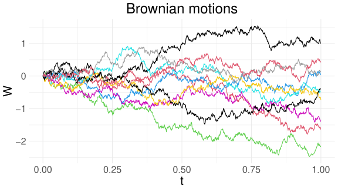{#fig-bms width="60%"}

앞에서 논의한 방식으로 확률론적 관점에서 얘기하자면, 위 그림에서 각 색깔별 경로 하나는 확률공간 $\Omega$의 원소 중 하나인 $\omega$에 대응된다.

다시 말해 브라운 운동의 정확한 표현은 $t$와 $\omega$에 대한 함수로서 $W(t,\omega)$로 나타낼 수 있다.

다만 이항 나무 모형과는 달리, 브라운 운동을 표현하기 위해서 설립되는 확률공간 $\Omega$에는 셀 수 없이 무한한 원소들이 존재한다.

따라서 유한한 확률공간에서 논의했던 것처럼 각 경제적 상태에 대한 애로-드브루 증권을 정의할 수가 없다.

대신 밀도 함수의 개념으로 자산 가격 결정 이론을 살펴볼 것이다.

편의상 브라운 운동을 표현할 때 특별한 이유가 없다면 $\omega$는 생략하여 $W(t)$ 혹은 더 간단히 $W_t$로 나타낸다.

::: {.callout-tip title="예제: 브라운 운동의 확률밀도함수"}
시점 $t=2$일 때 $W_t$, 즉 $W_2$의 확률밀도함수를 구해 보자.

브라운 운동의 성질에 따라 $W_2 \sim N(0,2)$이므로 확률밀도함수는

$$
f(x)=\frac{1}{\sqrt{4\pi}}\exp\left\{-\frac{x^2}{4}\right\}
$$

이다.

또한

$$
\mathbb{E}[W_2^2]=2
$$

이다.

임의의 $t$로 확장하면 $W_t$의 확률밀도함수는

$$
f(x)=\frac{1}{\sqrt{2\pi t}}\exp\left\{-\frac{x^2}{2t}\right\}
$$

이고,

$$
\mathbb{E}[W_t^2]=t
$$

이다.
:::

@fig-bm2s 에서는 시간 $t=0.5$까지는 동일하지만 그 이후 달라지는 가상의 경로들을 나타낸다.

이 그림에서 $W_{0.5}=1.08$이며, 그 이후의 경로들은 랜덤하게 시뮬레이션하였다.

위에서 살펴본

$$
W_{t+u}-W_t \sim N(0,u)
$$

의 성질에 따라 $W_1-W_{0.5}$는 확률변수로서 $N(0,0.5)$의 분포를 따른다.

만약 우리가 0.5 시점까지 확률과정을 관찰하였고 그 이후의 상황에 대해 시뮬레이션을 하고 싶다면, @fig-bm2s 에 제시된 경로들을 생성할 수 있다.

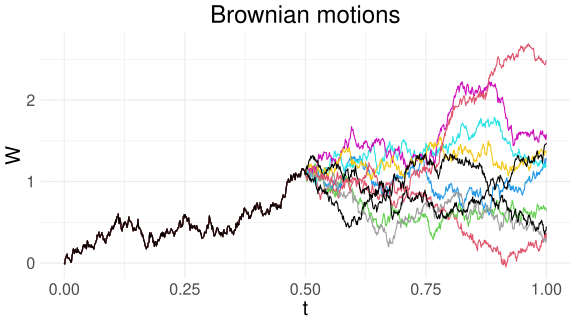{#fig-bm2s width="70%"}

이산 시간 모형에서 정의했던 마틴게일은 연속 시간 모형에서도 동일하게 적용된다.

::: {.callout-important title="명제: 브라운 운동의 마틴게일 성질"}
브라운 운동 $W$는 마틴게일이다.

즉, $0 \leq t < u$에 대해,

$$
\mathbb{E}_t[W_u]=W_t
$$

이다.

여기서 $\mathbb{E}_t$는 $t$ 시점까지의 정보만을 이용하여 기댓값을 취한 것이다.
:::


::: {.callout-tip title="예제: 브라운 운동의 조건부 기댓값"}
@fig-bm2s 에서 $W_{0.5}=1.08$이므로 $u>0.5$에 대해 $\mathbb{E}_{0.5}[W_u]=1.08$이다.

즉,

$$
\mathbb{E}_{0.5}[W_1]
=
\mathbb{E}_{0.5}[W_{1.5}]
=
\mathbb{E}_{0.5}[W_{10}]
=
1.08
$$

이다.

다시 말해, 브라운 운동은 상승할 확률과 하강할 확률이 0.5로 동일하기 때문에 미래의 기댓값이 현재의 브라운 운동의 값과 일치한다.
:::

#### Infinite variation

브라운 운동의 움직임은 매우 불규칙하다.

@fig-bm-enlarge 에서처럼 특정 부분을 확대하더라도 이러한 불규칙함은 그대로 유지된다. 확대된 부분을 다시 한 번 확대해도 여전히 불규칙한 브라운 운동을 관찰할 수 있으며, 설령 무한 번 확대하여 살펴본다 할지라도 브라운 운동의 불규칙성은 무한히 계속된다.

브라운 운동의 경로를 관찰해 보면, 선이 올라가는 듯하다가도 내려가고, 내려가는 듯하다가도 올라간다.

아주 짧은 시간이라도 온전히 올라가거나 온전히 내려가는 동일한 트렌드를 가진 구간을 찾을 수 없다.

관찰 간격을 아무리 짧게 해도 그 안에는 상승과 하락이 뒤섞인 불규칙한 움직임만 있을 뿐이다.

{#fig-bm-enlarge width="100%"}

브라운 운동의 이러한 성질을 무한 변동(infinite variation)이라고 한다.

수학적으로 표현하면, $0=t_0<t_1,\cdots,t_n=t$이며, $\delta t=t_i-t_{i-1}$인 $\{t_i\}$들이 있을 때,

$$
\sum_i \left|W_{t_i}-W_{t_{i-1}}\right|
\rightarrow \infty
\quad \text{as} \quad
\delta t \rightarrow 0
$$

이다.

여기서 $\delta t \rightarrow 0$는 각 구간의 길이를 점점 줄여 0으로 수렴하게 하여, 궁극적으로 서브 구간의 개수가 무한으로 증가하도록 하는 것을 의미한다.

반면, 우리가 종종 배우는 대부분의 함수들, 예를 들어 지수함수, 삼각함수, 로그함수, 다항함수 등은 유한한 구간 위에서 유한한 변동(finite variation)을 지닌다.

@fig-tv 에서 왼쪽의 브라운 운동에 대해, 고정된 $0=t_0<t_1,\cdots,t_n=1$의 구간에서 $\delta t$를 달리하면서 전변동(total variation)

$$
\sum_i \left|W_{t_i}-W_{t_{i-1}}\right|
$$

의 값을 계산하였다.

서브 구간의 길이인 $\delta t$의 값이 0에 가까울수록 전변동의 값이 무한대로 발산함을 볼 수 있다.

::: {#fig-tv layout-ncol=2}

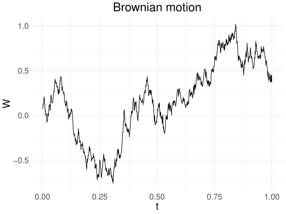


브라운 운동(왼쪽)과 고정된 $[0,1]$ 구간에서 $\delta t$를 달리하여 계산한 전변동(오른쪽)

:::

브라운 운동은 어디에서나 미분 불가능(nowhere differentiable)하다.

예를 들어, $f(t)=|t|$는 $t=0$에서 꺾인 선이기 때문에 $t=0$에서 미분 불가능하다.

브라운 운동은 모든 $t$에 대해 $|t|$의 뾰족한 부분처럼 불규칙하기 때문에 어디에서도 미분 불가능하다.

이 성질은 브라운 운동의 미래에 대한 추가적인 예측을 불가능하게 한다.

미분 가능한 함수 $f$의 $f(t)$와 $f'(t)$의 값이 알려져 있다면, $\Delta t$만큼의 시간이 흐른 후 $f(t+\Delta t)$의 값은

$$
f(t+\Delta t)\approx f(t)+f'(t)\Delta t
$$

로 근사 가능한 반면, $W_t$를 알고 있을 때 $W_{t+\Delta t}$의 가장 좋은 예측값은 $W_t$일 뿐이다.

브라운 운동의 예측 불가능성은 효율적 시장 가설과 더불어 자산 가격의 움직임에 대한 모형으로 인기를 끈 이유이다.

효율적 시장 가설에서는 주식의 가격에 모든 사용 가능한 정보가 이미 반영되어 있기 때문에 자산 가격의 방향성을 예측하기 불가능하다고 주장한다.

브라운 운동 또한 모든 시점 $t$에서 미분 불가능하기 때문에 아무리 짧은 시간이라고 하여도 미래의 방향성을 예측하기 불가능하다.

#### Quadratic variation

브라운 운동의 또 다른 흥미로운 성질은 이차 변동(quadratic variation)에 대한 것이다.

무한 변동 성질을 설명할 때 했던 것처럼 $0=t_0<t_1,\cdots,t_n=t$이며, $\delta t=t_i-t_{i-1}$인 $\{t_i\}$들이 있을 때, 브라운 운동 $W$는

$$
\sum_i \left(W_{t_i}-W_{t_{i-1}}\right)^2
\rightarrow t
\quad \text{as} \quad
\delta t \rightarrow 0
$$ {#eq-qv}

의 성질을 지닌다.

위 식의 좌변인 $\sum_i (W_{t_i}-W_{t_{i-1}})^2$를 이차 변동이라 한다.

원고의 식 `eq:real_vol`에서 변동성을 구하기 위해 수익률 프로세스 $r$에 대해

$$
\sum (r_{t_i}-r_{t_{i-1}})^2
$$

의 계산에 관심을 가졌던 것을 상기해 보라.

@eq-qv 의 성질 때문에 우리는 종종 유한한 구간들에 대해서도

$$
\sum_{i=1}^{n}
\left(W_{t_i}-W_{t_{i-1}}\right)^2
\approx t
$$

로 근사하여 사용하거나, 형식적 계산에서 유용한 규칙으로서

$$
(\mathrm{d}W_t)^2
=
\left(W_t-W_{t+\mathrm{d}t}\right)^2
=
\mathrm{d}t
$$ {#eq-dwt}

로 표현한다.

이 식은 정확한 수학적 식은 아니나, 편의를 위해 그대로 사용하여도 무방하다.


반면, 우리가 종종 다루는 다른 대부분의 함수들의 이차 변동은 모두 0이다.

예를 들어, $f(t)=t^2$과 같은 함수는

$$
\sum_i \left(f(t_i)-f(t_{i-1})\right)^2 \rightarrow 0
$$

이며, 이차 변동이 0이다.

@eq-dwt 와 비슷한 맥락으로

$$
(\mathrm{d}t)^2=0,
\qquad
(\mathrm{d}t)(\mathrm{d}W_t)=0
$$ {#eq-dt}

로 표현한다.

@fig-qv 의 왼쪽에는 브라운 운동이 나타나 있고, 오른쪽에는 $0=t_0<t_1<\cdots<t_n=t$이며, $\delta t=t_i-t_{i-1}$인 $\{t_i\}$들에 대해 $\delta t$를 달리하여 계산한

$$
\mathrm{QV}_t
=
\sum_i \left(W_{t_i}-W_{t_{i-1}}\right)^2
$$

의 값이 표현되어 있다.

위에서 언급한 대로, $\delta t\rightarrow 0$이면 이차 변동 과정은 $t$로 수렴함을 볼 수 있다.

::: {#fig-qv layout-ncol=2}

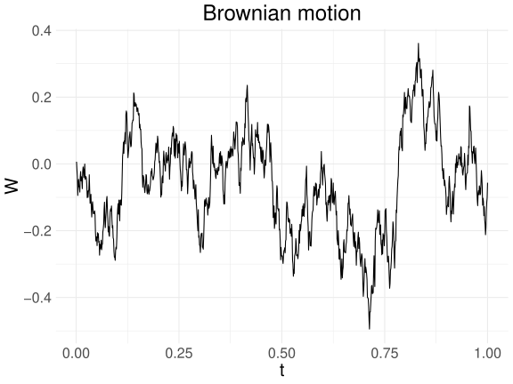


브라운 운동(왼쪽)과 이차 변동 과정(오른쪽)

:::

이를 바탕으로 이토 공식의 간단한 버전에 대해 알아본다.

::: {.callout-important title="정리: 이토 공식(Itô's formula)"}
두 번 미분 가능한 함수 $f(t,x)$에 대해

$$
\mathrm{d}f(t,W_t)
=
\left(
\frac{\partial f}{\partial t}(t,W_t)
+
\frac{1}{2}
\frac{\partial^2 f}{\partial x^2}(t,W_t)
\right)\mathrm{d}t
+
\frac{\partial f}{\partial x}(t,W_t)\mathrm{d}W_t
$$

이다.

여기서 $\mathrm{d}f(t,W_t)$는 시간 $t$에서 $t+\mathrm{d}t$만큼 극소 시간이 변할 때, $f(t,W_t)$의 변화량을 나타낸다.

즉, 대략적으로 표현하면,

$$
\mathrm{d}f(t,W_t)
=
f(t+\mathrm{d}t,W_{t+\mathrm{d}t})
-
f(t,W_t)
$$

이다.
:::

::: {.callout-note title="이토 공식의 증명"}
다음은 이토 공식을 형식적으로 유도한 것이며, 개념적 이해를 돕기 위한 것이다. 엄밀한 증명은 확률 해석 및 극한 수렴의 도구가 필요하다.

Taylor 전개에 의해,

$$
\begin{aligned}
\mathrm{d}f(t,x)
={}&
\frac{\partial f}{\partial t}\mathrm{d}t
+
\frac{\partial f}{\partial x}\mathrm{d}x\\
&+
\frac{1}{2}\frac{\partial^2 f}{\partial t^2}(\mathrm{d}t)^2
+
\frac{1}{2}\frac{\partial^2 f}{\partial x^2}(\mathrm{d}x)^2\\
&+
\frac{\partial^2 f}{\partial t\partial x}
(\mathrm{d}t)(\mathrm{d}x)
+\cdots
\end{aligned}
$$

로 표현할 수 있는데, 일반적인 변수 $t,x$들에 대해서는 $(\mathrm{d}t)^2$ 등을 매우 작은 값으로 취급하여 이차항 이상은 모두 0이 된다.

그러나 $x=W_t$일 경우, @eq-dwt 에 의해 $(\mathrm{d}x)^2=(\mathrm{d}W_t)^2=\mathrm{d}t$의 항이 남아,

$$
\mathrm{d}f(t,W_t)
=
\frac{\partial f}{\partial t}\mathrm{d}t
+
\frac{\partial f}{\partial x}\mathrm{d}W_t
+
\frac{1}{2}\frac{\partial^2 f}{\partial x^2}\mathrm{d}t
$$

이 된다.
:::

::: {.callout-tip title="예제: $f(t,x)=x^2$"}
함수 $f(t,x)=x^2$를 생각하자. 이때,

$$
\frac{\partial f}{\partial t}=0,
\quad
\frac{\partial f}{\partial x}=2x,
\quad
\frac{\partial^2 f}{\partial x^2}=2
$$

이다.

따라서 이토 공식에 의해,

$$
\begin{aligned}
\mathrm{d}(W_t^2)
&=\mathrm{d}f(t,W_t)\\
&=\left(0+\frac{1}{2}\times 2\right)\mathrm{d}t
+2W_t\mathrm{d}W_t\\
&=\mathrm{d}t+2W_t\mathrm{d}W_t
\end{aligned}
$$

가 된다.

즉, 브라운 운동의 제곱은 단순히 미분된 것이 아니라 추가적인 $\mathrm{d}t$ 항이 포함된다.
:::

::: {.callout-tip title="예제: $f(t,x)=tx$"}
함수 $f(t,x)=tx$를 생각하자. 이때,

$$
\frac{\partial f}{\partial t}=x,
\quad
\frac{\partial f}{\partial x}=t,
\quad
\frac{\partial^2 f}{\partial x^2}=0
$$

이다.

이토 공식을 적용하면,

$$
\begin{aligned}
\mathrm{d}(tW_t)
&=\left(W_t+\frac{1}{2}\times 0\right)\mathrm{d}t
+t\mathrm{d}W_t\\
&=W_t\mathrm{d}t+t\mathrm{d}W_t
\end{aligned}
$$

이다.

이는 시간과 브라운 운동의 곱의 확률 미분 방정식을 나타낸다.
:::

::: {.callout-tip title="예제: $f(t,x)=e^x$"}
함수 $f(t,x)=e^x$를 생각하자. 이때,

$$
\frac{\partial f}{\partial t}=0,
\quad
\frac{\partial f}{\partial x}=e^x,
\quad
\frac{\partial^2 f}{\partial x^2}=e^x
$$

이다.

이토 공식에 의해,

$$
\begin{aligned}
\mathrm{d}e^{W_t}
&=
\left(0+\frac{1}{2}e^{W_t}\right)\mathrm{d}t
+e^{W_t}\mathrm{d}W_t\\
&=
\frac{1}{2}e^{W_t}\mathrm{d}t
+e^{W_t}\mathrm{d}W_t
\end{aligned}
$$

이다.

즉, $e^{W_t}$의 확률 미분은 드리프트 항 $\frac{1}{2}e^{W_t}\mathrm{d}t$와 확산 항 $e^{W_t}\mathrm{d}W_t$로 이루어져 있음을 알 수 있다.
:::


### 기하 브라운 운동

브라운 운동은 주식 가격의 움직임을 표현하는 데에 있어 매우 흥미로운 공통점들을 가지고 있지만, 언제든지 0 미만의 값에 도달할 수 있으며, 이는 항상 0 이상인 주식 가격의 움직임과는 다르다.

따라서 브라운 운동 대신 지수 함수로 변환한 기하 브라운 운동(geometric Brownian motion)을 자산 가격 움직임에 주로 활용한다.

기하 브라운 운동은

$$
S_t=S_0\exp\left\{
\left(\mu-\frac{1}{2}\sigma^2\right)t+\sigma W_t
\right\}
$$ {#eq-gbm-s}

로 나타내며, 다음 성질을 지닌다.

$$
\mathbb{E}[S_t]=S_0e^{\mu t}
$$ {#eq-e-gbm}

@eq-gbm-s 에서 $S_t$는 로그정규분포를 따르며,

$$
\log\frac{S_t}{S_0}
=
\left(\mu-\frac{1}{2}\sigma^2\right)t+\sigma W_t
$$ {#eq-log-s}

이므로,

$$
\log\frac{S_t}{S_0}
\sim
N\left(
\left(\mu-\frac{1}{2}\sigma^2\right)t,\;
\sigma^2t
\right)
$$

이다.

즉, 자산의 가격이 기하 브라운 운동을 따르면 로그 수익률이 정규분포를 따른다.

모수 $\mu$는 드리프트(drift) 항이라고도 불리며, $\mu$가 클수록 해당 자산의 기대수익률이 높다.

단, 로그 수익률의 기댓값은 $\mu$만이 아니라 $-0.5\sigma^2$으로 조정된 항(Ito correction이라고도 불린다)을 포함하고 있음을 살펴보라.

로그 수익률의 분산은 $\sigma^2t$로 결정된다.

@fig-gbm 에는 브라운 운동(왼쪽)과 대응되는 기하 브라운 운동(오른쪽)을 나타내었다.

편의상 $\mu=0$과 $\sigma=1$로 하였다.

예를 들어, 파란색 브라운 운동의 경우 음의 값들을 가짐에도 불구하고, 지수 변환에 따라 오른쪽의 파란색 기하 브라운 운동은 항상 양의 값을 지닌다.

::: {#fig-gbm layout-ncol=2}

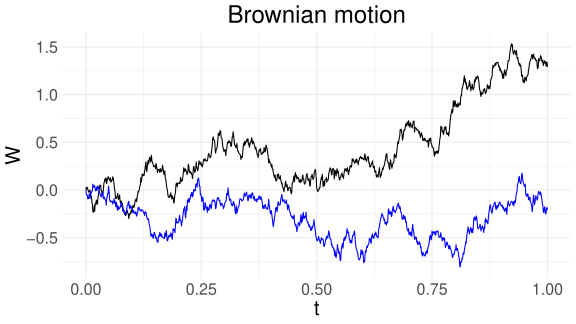

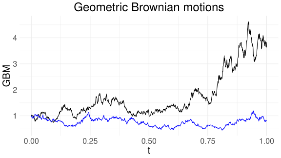

브라운 운동(왼쪽)과 대응되는 기하 브라운 운동(오른쪽)

:::

기하 브라운 운동의 순간적인 변화량은 이토 공식을 통해 계산할 수 있다.

$$
f(t,x)=S_0\exp\left\{
\left(\mu-\frac{1}{2}\sigma^2\right)t+\sigma x
\right\}
$$

라고 하면,

$$
\begin{aligned}
\frac{\partial f}{\partial t}
&=\left(\mu-\frac{1}{2}\sigma^2\right)f(t,x)\\
\frac{\partial f}{\partial x}
&=\sigma f(t,x)\\
\frac{\partial^2 f}{\partial x^2}
&=\sigma^2 f(t,x)
\end{aligned}
$$

이다.

따라서 $S_t=f(t,W_t)$이므로, 앞에서 살펴본 이토 공식에 의해,

$$
\mathrm{d}S_t
=
\mu S_t\mathrm{d}t
+
\sigma S_t\mathrm{d}W_t
$$ {#eq-gbm}

이다.

위 식에서 $\mu S_t\mathrm{d}t$는 $t$ 시점에서 고정된 값이지만, $\sigma S_t\mathrm{d}W_t$에는 랜덤한 $\mathrm{d}W_t$의 값이 있음을 주목하라.

브라운 운동의 성질에 따라, 다소 비수학적인 표현이지만,

$$
\mathrm{d}W_t
=
W_{t+\mathrm{d}t}-W_t
\sim N(0,\mathrm{d}t)
$$

로 표현할 수 있으며, 다시 쓰면

$$
S_{t+\mathrm{d}t}-S_t
\sim
N\left(
\mu S_t\mathrm{d}t,\;
\sigma^2S_t^2\mathrm{d}t
\right)
$$

이다.

극소 시간(instantaneous time) 동안 자산 가격의 변화량 $S_{t+\mathrm{d}t}-S_t$은 평균 $\mu S_t\mathrm{d}t$, 분산 $\sigma^2S_t^2\mathrm{d}t$의 정규분포로 근사할 수 있다.

@eq-gbm-s 와 @eq-gbm 은 동치이므로, 어떤 것을 사용해도 같은 의미를 지닌다.

::: {.callout-tip title="예제: 10분 동안의 주식 가격 변화량"}
어떤 주식이 연간 $\mu=0.2$, $\sigma=0.1$인 기하 브라운 운동을 따른다고 하자.

현재 주식의 가격을 100이라고 할 때, 향후 10분간 주식 가격의 변화량의 분포를 근사해 보자.

1년을 250영업일, 하루의 주식 거래 시간을 대략 6.5시간이라고 하면,

$$
\mathrm{d}t
=
\frac{10}{250\times6.5\times60}
\approx0.0001
$$

이다.

따라서 향후 10분간 주식 가격의 변화량은 대략 평균

$$
\mu S_t\mathrm{d}t
\approx
0.2\times100\times0.0001
=
0.002
$$

표준편차

$$
\sigma S_t\sqrt{\mathrm{d}t}
\approx
0.1\times100\times\sqrt{0.0001}
=
0.1
$$

의 정규분포를 근사적으로 따른다.
:::

::: {.callout-tip title="예제: 로그 주식 가격의 확률 미분"}
$S_t$가 기하 브라운 운동을 따를 때, 이토 공식을 이용하여 $\mathrm{d}\log S_t$를 구하여 보자.

$$
\log S_t
=
\log S_0
+
\left(\mu-\frac{1}{2}\sigma^2\right)t
+
\sigma W_t
$$

이며,

$$
f(t,x)
=
\log S_0
+
\left(\mu-\frac{1}{2}\sigma^2\right)t
+
\sigma x
$$

로 하여 이토 공식을 적용하면,

$$
\frac{\partial f}{\partial t}
=
\mu-\frac{1}{2}\sigma^2,
\quad
\frac{\partial f}{\partial x}
=
\sigma,
\quad
\frac{\partial^2 f}{\partial x^2}
=
0
$$

이므로,

$$
\mathrm{d}\log S_t
=
\left(\mu-\frac{1}{2}\sigma^2\right)\mathrm{d}t
+
\sigma\mathrm{d}W_t
$$ {#eq-dlogs}

이다.
:::


## 블랙-숄즈 공식

블랙-숄즈(Black-Scholes) 공식은 옵션 가격 결정 공식으로서 이전 단원에서 공부한 이항 나무 방법의 연속 시간으로의 확장이라고 볼 수 있다.

블랙-숄즈 모형은 파생상품 가격 산출의 핵심이 되는 중요한 기반을 제공하여 금융공학 분야의 발전을 이끌었다.

이 모델은 옵션 가격 평가뿐만 아니라 다양한 파생상품의 가치 평가와 관련된 다양한 모델의 기반이 되었다.

이러한 공로로 숄즈와 머튼은 노벨 경제학상을 수상하였다.

### 연속 시간 모형에서의 no-arbitrage principle

이항 나무 금융 모형에서 **위험 중립형 확률 측도의 존재는 차익 거래의 기회가 없다는 것과 동치**임을 살펴보았다.

복습하자면, 위험 중립형 확률 측도란 금융 모형 내의 모든 자산의 기대 수익률이 무위험 이자율과 동일하도록 만들어주는 확률 측도이다.

위험 중립형 확률 측도는 실제 확률 측도는 아니지만, 옵션 등 파생상품의 가격을 결정하는 데 매우 유용하다.

연속 시간 모형에서도 이산 시간 모형에서와 비슷하게 위험 중립형 확률 측도의 존재와 차익 거래의 기회가 없다는 것은 거의 동치이다.

다만 이 둘의 관계를 수학적으로 규명하기는 쉽지만은 않다. 자세한 내용은 @delbaen1994general 을 참고하라.

금융 모형 내에 차익 거래의 기회가 있으면 그다지 적절한 모형이 아니므로, 금융 모형 내에 차익 거래의 기회가 없다고 가정하겠다.

물론 이를 위해서는 자산 가격 프로세스에 대한 엄밀한 수학적 가정이 필요할 것이나, 이 자료에서는 그 부분까지 자세히 다루지는 않기로 한다.

만약 차익 거래의 기회가 없다면, 앞에서 언급한 것처럼 이는 위험 중립형 확률 측도가 존재한다는 것과 동치인 것으로 간주하겠다.

원고의 식 `eq:Q_exp`에서 살펴본 것처럼, 금융 모형 내에 위험 중립형 확률 측도 $\mathbb{Q}$가 존재한다고 가정하는 것은 이 금융 모형에 가정하는 모든 자산(정확히는 배당을 제공하지 않는 자산) $V$의 현재 가격이

$$
V_0=e^{-rT}\mathbb{E}^{\mathbb{Q}}[V_T]
$$

를 만족하는 확률 측도 $\mathbb{Q}$를 정의할 수 있다는 뜻이다.

특별한 언급이 없는 한, 간단히 하기 위해 고정된 이자율 상수 $r$을 사용하기로 하자.

위험 중립형 확률 측도가 존재한다면 유러피언 콜 옵션이나 풋 옵션의 경우에도 마찬가지로 페이오프에 대한 위험 중립형 기댓값으로 현재 가격을 책정할 수 있다.

다시 말해,

$$
C_0=e^{-rT}\mathbb{E}^{\mathbb{Q}}[(S_T-K)^+],
\qquad
P_0=e^{-rT}\mathbb{E}^{\mathbb{Q}}[(K-S_T)^+]
$$

로 나타나며, $S_T$의 위험 중립형 확률 측도에서의 확률밀도함수(실제 확률밀도함수와는 다르다) $\tilde f$를 통하여,

$$
\begin{aligned}
C_0&=e^{-rT}\int_K^\infty(x-K)\tilde f(x)\,\mathrm{d}x,\\
P_0&=e^{-rT}\int_{-\infty}^K(K-x)\tilde f(x)\,\mathrm{d}x
\end{aligned}
$$ {#eq-option-density}

라고 표현할 수도 있다.

@eq-option-density 는 평범한 적분식이므로, 만약 $\tilde f(x)$를 구할 수 있다면 옵션의 가격도 그에 따라 계산할 수 있다.

시작점 0뿐만 아니라 임의의 $t$ 시점에서는 금융 자산의 가격 프로세스 $V$는 다음을 만족한다.

$$
V_t=e^{-r(T-t)}\mathbb{E}_t^{\mathbb{Q}}[V_T]
$$

혹은 가치를 측정하고 비교하기 위해 사용되는 기준 단위인 numeraire 관점에서, 단기금융시장계좌(MMA) $M_t$를 기준 단위로 하였을 때,

$$
\frac{V_t}{M_t}
=
\mathbb{E}_t^{\mathbb{Q}}
\left[\frac{V_T}{M_T}\right]
$$

이다.

즉, 금융 시장 내의 배당이 없는 자산들의 가격 프로세스는 MMA를 통화 기준(numeraire)으로 하였을 때 마틴게일이 된다.

유러피언 콜 옵션이나 풋 옵션의 경우,

$$
\begin{aligned}
C_t&=e^{-r(T-t)}\mathbb{E}_t^{\mathbb{Q}}[(S_T-K)^+],\\
P_t&=e^{-r(T-t)}\mathbb{E}_t^{\mathbb{Q}}[(K-S_T)^+]
\end{aligned}
$$

또는 numeraire 관점에서 표현하면,

$$
\begin{aligned}
\frac{C_t}{M_t}
&=
\mathbb{E}_t^{\mathbb{Q}}
\left[\frac{(S_T-K)^+}{M_T}\right],\\
\frac{P_t}{M_t}
&=
\mathbb{E}_t^{\mathbb{Q}}
\left[\frac{(K-S_T)^+}{M_T}\right]
\end{aligned}
$$

이다.

여기서 $M_t=e^{rt}$로 단기금융시장계좌(MMA)를 나타내며, 두 표현은 사실상 같은 것임을 확인하라.

위 식들은 아직은 추상적인 공식이며, 구체적으로 값을 계산하기 위해서는 $S$에 대한 추가적인 가정이 필요하다.

연속 시간 모형에서 가장 보편적인 모형은 블랙-숄즈 모형이다.

### 공식의 유도

블랙-숄즈 프레임워크에 대해 보다 자세히 살펴보자.

::: {.callout-important title="가정: Black-Scholes"}
금융 모형 내에 위험자산 $S$와 무위험자산이 존재하며, 위험자산 $S$는 다음의 움직임을 따른다.

$$
S_t
=
S_0\exp\left\{
\left(\mu-\frac{1}{2}\sigma^2\right)t+\sigma W_t
\right\}
$$

여기서 드리프트(drift) 항인 $\mu$와 변동성 $\sigma$, 그리고 이자율 $r$은 상수이다.
:::

::: {.callout-important title="정리: 위험 중립형 확률 측도에서의 자산 가격"}
위 블랙-숄즈 가정을 따르는 금융 모형에서 차익 거래의 기회가 없다면, 위험 중립형 확률 측도 $\mathbb{Q}$가 존재하며, 자산 $S$의 움직임은 다음으로 표현된다.

$$
S_t
=
S_0\exp\left\{
\left(r-\frac{1}{2}\sigma^2\right)t
+
\sigma\widetilde W_t
\right\}
$$ {#eq-rgbm}

여기서 $\widetilde W$는 측도 $\mathbb{Q}$ 아래에서 브라운 운동이다.

다시 말해, $\mathbb{Q}$ 측도 아래에서 $\widetilde W_{t+u}-\widetilde W_t$는 평균이 0이고 분산이 $u$인 정규분포를 따른다.
:::

위험 중립형 확률 측도 아래에서는 원고의 식 `eq:Q_exp2`의 조건을 만족해야 한다.

즉,

$$
\mathbb{E}^{\mathbb{Q}}[S_t]
=
S_0e^{rt}
$$ {#eq-s-q}

가 성립해야 한다.

자산 가격의 움직임이 $\mathbb{Q}$ 측도 아래에서 @eq-rgbm 으로 표현된다면, @eq-gbm-s 와 @eq-e-gbm 에서 살펴본 바와 같이 @eq-s-q 를 만족할 것이다.

@eq-gbm-s 와 @eq-rgbm 을 비교하면 $\mu$를 $r$로, $W$를 $\widetilde W$로 바꾼 것이다.

@eq-gbm 은 실제 확률 측도 $\mathbb{P}$ 하에서의 자산 가격 움직임을, @eq-rgbm 은 위험 중립 확률 측도 $\mathbb{Q}$ 하에서의 움직임을 나타낸다.

두 식 모두 동일한 자산 가격 $S_t$를 서로 다른 확률 측도 아래에서 표현한 것이므로, 형식적으로 두 표현을 비교하면

$$
\widetilde W_t
=
\frac{\mu-r}{\sigma}t+W_t
$$

라는 관계를 얻을 수 있다.

즉, $W_t$는 $\mathbb{P}$에서 브라운 운동이지만, $\mathbb{Q}$에서는 브라운 운동이 아니다.

반대로, $\widetilde W_t$는 $\mathbb{Q}$에서 브라운 운동이지만, $\mathbb{P}$에서는 브라운 운동이 아니다.

위 식에서 $\dfrac{\mu-r}{\sigma}$는 리스크의 시장 가격(market price of risk)이라고 부르며, 단위 변동성당 초과 기대 수익률을 나타낸다.

기초 자산의 가격이 기하 브라운 운동을 따른다는 가정과 위험 중립형 가격 결정 이론을 바탕으로 유도된 옵션의 가격 공식을 블랙-숄즈 옵션 가격이라고 한다.

이 공식은 @black1973pricing 과 @merton1973theory 에 의해 독립적으로 유도되었기 때문에 블랙-숄즈-머튼 공식이라고도 한다.

::: {.callout-important title="정리: 블랙-숄즈(Black-Scholes) 공식"}
금융 모형이 앞에서 제시한 블랙-숄즈 가정을 따른다고 하자.

시점 $t$에서의 콜과 풋 옵션 가격에 대한 블랙-숄즈 공식은 각각 다음과 같다.

$$
\begin{aligned}
C_t
&=
S_tN(d_1)-Ke^{-r(T-t)}N(d_2)\\
P_t
&=
-S_tN(-d_1)+Ke^{-r(T-t)}N(-d_2)
\end{aligned}
$$

여기서,

- $S_t$: 기초 자산의 $t$ 시점에서의 가격
- $K$: 행사 가격
- $T$: 만기일(expiry date)
- $r$: 상수 이자율
- $\sigma$: 상수 변동성

이고,

$$
d_1
=
\frac{
\log\frac{S_t}{K}
+
\left(r+\frac{1}{2}\sigma^2\right)(T-t)
}{
\sigma\sqrt{T-t}
}
$$

$$
d_2
=
\frac{
\log\frac{S_t}{K}
+
\left(r-\frac{1}{2}\sigma^2\right)(T-t)
}{
\sigma\sqrt{T-t}
}
$$

이다.

또한,

$$
d_1=d_2+\sigma\sqrt{T-t}
$$

의 관계를 지닌다.
:::

::: {.callout-note title="증명: 블랙-숄즈 콜 옵션 가격 공식"}
편의상 $t=0$인 시점에 대해 콜 옵션의 가격을 유도하겠다.

$$
\begin{aligned}
C_0
&=
e^{-rT}\mathbb{E}^{\mathbb{Q}}[(S_T-K)^+]\\
&=
e^{-rT}\mathbb{E}^{\mathbb{Q}}[S_T\mathbf{1}_A]
-
Ke^{-rT}\mathbb{E}^{\mathbb{Q}}[\mathbf{1}_A]
\end{aligned}
$$

이며, 여기서 $A=\{S_T>K\}$이다.

계산이 용이한 뒤 항부터 먼저 살펴보자.

$$
\begin{aligned}
\mathbb{E}^{\mathbb{Q}}[\mathbf{1}_A]
&=
\mathbb{Q}(S_T>K)\\
&=
\mathbb{Q}\left(
S_0\exp\left\{
\left(r-\frac{1}{2}\sigma^2\right)T
+\sigma\widetilde W_T
\right\}>K
\right)\\
&=
\mathbb{Q}\left(
\frac{
\log\frac{K}{S_0}
-
\left(r-\frac{1}{2}\sigma^2\right)T
}{
\sigma\sqrt{T}
}
<
\frac{\widetilde W_T}{\sqrt{T}}
=:\widetilde Z
\right)\\
&=
\mathbb{Q}(-d_2<\widetilde Z)\\
&=
\mathbb{Q}(\widetilde Z<d_2)\\
&=
N(d_2)
\end{aligned}
$$

이다.

여기서 $\widetilde Z$는 $\mathbb{Q}$ 측도 하에서 표준정규분포를 따르는 더미 확률변수이다.

앞의 항을 보면,

$$
\begin{aligned}
&e^{-rT}\mathbb{E}^{\mathbb{Q}}[S_T\mathbf{1}_A]\\
&=
S_0\mathbb{E}^{\mathbb{Q}}\left[
e^{-rT}
\exp\left\{
\left(r-\frac{1}{2}\sigma^2\right)T
+\sigma\widetilde W_T
\right\}
\mathbf{1}_{\{
\widetilde W_T/\sqrt{T}>-d_2
\}}
\right]\\
&=
S_0\mathbb{E}^{\mathbb{Q}}\left[
\exp\left\{
-\frac{1}{2}\sigma^2T
+\sigma\sqrt{T}\widetilde Z
\right\}
\mathbf{1}_{\{\widetilde Z>-d_2\}}
\right]\\
&=
S_0\int_{-d_2}^{\infty}
\frac{1}{\sqrt{2\pi}}
\exp\left(
-\frac{1}{2}\sigma^2T
+\sigma\sqrt{T}z
-\frac{z^2}{2}
\right)\mathrm{d}z\\
&=
S_0\int_{-d_2}^{\infty}
\frac{1}{\sqrt{2\pi}}
\exp\left(
-\frac{(z-\sigma\sqrt{T})^2}{2}
\right)\mathrm{d}z\\
&=
S_0\mathbb{Q}(\widetilde Z+\sigma\sqrt{T}>-d_2)\\
&=
S_0\mathbb{Q}(\widetilde Z>-d_2-\sigma\sqrt{T})\\
&=
S_0\mathbb{Q}(\widetilde Z<d_1)\\
&=
S_0N(d_1)
\end{aligned}
$$

위와 비슷하게 $\widetilde Z$는 $\mathbb{Q}$ 측도 하에서 표준정규분포를 따르는 더미 확률변수로, 이해를 돕기 위해 사용되었다.
:::

::: {.callout-note title="참고: 옵션 가격과 드리프트"}
이항 나무 모형에서 실제 확률 $p$가 옵션의 가격에 영향을 미치지 않았던 것처럼, 블랙-숄즈 옵션 공식에서도 자산 가격의 실제 드리프트(drift)인 $\mu$가 옵션의 가격에 영향을 미치지 않음을 주목하라.

이러한 점은 처음 옵션 이론을 공부할 때 직관에 반대되게 느껴질 수 있다.

예를 들어, 드리프트가 큰, 즉 기대 수익이 큰 자산은 미래에 가격이 상승할 확률이 높아 이러한 주식의 콜 옵션을 구매하면 높은 이득을 얻을 수 있을 것으로 보여, 이 주식의 콜 옵션은 이에 따라 높은 가격일 것으로 느껴진다.

반대로 드리프트가 작은 자산은 미래에 가격이 상승할 확률이 낮아 구매 매력도가 떨어져, 콜 옵션의 가격도 낮을 것으로 느껴진다.

하지만 블랙-숄즈 공식에 따르면 드리프트는 콜 옵션의 가격에 영향을 미치지 않는다.

옵션 가격에 영향을 미치는 주식 프로세스의 성질은 변동성뿐이다.

이는 콜 옵션의 매도자 또한 기초 자산을 매입함으로써 위험을 헷지할 수 있기 때문이다.

예를 들어, 기대 수익이 큰 주식의 콜 옵션의 매도자는 높은 드리프트 때문에 손해를 볼 확률이 높아 보이지만, 지급받은 옵션 프리미엄을 기초 자산에 투자하였다면 기초 자산의 높은 수익률에 따른 이득으로 상쇄할 수 있다.
:::


::: {.callout-tip title="예제: 블랙-숄즈 옵션 가격 계산"}
만기가 $T=1$, 행사 가격 $K=95$인 유러피안 콜 옵션에 대해,

$$
S_0=100,\qquad r=0.05,\qquad \sigma=0.10
$$

으로 주어졌을 때, 이 옵션의 0 시점에서의 블랙-숄즈 옵션 가격을 구해 보자.

공식에 따라

$$
\begin{aligned}
d_1
&=
\frac{\log\frac{S_t}{K}+
\left(r+\frac{1}{2}\sigma^2\right)(T-t)}
{\sigma\sqrt{T-t}}
\approx 1.06,\\[6pt]
d_2
&=
\frac{\log\frac{S_t}{K}+
\left(r-\frac{1}{2}\sigma^2\right)(T-t)}
{\sigma\sqrt{T-t}}
\approx 0.96
\end{aligned}
$$

이며,

$$
C_0=S_0N(d_1)-Ke^{-rT}N(d_2)\approx 10.41
$$

이다.

이전 장의 이항 나무 모형을 바탕으로 콜 옵션의 값들을 계산한 예제(`ex:binom_covergence`)와 비교하라.

즉, 블랙-숄즈 옵션 가격은

$$
S_{t+\delta t}
=
\begin{cases}
S_te^{\sigma\sqrt{\delta t}},\\
S_te^{-\sigma\sqrt{\delta t}}
\end{cases}
$$

로 주어지는 $n$기간 이항 나무 모형에서 $n\rightarrow\infty$의 극한을 취한 옵션의 가격과 같다.

계산을 위해 아래의 R 코드를 이용할 수 있다.

```{.r}
r <- 0.05
S <- 100
K <- 95
sigma <- 0.1
TTM <- 1

d1 <- (log(S/K) + (r + 0.5*sigma^2)*TTM) /
      (sigma * sqrt(TTM))
d2 <- (log(S/K) + (r - 0.5*sigma^2)*TTM) /
      (sigma * sqrt(TTM))

bls_C <- S * pnorm(d1) - K * exp(-r*TTM) * pnorm(d2)
bls_P <- -S * pnorm(-d1) + K * exp(-r*TTM) * pnorm(-d2)
```
:::

@fig-s-c 는 기하 브라운 운동을 따르는 가상의 주식 가격의 변화와 그에 따른 블랙-숄즈 콜 옵션의 가격 변화를 나타낸 그래프이다.

만기는 $T=1$로 가정하였고, $S_0=100$, $K=100$이다.

기초 자산의 가격 변화에 따라 옵션 가격이 어떻게 변하는지 관찰해 보라.


::: {#fig-s-c}

::: {layout-ncol=2}

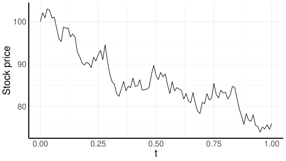


:::

*만기에 외가격으로 종료되는 예*

::: {layout-ncol=2}

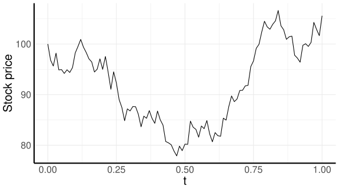

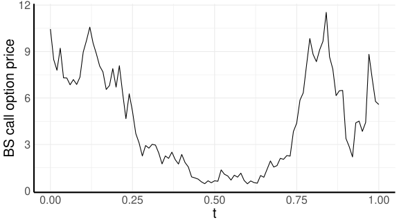

:::

*만기에 내가격으로 종료되는 예*

기하 브라운 운동을 따르는 가상의 기초 자산 가격(왼쪽)과 그에 대응되는 블랙-숄즈 콜 옵션 가격(오른쪽)의 시간에 따른 변화

:::


주의할 점은 블랙-숄즈 가격 공식은 계산이 편리하고 이해하기 쉽지만, 이 가격이 실제 거래되는 유러피안 옵션의 가격과 완전히 일치하는 것은 아니다.

실제 금융 시장에서 옵션 등 금융 상품의 가격은 철저히 수요-공급 법칙에 의해 결정되며, 블랙-숄즈 옵션 가격의 공식은 실제 가격을 근사하여 살펴보는 것에 의의가 있다.

블랙-숄즈 옵션 가격과 실제 옵션 가격이 일치하지 않는 것에는 몇 가지 이유들이 있을 수 있다.

- 기초 자산 가격의 움직임이 기하 브라운 운동의 확률적 성질과 일치하지 않는다. 앞의 `Sect:empirical`장에서 살펴보았듯이, 주식 수익률의 분포는 정규분포보다 두꺼운 꼬리와 음의 왜도 현상을 지닌다.

- 위에서 살펴본 내용의 연장선으로, 자산 수익률의 변동성은 시간에 따라 변한다. 따라서 상수 변동성 $\sigma$를 가정한 블랙-숄즈의 공식은 완벽히 들어맞지 않는다.

- 또한 기하 브라운 운동의 변화량은 과거의 값들과 독립이지만, `Sect:empirical`장에서 살펴본 바와 같이 자산 가격 수익률들은 종속적이다.

- 완벽한 헷지는 불가능하다. 앞에서 따로 설명하지는 않았지만, 블랙-숄즈 모형에서도 이항 나무 모형에서와 같이 옵션 포지션에 델타 헷징을 수행하여 위험을 제거할 수 있다. 하지만 블랙-숄즈 모형에서는 헷징이 연속적(continuous)으로 이루어져야 하며, 실제적으로는 불가능하다.

- 실제 세상에서는 거래 비용, 세금 등의 추가적인 비용이 발생할 수 있으며, 공매도 제한 등의 제도적 한계 또한 존재한다.

- 변동성처럼 이자율도 시간에 따라 변동하며, 이 또한 옵션의 가격에 영향을 미칠 수 있다.

모형의 가정에 따라 옵션 가격의 공식도 달라진다.

예를 들어, 옵션 이론의 선구자인 @bachelier1900theorie 는 기하 브라운 운동 대신 다음의 산술 브라운 운동을 기초 자산의 가격 프로세스로 가정했으며,

$$
S_t=S_0+\mu t+\sigma W_t
$$

이 경우 콜 옵션의 가격 공식은

$$
C_t
=
\sigma\sqrt{T-t}f(d)
+
(S_t-K)N(d),
\qquad
d=\frac{S_t-K}{\sigma\sqrt{T-t}}
$$

이며, 여기서 $f$는 정규분포의 확률밀도함수이다.

자세한 사항은 @Musiela 를 참고하라.


### 함수로서의 옵션 가격

블랙-숄즈 옵션 가격은 기초 자산의 가격, 행사 가격, (만기까지의 남은) 시간, 이자율, 변동성에 의해 결정된다.

따라서 콜 옵션의 가격을 위 변수들의 함수로 생각하면 다음과 같이 표현할 수 있다.

$$
C(t,S,r,\sigma,K,T)
$$ {#eq-c}

혹은 만기까지의 시간을 이용하여,

$$
C(T-t,S,r,\sigma,K)
$$ {#eq-c2}

로도 나타낼 수 있다.

이 중 다른 것들은 관찰 가능하지만 변동성 $\sigma$는 숨겨진 변수임을 주목하라.

@fig-surface 는 $r=0.05$, $\sigma=0.2$, $K=100$으로 고정하고, 자산 가격 $S$와 만기까지의 시간 $T-t$에 대한 함수로 유러피안 콜 옵션의 가격을 표현한 그림이다.

만기까지의 시간(time to maturity)이 0일 때는 콜 옵션의 payoff가 꺾인 선인 $(S-K)^+$의 형태로 나타남을 볼 수 있다.

그 외의 시간에서는 콜 옵션의 가격은 미분 가능한 부드러운 곡선의 형태로 나타난다.

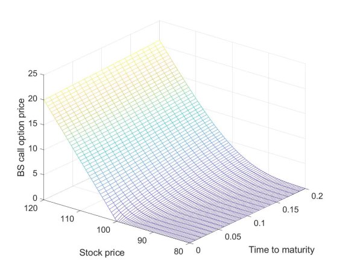{#fig-surface width=70%}

#### 옵션 가격과 기초 자산 가격의 관계 {.unnumbered}

콜 옵션 가격과 기초 자산 가격만을 살펴보는 것은 @fig-surface 에서 시간을 고정시킨 상태로 표면을 수직 방향으로 잘라 곡선을 관찰하는 것과 같다.

현재 시점의 기초 자산 가격 $S_t$가 증가할수록 콜 옵션의 가격 또한 상승한다.

높은 자산 가격은 만기 시점에 이르러 높은 payoff를 가져올 가능성이 높기 때문이다.

반대로 현재 시점의 기초 자산 가격 $S_t$가 증가할수록 풋 옵션의 가격은 하락한다.

@fig-bs-call-put 은 $r=0.05$, $\sigma=0.2$, $K=100$, $T-t=0.2$로 고정하고, 기초 자산 가격에 따른 유러피언 콜 옵션(왼쪽)과 풋 옵션의 가격(오른쪽)을 나타낸 것이다.

이자율이나 변동성 등 다른 변수를 변경한다고 하여도 그래프가 조금은 달라지겠지만, 전체적인 형태는 비슷하다.

::: {#fig-bs-call-put layout="[50,50]"}



기초 자산 가격에 따른 블랙-숄즈 콜 옵션 가격과 풋 옵션 가격

:::

#### 옵션 가격과 변동성과의 관계 {.unnumbered}

변동성 $\sigma$가 높을수록 콜 옵션과 풋 옵션의 가격은 상승한다.

옵션이 현재 외가격(out-of-the-money)에 있더라도 변동성이 높을수록 만기 시점에 내가격(in-the-money)에 도달할 확률이 높아진다.

또한 옵션이 현재 등가격이나 내가격에 있더라도 변동성이 높을수록 만기 시점에 더 높은 payoff를 제공할 가능성이 높아진다.

@fig-bs-call-put-sigma 는 $r=0.05$, $S_0=100$, $K=100$, $T-t=0.2$로 고정하고, 변동성에 따른 유러피언 콜 옵션(왼쪽)과 풋 옵션(오른쪽)의 가격을 나타낸 것이다.

이 그림은 등가격 옵션에 대해서만 나타내었지만, 외가격이나 내가격 옵션 가격의 변동성에 따른 변화의 양상도 크게 다르지 않다.

이런 점 때문에 옵션에 투자하는 것은 변동성에 투자하는 것과 비슷하다.

옵션을 매수하였을 경우 미래에 변동성이 커진다면 이득을 볼 가능성이 높다.

반대로 미래 변동성이 작아진다면 손해를 볼 가능성이 높아질 것이다.

::: {#fig-bs-call-put-sigma layout="[50,50]"}



변동성에 따른 블랙-숄즈 콜 옵션 가격과 풋 옵션 가격

:::

#### 옵션 가격과 시간과의 관계 {.unnumbered}

시간이 지나 만기가 다가올수록 옵션의 가치는 떨어진다.

예를 들어, 옵션이 현재 외가격(out-of-the-money)에 있을 경우 잔존 만기가 짧아질수록 만기 시점에 내가격에 도달할 확률이 낮아진다.

반대로 만기까지의 시간이 충분히 길 경우, 설령 현재 옵션이 외가격에 있더라도 만기 시점에는 내가격에 도달할 가능성이 꽤 있을 것이라고 생각할 수 있다.

@fig-bs-call-ttm 은 시간의 변화에 따른 유러피언 콜 옵션의 변화를 나타낸 것이다.

그림의 $x$축이 만기까지의 시간(TTM)이기 때문에 실제 시간의 흐름을 고려한다면 오른쪽에서 왼쪽으로 진행하며 살펴봐야 할 것이다.

다른 변수들은 $r=0.05$, $K=100$, $\sigma=0.2$로 고정하였다.

그림의 왼쪽은 외가격 $S=90$으로 고정하여 만기까지의 시간에 따른 콜 옵션 가격을 함수로 표현한 것이고, 그림의 오른쪽은 내가격 $S=110$으로 고정하여 만기까지의 시간에 따른 콜 옵션 가격을 함수로 표현하였다.

외가격일 때는 만기까지의 시간이 0이 되는 순간 옵션의 가격도 0이 되고, 내가격일 경우에는 옵션의 가격이 $110-100=10$으로 수렴한다.

::: {#fig-bs-call-ttm layout="[50,50]"}



만기까지의 시간에 따른 블랙-숄즈 콜 옵션 가격

:::

이 그림에서는 $S$를 고정하였기 때문에 옵션 가격의 실제 랜덤한 움직임과는 다르다.

실제 세상에서는 $S$가 확률 과정으로 끊임없이 변동하며, 옵션 가격 또한 랜덤하게 움직인다.

@fig-s-c 를 다시 복습해 보라.

#### 옵션 가격과 이자율과의 관계 {.unnumbered}

옵션 가격과 이자율과의 관계는 다른 관계들에 비해 상대적으로 덜 중요하지만, 간단히 알아보면 이자율이 상승할수록 콜 옵션의 가격은 상승하고 풋 옵션의 가격은 하락한다.

@fig-bs-call-put-r 을 살펴보라.

다른 변수들은 $S_t=100$, $K=100$, $\sigma=0.2$, $T-t=0.2$로 고정하였다.

::: {#fig-bs-call-put-r layout="[50,50]"}



이자율에 따른 블랙-숄즈 콜 옵션 가격과 풋 옵션 가격

:::


## Greeks

앞에서 살펴보았던 옵션 가격과 변수들의 관계를 정량적으로 계산한 것을 그릭(Greek)이라고 한다.

일반적으로 금융 기관이 옵션을 매도하면 위험 관리를 위해 헷지를 진행한다.

예를 들어 콜 옵션을 매도하였을 경우 적정량의 기초 자산을 매수하여, 기초 자산의 가격 변화에 따른 위험을 중립화할 수 있다.

자산 가격이 상승하면 옵션 매도 포지션에서 손해를 보겠지만, 기초 자산 가격 상승으로 이득을 얻어 손해가 상쇄된다.

반대로 자산 가격이 하락하면 옵션 매도 포지션에서 이득을 보지만, 기초 자산 가격 하락으로 손해를 보아 효과가 상쇄된다.

즉, 자산 가격의 변화에 상관없이 손익은 중립이 되도록 전략을 취할 수 있다.

매수 혹은 매도해야 할 정확한 기초 자산의 양을 계산하기 위해서 그릭의 값들을 계산해야 한다.

수학적으로 그릭은 옵션 가격 함수의 각 변수들에 대한 미분값들을 지칭한다.

여기서 살펴볼 그릭들로는 다음이 있다.

- $\Delta = \frac{\partial C}{\partial S}$ : 델타, 자산 가격이 아주 조금 변했을 때 옵션 가격이 변하는 정도
- $\Gamma = \frac{\partial^2 C}{\partial S^2}$ : 감마, 자산 가격이 아주 조금 변했을 때 델타가 변하는 정도
- $\Theta = \frac{\partial C}{\partial t}$ : 쎄타, 시간이 아주 조금 변했을 때 옵션 가격이 변하는 정도
- $\rho = \frac{\partial C}{\partial r}$ : 로, 이자율이 아주 조금 변했을 때 옵션 가격이 변하는 정도
- $\mathrm{Vega} = \frac{\partial C}{\partial \sigma}$ : 베가, 변동성이 아주 조금 변했을 때 옵션 가격이 변하는 정도

그릭의 값은 옵션 계산에 사용한 공식에 따라 다르며, 이 자료에서는 블랙-숄즈 공식을 미분한 블랙-숄즈 그릭들을 알아본다.

::: {.callout-important title="정리: 블랙-숄즈 그릭"}

유러피안 콜 옵션에 대한 블랙-숄즈 그릭은 다음과 같다.

$$
\begin{aligned}
\Delta &= N(d_1) \\
\Gamma &= \frac{N'(d_1)}{S\sigma\sqrt{T-t}} \\
\Theta &= -\frac{S\sigma}{2\sqrt{T-t}}N'(d_1)
-rKe^{-r(T-t)}N(d_2) \\
\mathrm{Vega} &= S\sqrt{T-t}N'(d_1) \\
\rho &= K(T-t)e^{-r(T-t)}N(d_2)
\end{aligned}
$$

유러피안 풋 옵션에 대한 블랙-숄즈 그릭은 다음과 같다.

$$
\begin{aligned}
\Delta &= -N(-d_1) \\
\Gamma &= \frac{N'(d_1)}{S\sigma\sqrt{T-t}} \\
\Theta &= -\frac{S\sigma}{2\sqrt{T-t}}N'(d_1)
-rKe^{-r(T-t)}N(-d_2) \\
\mathrm{Vega} &= S\sqrt{T-t}N'(d_1) \\
\rho &= -K(T-t)e^{-r(T-t)}N(-d_2)
\end{aligned}
$$

:::

위 정리에서 $N'$는 표준정규분포의 확률밀도함수이다.

#### 델타 {.unnumbered}

옵션 델타는 다른 모든 조건이 동일한 채로 기초 자산의 가격이 아주 조금인 $\mathrm{d}S$만큼 변화하였을 때, 옵션의 가격이 얼마만큼 변할지에 대한 수치적 값이다.

우리는 주로 유러피안 콜 옵션과 풋 옵션의 델타에 대해 알아보겠지만, 다른 종류의 옵션들이나 파생상품, 포트폴리오 등에서도 델타를 정의할 수 있다.

블랙-숄즈 모형에서 유러피안 콜 옵션의 델타는 다음과 같다.

$$
\Delta=N(d_1)
$$ {#eq-delta}

이항 나무 모형에서는 이전 장의 식 `eq:binom_delta`로 나타났던 것처럼 모형에 따라 델타의 공식도 다르다.

@fig-delta-call-put 에서 기초 자산의 가격에 따른 콜 옵션과 풋 옵션의 델타를 그래프로 나타내었다.

그림에서 $r=0.05$, $\sigma=0.2$, $T-t=0.2$, $K=100$을 가정하였다.

만약 이 수치들이 바뀐다면 그래프의 형태는 달라지겠지만, 전체적인 형태는 비슷하다.

{#fig-delta-call-put width=65%}

델타의 의미를 구체적으로 살펴보자.

아래 그림에서 검은색 선은 앞에서 살펴본 것처럼 특정 시점에서 기초 자산의 가격과 콜 옵션 가격의 관계를 나타낸다.

만약 현재 기초 자산의 가격이 $S_t=105$라고 한다면,

$$
\begin{aligned}
d_1
&=
\frac{\log\frac{105}{100}+(0.05+\frac12 0.2^2)0.2}
{0.2\sqrt{0.2}}
\approx 0.70,\\
d_2
&=
\frac{\log\frac{105}{100}+(0.05-\frac12 0.2^2)0.2}
{0.2\sqrt{0.2}}
\approx 0.61
\end{aligned}
$$

이고, 블랙-숄즈 콜 옵션의 가격은

$$
C_t=105N(d_1)-100e^{-0.05\times0.2}N(d_2)\approx7.39
$$ {#eq-delta-c1}

이다.

해당 위치에서 검은 선의 기울기의 값, 즉,

$$
\Delta=N(d_1)\approx0.78
$$

이며, $\Delta$의 기울기를 가지며 검은 선과 접하는 직선을 그림에서 파란색으로 나타내었다.

콜 옵션의 델타의 값은 $N(d_1)$으로 정규분포의 누적확률분포함수로 계산한 확률값이기 때문에 항상 0과 1 사이의 양수이다.

풋 옵션의 델타는 0과 $-1$ 사이이다.

콜 옵션의 가격이 볼록(convex)하기 때문에 파란 직선의 방정식은 검은색으로 표현된 콜 옵션의 가격 함수보다 작거나 같다.

빨간 선은 $-\Delta$의 값을 기울기로 하는 직선의 방정식이다.

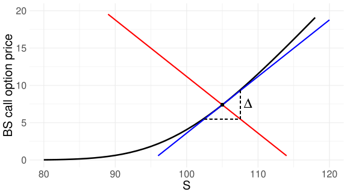{width=65%}

콜 옵션 매수자는 $-\Delta$만큼의 기초 자산을 매입하여, 즉 이 경우 $\Delta$만큼 기초 자산을 공매도하여 기초 자산 가격 변화에 따른 옵션의 가치 변화를 상쇄할 수 있다.

이를 델타 헷징이라고 한다.

반대로 콜 옵션 매도자는 $\Delta$만큼의 기초 자산을 매입하여 델타 헷징한다.

그래프로 이야기하자면 위 그림에서 검은 선과 붉은 선을 더하는 개념이다.

이렇게 합쳐진 선을 그림으로 표현하면 아래와 같다.


{width=65%}

기초 자산의 가격이 105인 점에서 헷지된 포트폴리오 가치 곡선의 접선의 기울기는 0이다.

즉, 기초 자산의 가격이 105로부터 아주 조금 변화하였을 때, 헷지된 포트폴리오의 가치 변화는 거의 0에 가깝다.

이러한 상태를 델타 중립(delta-neutral)이라고 한다.

물론 기초 자산의 가격이 105로부터 어느 정도 변한다면 포트폴리오의 가치 또한 그에 따라 변할 것이다.

콜 옵션의 가격을 기초 자산의 가격에 대한 함수로 나타내었을 때 볼록(convex)하다는 성질 때문에, 만약 기초 자산의 가격이 양의 방향이든 음의 방향이든 급격히 변하면 헷지된 포트폴리오의 가치는 상승한다.

예를 들어, 기초 자산의 가격이 105에서 106으로 변하였다고 하자.

그러면 다른 조건은 같다고 한 채, 변화된 콜 옵션의 가격은

$$
C_t = 106N(d_1)-100e^{-0.05\times0.2}N(d_2)\approx8.17
$$

이며, $d_1$과 $d_2$도 다시 계산하여야 한다.

식 @eq-delta-c1 과 비교하면 콜 옵션 매입 포지션으로부터 대략 $8.17-7.39=0.77$의 이득을 보았다.

한편 공매도한 주식의 포지션으로부터

$$
-\Delta\times(106-105)=-0.76
$$

의 손실을 보게 되므로, 이득과 손실의 크기는 비슷하여 전체 포트폴리오의 손익은 거의 0이라고 할 수 있다.

이번에는 기초 자산의 가격이 105에서 115로 크게 변하였다고 가정하자.

그러면 다른 조건은 같다고 한 채, 변화된 콜 옵션의 가격은

$$
C_t=115N(d_1)-Ke^{-r(T-t)}N(d_2)\approx16.18
$$

이며, 콜 옵션 매입 포지션으로부터 대략 $16.18-7.39=8.79$의 이득을 보았다.

한편 공매도한 주식의 포지션으로부터

$$
-\Delta\times(115-105)=-7.59
$$

의 손실을 보게 되므로, 총 손익은 대략 $8.79-7.59=1.2$의 이익이 발생하였다.

또한 기초 자산의 가격이 105에서 95로 크게 변하였다고 가정하면,

$$
C_t=95N(d_1)-Ke^{r(T-t)}N(d_2)\approx1.82
$$

이며, $1.82-7.39=-5.57$로서 손실을 본다.

그러나 공매도한 주식의 포지션으로부터

$$
\Delta\times10=7.59
$$

의 이득을 보게 되므로, 총 손익은 대략 2.01의 이득이다.

이처럼 거래한 옵션의 델타만큼의 반대 포지션을 취하여 기초 자산의 가격이 조금 변할 때 전체 포지션의 손익을 0에 가깝게 만든 포지션을 델타 중립이라 하며, 이러한 전략을 델타 헷징이라고 부른다.

기억해야 할 점은 델타 또한 시간에 따라 변하는 값이므로 델타 중립의 기간은 매우 짧다.

따라서 헷징 포지션은 지속적으로 재조정(rebalancing)되며, 이를 동적 헷징 전략이라 한다.

수학적으로 완벽한 델타 중립을 유지하기 위해서는 연속적으로 재조정이 이루어져야 할 것이나, 실제로는 그렇게 할 수 없으므로 완벽한 델타 헷징이 아닌 어느 정도의 오차가 발생한다.

이 오차의 크기는 다음에 살펴볼 감마라는 그릭과 관련이 있으며, 옵션이 등가격에 가까울수록 델타 헷징 에러가 크다.

#### 감마 {.unnumbered}

앞에서 살펴본 바와 같이 옵션 포지션을 헷지하여 델타 중립 포지션을 이루는 헷지된 포트폴리오를 구성하였더라도, 기초 자산의 가격이 크게 변하면 헷지된 포트폴리오의 가치 또한 변한다.

얼마만큼 변할지는 콜 옵션 가격 함수의 곡률과 관계있다.

만약 @fig-curvature 의 왼쪽처럼 콜 옵션 가격 함수의 곡률이 작다면 기초 자산의 가격이 크게 변하여도 헷지된 포트폴리오의 가격 변화는 심하지 않을 것이다.

반대로 오른쪽처럼 함수의 곡률이 크다면 기초 자산의 가격이 크게 변할 때 헷지된 포트폴리오의 가격 또한 크게 변할 것이다.

::: {#fig-curvature layout-ncol=2}



헷지된 포트폴리오의 가치 함수가 곡률이 작은 경우(왼쪽)와 곡률이 큰 경우(오른쪽)

:::

곡선의 곡률은 해당 함수를 두 번 미분하여 계산하며, 이 값이 양수이면 볼록(convex)하다고 하고 음수이면 오목(concave)하다고 한다.

옵션 그릭으로는 감마가 이에 해당하며, 2차 가격 민감도라고도 한다.

콜 옵션과 풋 옵션 모두 양의 감마를 지닌다.

@fig-gamma 에서처럼 심내가격과 심외가격의 경우 감마는 0에 가까우며 등가격에 가까울수록 큰 감마의 값을 갖는다.

다시 말해 기초 자산의 가격이 등가격 근방에서 요동칠 경우 옵션의 델타 또한 심하게 변하며, 그로 인해 실무에서는 동적 델타 헷징에 있어 어려움을 겪는다.

{#fig-gamma width=65%}

앞의 그림에서 살펴본 것처럼 양의 감마를 지니는 헷지된 포트폴리오는 기초 자산의 가격이 어느 방향으로든 크게 변하였을 때 가치가 상승한다.

시간이 지나면 결국 기초 자산의 가격이 변할 것이므로, 델타 헷지된 포트폴리오를 매입한 투자자는 궁극적으로 항상 이득을 보게 될까?

무차익 원리에 따라 그런 일은 발생하지 않는다.

이를 이해하기 위해서는 시간의 변화에 따른 가치 변화를 살펴보아야 한다.

#### 쎄타 {.unnumbered}

앞에서 옵션의 시간 가치에 대해 이야기하면서 옵션은 만기가 다가올수록 시간 가치가 작아진다고 하였다.

즉, 옵션 가격의 시간에 따른 변화인 쎄타는 음의 값이다.

아래 그림에서 약간의 시간이 흘렀을 때 델타 헷지된 포트폴리오의 가치를 점선으로 나타내었다.

쎄타가 음수이므로 그래프가 전체적으로 조금씩 하락한 것을 볼 수 있다.

특히 $S_t=105$ 근방에서는 크게 하락하여 $t$ 시점에서의 헷지된 포트폴리오의 가치보다 더 작은 가치를 지니며, 따라서 이 경우에는 손실을 본다.

하지만 $S$가 105에서 멀어질수록 양의 감마로 인하여 포트폴리오의 가치가 상승하였으며, 이득을 본다.

정리하자면 델타 헷지된 포트폴리오를 재조정(rebalancing)하지 않은 채로 시간이 흐르도록 그대로 두었을 때, 우연히 기초 자산의 가격 변동이 크다면 양의 감마로 인해 이득을 보게 되고, 기초 자산의 가격 변동이 거의 없다면 음의 쎄타로 인해 손실을 보게 된다.


{width=65%}

::: {.callout-note title="참고: 디지털 옵션의 델타와 감마"}

디지털 옵션은 만기 payoff가 행사 가격 근방에서 불연속적으로 변하므로, 행사 가격 근처에서 델타와 감마가 매우 민감하게 움직인다.

특히 만기가 가까워질수록 델타는 행사 가격 주변에 집중되고, 감마는 그 주변에서 큰 값을 가지며 부호가 바뀔 수 있다.

따라서 디지털 옵션은 일반적인 바닐라 옵션보다 델타 헷징이 더 까다롭다.

:::

## Dynamic trading strategy

### Replication process

이항나무 모형에서 살펴봤던 것처럼 복제(replication) 과정은 기초 자산과 무위험자산을 이용하여 옵션과 같은 파생상품의 가격 프로세스를 흉내내는 과정을 말한다.

블랙-숄즈 옵션 가격 결정 이론에서는 시간에 대해 연속적으로 기초 자산과 무위험자산을 거래하여 유러피안 옵션의 가격을 정확하게 흉내내는 과정을 생성할 수 있다.

다만 실제 세상에서 연속적으로 거래를 하는 것은 불가능하기 때문에, 아주 짧은 시간 $\delta t$ 후에 포트폴리오를 재조정하여 옵션의 가격을 근사하는 과정에 대해 먼저 살펴본다.

재조정이 이루어지는 시간들은 $\{t_i\}_{i=0}^n$이며, $t_0=0$, $t_n=T=$ 만기이다.

유러피안 콜 옵션의 가격 $C_t$를 흉내내기 위하여, 0 시점에 $C_0$의 현금을 가지고 포트폴리오를 구성하는 과정을 살펴보자.

유러피안 콜 옵션의 움직임을 따라가기 위해서는 $\Delta_0$만큼의 기초 자산을 $S_0$의 가격에 매수하여야 한다.

만약 부족한 금액이 있다면 대출을 하여 조달하고, 남는 금액이 있다면 무위험자산에 투자(예금)한다.

대출 혹은 예금을 의미하는 무위험자산은 $M$으로 표현하고, MMA(money market account)라고 부르기도 하겠다.

만약 $M$이 양수이면 예금을 뜻하고, $M$이 음수이면 대출을 뜻한다.

기초 자산과 무위험자산으로 구성된 복제 포트폴리오의 가치 프로세스를 $\Pi$라고 하면, 0 시점에 이 포트폴리오의 가치는 다음과 같다.

$$
t=0:\qquad \Pi_0=C_0=\Delta_0S_0+M_0
$$

이로부터 $\delta t$만큼의 시간이 흘러 $t_1=\delta t$에 도달하였다고 하자.

시간이 흘러 기초자산의 가격은 $S_{t_1}$으로 변하며, 이에 따라 기초 자산 매입 포지션의 가치는 다음과 같다.

$$
\Delta_0S_{t_1}
$$

위 식에서 이전 시점에 설정한 $\Delta_0$만큼의 기초 자산을 가지고 있음을 확인하라.

또한 이 기간 동안 MMA는 $r$의 이자율로 이자가 형성되며, 이자와 원금을 합쳐 지수 함수의 형식 혹은 선형 근사로서 다음과 같이 표현할 수 있다.

$$
M_0\exp(r\delta t)\approx M_0(1+r\delta t)
$$

따라서 델타를 재조정하기 전의 포트폴리오 상황은 다음과 같다.

$$
t=t_1:\qquad
\Pi_{t_1}
=
\Delta_0S_{t_1}
+
M_0\exp(r\delta t)
$$ {#eq-rep1}

시간이 흘러 기초 자산의 가격과 만기까지의 시간 등이 변했으므로, 옵션의 델타 또한 $\Delta_{t_1}$으로 변한다.

투자자는 변경된 델타를 바탕으로 포트폴리오를 재조정하여야 하는데, 이때 필요한 추가 자금은

$$
(\Delta_{t_1}-\Delta_0)S_{t_1}
$$

이다.

만약 이 값이 양수이면 비용이 더 필요하다는 의미이며, 필요한 만큼 MMA로부터 조달하여야 한다.

음수이면 기초 자산을 일부 매도하여 수익을 얻은 셈이며, 얻은 이익은 MMA에 투자한다.

즉, 거래 전략을 수행하는 동안 초기 자본 외에는 추가적으로 외부에서 자본을 들여오지 않고 운영하며, 이러한 거래 전략을 self-financing이라 한다.

재조정 후의 포트폴리오 상황을 수식으로 표현하면 다음과 같다.

$$
\begin{aligned}
t=t_1:\qquad
\Pi_{t_1}
&=
\Delta_{t_1}S_{t_1}+M_{t_1},\\
M_{t_1}
&=
M_0\exp(r\delta t)
-
(\Delta_{t_1}-\Delta_0)S_{t_1}
\end{aligned}
$$ {#eq-rep11}

이 포트폴리오의 가치 총액은 식 @eq-rep1 과 동일함을 확인하라.

마찬가지로 $\delta t$만큼의 시간이 흘러 $t_2=2\delta t$에 도달하면 MMA는 이자로 인해 증가하고, 투자자는 수정된 $\Delta$를 바탕으로 포트폴리오를 재조정한다.

이 과정을 재조정된 포트폴리오를 기준으로 시간 순서에 따라 작성하면 다음과 같다.

$$
\begin{aligned}
t=t_2:\quad
\Pi_{t_2}
&=\Delta_{t_2}S_{t_2}+M_{t_2},\\
M_{t_2}
&=M_{t_1}\exp(r\delta t)
-(\Delta_{t_2}-\Delta_{t_1})S_{t_2},\\[6pt]
t=t_3:\quad
\Pi_{t_3}
&=\Delta_{t_3}S_{t_3}+M_{t_3},\\
M_{t_3}
&=M_{t_2}\exp(r\delta t)
-(\Delta_{t_3}-\Delta_{t_2})S_{t_3},\\
&\vdots\\
t=T:\quad
\Pi_T
&=\Delta_{t_{n-1}}S_T+M_T,\\
M_T
&=M_{t_{n-1}}\exp(r\delta t)
\end{aligned}
$$

마지막 시점에서는 재조정을 할 필요가 없기 때문에 재조정 과정은 생략하였다.

Replication 과정을 성공적으로 수행했다면, 만기를 포함하여 각 시점에서 포트폴리오의 가치는 유러피안 콜 옵션의 가격과 거의 비슷할 것이다.

$$
\Pi_t\approx C_t,
\qquad
\text{for }t=t_0,t_1,\cdots,T.
$$

아래의 코드를 통해 실험해 보자.

**Replication process — R 코드**

```{.r}
TT <- 1
dt <- 0.0001 # Maturity and dt
times <- seq(0, TT, dt)

mu <- 0.1
sigma <- 0.2
S0 <- 101
r <- 0.05
K <- 100

n <- length(times) - 1
dWs <- rnorm(n, 0, sqrt(dt))
W <- c(0, cumsum(dWs))
S <- S0 * exp((mu - 0.5 * sigma)*times + sigma * W)

TTM <- TT - times # time to maturity

# d_1, d_2 : Be careful not to be NaN
d_1 <- (log(S / K) + (r + 0.5 * sigma^2) * TTM) /
  (sigma * sqrt(TTM))

d_2 <- (log(S / K) + (r - 0.5 * sigma^2) * TTM) /
  (sigma * sqrt(TTM))

bls_C <- S * pnorm(d_1) - K * exp(-r * TTM) * pnorm(d_2)
Delta_C <- pnorm(d_1)

MMA <- bls_C[1] - Delta_C[1] * S[1]
replicate_portfolio <- MMA + Delta_C[1] * S[1]

for (i in 2:length(times)) {
  MMA[i] <- MMA[i-1] * exp(r * dt) -
    (Delta_C[i] - Delta_C[i-1]) * S[i]

  replicate_portfolio[i] <- MMA[i] + Delta_C[i] * S[i]
}

# Now replicate_portfolio is approximately equal to bls_C
par(mfrow = c(1, 2))
plot(times, bls_C, type = 'l')
plot(times, replicate_portfolio, type = 'l')
```


위 코드와 R의 기본 plot 기능을 사용하여 콜 옵션의 블랙-숄즈 가격 변화 과정과 복제 포트폴리오의 가치 변화를 @fig-c-repl 에 나타내었다.

기초 자산 가격의 변화를 랜덤하게 형성하였기 때문에 실험할 때마다 움직임의 전반적인 형태는 달라지겠지만, 두 포트폴리오의 가치 변화는 매번 거의 비슷하다.

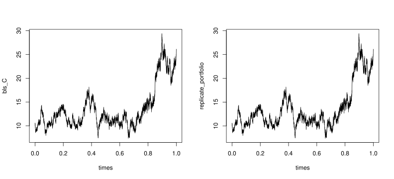{#fig-c-repl width=99%}

### Delta-hedging process

비슷하게 옵션에 매입이나 매도 포지션을 취하고 있는 옵션 거래자가 기초 자산 가격 변동에 따른 옵션 가격의 위험을 헷지하기 위해 기초 자산을 델타만큼 반대 거래를 하는 상황을 살펴보자.

통상적으로 유러피언 옵션의 매도자는 만기에 큰 하방 리스크에 노출될 수 있기 때문에 헷지 수단을 동원하게 된다.

유러피안 콜 옵션의 매도자가 $\Delta$만큼의 기초 자산을 매입하여 델타 헷징 포트폴리오 $\Pi$를 구성하는 상황을 살펴보자.

만약 풋 옵션을 매도했다면 기초 자산을 $\Delta$만큼 공매도한다.

델타만큼 기초 자산을 매입하면서 만약 부족한 금액이 발생하면 대출하여 조달하고, 만약 남는 금액이 발생하면 무위험자산에 투자한다.

초기 자본 $\Pi_0=0$이었다고 하면, 이 포트폴리오의 0 시점에서의 구성은 다음과 같다.

$$
\begin{aligned}
t=0:\quad
\Pi_0
&=0=-C_0+\Delta_0S_0+M_0,\\
M_0&=C_0-\Delta_0S_0
\end{aligned}
$$

앞에서 했던 것과 동일한 논리로 self-financing delta hedged 포트폴리오의 각 시점에서 가치는 다음과 같이 표현된다.

$$
\begin{aligned}
t=t_1:\quad
\Pi_{t_1}
&=-C_{t_1}+\Delta_{t_1}S_{t_1}+M_{t_1},\\
M_{t_1}
&=M_0\exp(r\delta t)
-(\Delta_{t_1}-\Delta_0)S_{t_1},\\[8pt]
t=t_2:\quad
\Pi_{t_2}
&=-C_{t_2}+\Delta_{t_2}S_{t_2}+M_{t_2},\\
M_{t_2}
&=M_{t_1}\exp(r\delta t)
-(\Delta_{t_2}-\Delta_{t_1})S_{t_2},\\[8pt]
t=t_3:\quad
\Pi_{t_3}
&=-C_{t_3}+\Delta_{t_3}S_{t_3}+M_{t_3},\\
M_{t_3}
&=M_{t_2}\exp(r\delta t)
-(\Delta_{t_3}-\Delta_{t_2})S_{t_3},\\
&\vdots\\
t=T:\quad
\Pi_T
&=-C_T+\Delta_{t_{n-1}}S_T+M_T,\\
M_T
&=M_{t_{n-1}}\exp(r\delta t)
\end{aligned}
$$

델타-헷징 프로세스를 성공적으로 수행했다면 모든 시점에서 포트폴리오의 가치는 0에 가깝다.

$$
\Pi_t\approx0,\qquad t=t_0,t_1,\cdots,T.
$$

앞 절의 내용과 비교해 보면 replication process와 delta hedging process는 수학적으로 동일함을 알 수 있다.

### Continuous trading and Black-Scholes PDE

앞의 replication portfolio 과정에서 임의의 $t_i$ 시점에 대해 포트폴리오의 변화량인 $\Pi_{t_{i+1}}-\Pi_{t_i}$를 계산하여 정리하면 다음으로 표현된다.

$$
\Pi_{t_{i+1}}-\Pi_{t_i}
=
\Delta_{t_i}(S_{t_{i+1}}-S_{t_i})
+rM_{t_i}\delta t
$$

여기서는 식을 간결하게 나타내기 위해 $\exp(r\delta t)\approx1+r\delta t$의 선형 근사를 이용하였다.

정확하게 복제되었다면 포트폴리오의 변화량 또한 콜 옵션의 변화량과 거의 동일해야 한다.

즉,

$$
C_{t_{i+1}}-C_{t_i}
\approx
\Delta_{t_i}(S_{t_{i+1}}-S_{t_i})
+rM_{t_i}\delta t
$$ {#eq-delta-c}

만약 $\delta t$의 시간 간격을 이론적인 극소 시간 간격인 $\mathrm{d}t$로 줄였다고 가정해 보자.

그러면 임의의 $t$ 시점에 대해 옵션의 가격 변화와 기초 자산의 가격 변화는 다음으로 나타낼 수 있으며,

$$
C_{t_{i+1}}-C_{t_i}\rightarrow\mathrm{d}C_t,
\qquad
S_{t_{i+1}}-S_{t_i}\rightarrow\mathrm{d}S_t
$$

식 @eq-delta-c 는 다음과 같이 표현된다.

$$
\mathrm{d}C_t
=
\Delta_t\mathrm{d}S_t
+rM_t\mathrm{d}t
$$

한편, 식 @eq-rep11 에서와 같이 self-financing 포트폴리오로서 $M_t=C_t-\Delta_tS_t$이어야 하므로, 위 식을 다시 쓰면

$$
\mathrm{d}C_t
=
\Delta_t\mathrm{d}S_t
+r(C_t-\Delta_tS_t)\mathrm{d}t
$$

이다.

그리고 $S_t$는 기하 브라운 운동을 따르므로, 기하 브라운 운동의 확률미분방정식에 의해,

$$
\begin{aligned}
\mathrm{d}C_t
&=
\Delta_t
(\mu S_t\mathrm{d}t+\sigma S_t\mathrm{d}W_t)
+r(C_t-\Delta_tS_t)\mathrm{d}t\\
&=
\frac{\partial C}{\partial S}
(\mu S_t\mathrm{d}t+\sigma S_t\mathrm{d}W_t)
+r\left(
C_t-\frac{\partial C}{\partial S}S_t
\right)\mathrm{d}t
\end{aligned}
$$ {#eq-dc1}

로 나타낼 수 있다.

위 식의 두 번째 등식에서는 $\Delta_t$를 정의에 따라 콜 옵션 가격의 자산 가격에 대한 편미분으로 표현하였다.

보다 정확히는 콜 옵션의 가격을 현재 시간 $t$와 현재 기초 자산의 가격 $S$에 대한 함수 $C(t,S)$로 나타낼 때,

$$
\frac{\partial C}{\partial S}
:=
\frac{\partial C(t,S=S_t)}{\partial S}
$$

를 뜻한다.

위 식에서 편미분에 사용된 $S$는 함수의 미분에 사용되는 변수를 표현하므로 아래 첨자 $t$가 없는 것이고, 괄호 안의 $S_t$는 $t$ 시점의 기초 자산 가격을 대입한다는 의미로서 아래 첨자 $t$가 등장한다.

다음은 Itô 공식(보다 정확히는 Itô process에 대해 일반화된 Itô 공식)을 이용하여 유러피안 콜 옵션의 가격 $C$의 순간 변화량을 표현해 보자.

시간 $t$에서의 유러피안 콜 옵션의 가격을 시간 $t$와 기초 자산의 가격 $S$의 함수 $C(t,S)$로 표현할 수 있다. 즉,


$$
C_t=C(t,S=S_t).
$$

브라운 운동을 바탕으로 한 원래의 Itô 공식과 비슷하게 기하 브라운 운동 $S_t$를 이용하여도 다음과 같이 일반화된 Itô 공식을 이용하여 $\mathrm{d}C_t$를 전개할 수 있다.

$$
\begin{aligned}
\mathrm{d}C_t
&=
\frac{\partial C}{\partial t}\mathrm{d}t
+
\frac{1}{2}\frac{\partial^2 C}{\partial S^2}
\mathrm{d}S_t\mathrm{d}S_t
+
\frac{\partial C}{\partial S}\mathrm{d}S_t\\
&=
\left(
\frac{\partial C}{\partial t}
+
\mu S_t\frac{\partial C}{\partial S}
+
\frac{1}{2}\sigma^2S_t^2
\frac{\partial^2 C}{\partial S^2}
\right)\mathrm{d}t\\
&\quad+
\sigma S_t\frac{\partial C}{\partial S}\mathrm{d}W_t
\end{aligned}
$$ {#eq-dc2}

이 전개에서는

$$
\begin{aligned}
\mathrm{d}S_t\mathrm{d}S_t
&=
(\mu S_t\mathrm{d}t+\sigma S_t\mathrm{d}W_t)
(\mu S_t\mathrm{d}t+\sigma S_t\mathrm{d}W_t)\\
&=
\sigma^2S_t^2\mathrm{d}t
\end{aligned}
$$

를 이용하였다.

앞에서 살펴본 브라운 운동의 미분 규칙을 참고하라.

식 @eq-dc2 를 식 @eq-dc1 의 좌변에 대입하여 정리하면,

$$
\left(
\frac{\partial C}{\partial t}
+
rS_t\frac{\partial C}{\partial S}
+
\frac{1}{2}\sigma^2S_t^2
\frac{\partial^2 C}{\partial S^2}
-
rC_t
\right)\mathrm{d}t=0
$$

이며, 등식이 성립하기 위해서는 괄호 안의 값이 항상 0이어야 한다.

즉, 옵션의 가격 함수 $C$가 다음의 조건을 만족해야 한다.

$$
\frac{\partial C}{\partial t}
+
rS\frac{\partial C}{\partial S}
+
\frac{1}{2}\sigma^2S^2
\frac{\partial^2 C}{\partial S^2}
-
rC=0.
$$

위 방정식을 블랙-숄즈 편미분방정식이라고 부르며, 블랙-숄즈 이론이 처음 등장했을 때는 이처럼 편미분방정식을 먼저 유도한 후에 이 편미분방정식의 해로서 블랙-숄즈 공식이 유도되었다.

아래 정리는 임의의 유러피안 스타일 옵션에 모두 성립되기 때문에 $C$나 $P$ 대신 임의의 유러피안 옵션을 의미하는 $V$로 표현하였다.

::: {.callout-important title="정리: Black-Scholes PDE"}

기초 자산 가격의 움직임이 앞에서 제시한 블랙-숄즈 모형의 가정을 따를 때, 만기가 $T$이고 행사 가격이 $K$인 유러피안 옵션의 가격 함수 $V(t,S=S_t)$는 $0\leq t<T$에서 다음의 편미분방정식을 만족한다.

$$
\frac{\partial V}{\partial t}(t,S)
+
rS\frac{\partial V}{\partial S}(t,S)
+
\frac{1}{2}\sigma^2S^2
\frac{\partial^2V}{\partial S^2}(t,S)
-
rV(t,S)=0.
$$ {#eq-bs-pde}

한편, 만기 시점에서의 terminal condition인 $V(T,S)$는 옵션의 payoff이다.

즉,

**유러피안 콜 옵션:**

$$
V(T,S)=(S-K)^+
$$ {#eq-term-call}

**유러피안 풋 옵션:**

$$
V(T,S)=(K-S)^+
$$ {#eq-term-put}

:::

::: {.callout-important title="정리: 블랙-숄즈 공식과 PDE의 관계"}

앞에서 살펴본 블랙-숄즈 공식의 $C_t$와 $P_t$는 각각 식 @eq-term-call 과 식 @eq-term-put 을 terminal condition으로 하는 PDE @eq-bs-pde 의 해이다.

**증명**

앞에서 제시한 블랙-숄즈 그릭의 값을 식 @eq-bs-pde 에 대입하여 확인해 보라.

:::
