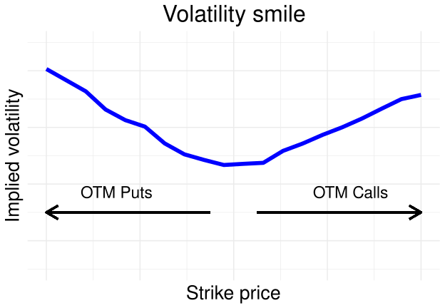
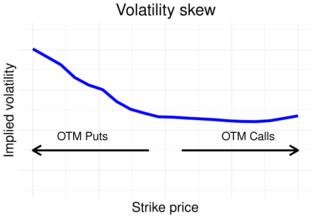
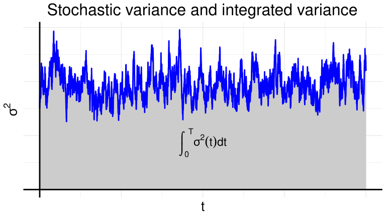

# 옵션 시장 가격

## 개요

앞 장에서는 금융 모형을 이용하여 옵션 가격을 계산하였다. 실제 시장에서 거래되는 옵션 가격에는 시장 상황뿐 아니라 투자자들의 기대, 위험에 대한 태도, 수요와 공급이 반영된다.

이 장에서는 관찰된 옵션 시장 가격에서 출발하여, 그 가격에 담긴 변동성과 위험에 관한 정보를 알아본다. 먼저 블랙–숄즈 공식을 역으로 이용해 내재변동성을 계산하고, 행사 가격에 따라 내재변동성이 달라지는 현상을 살펴본다.

## 학습 목표

- 내재변동성의 정의와 계산 방법을 이해한다.
- 변동성 미소와 변동성 스큐의 형태 및 의미를 설명한다.
- 역사적 변동성과 내재변동성의 차이를 설명한다.

## 내재변동성 {#sec-implied-volatility}

### 옵션 가격에서 변동성을 구하기

[변동성 장](../07-volatility/index.qmd)에서는 과거의 자산 가격이나 수익률 자료를 이용하여 변동성을 추정하였다. 변동성을 알아보는 또 다른 방법은 시장에서 거래되는 옵션 가격을 이용하는 것이다.

옵션 가격 공식에서 변동성을 제외한 나머지 입력값을 알고 있다면, 모형 가격이 시장 가격과 같아지도록 하는 변동성을 찾을 수 있다. 이렇게 구한 값을 **[내재변동성(implied volatility)](../../concepts/glossary.qmd#implied-volatility)**이라고 한다.

어떤 옵션 가격 모형을 사용하는지에 따라 내재변동성의 의미가 달라질 수 있다. 이 절에서는 [블랙–숄즈 공식](../12-continuous-time-model/02-black-scholes.qmd)을 사용하므로, 구체적으로는 블랙–숄즈 내재변동성을 다룬다.

::: {.callout-note}
블랙–숄즈 공식에 변동성을 입력하면 옵션 가격을 계산할 수 있다. 내재변동성을 구할 때는 이 과정을 거꾸로 진행한다. 옵션 시장 가격을 주어진 값으로 두고, 그 가격을 설명하는 변동성을 찾는다.
:::

### 블랙–숄즈 내재변동성의 정의

배당이 없는 기초자산에 대한 유러피언 옵션을 생각하자. 현재 기초자산 가격을 $S_0$, 행사 가격을 $K$, 만기까지의 시간을 $T$, 일정한 무위험 이자율을 $r$이라고 하자.

콜 옵션의 시장 가격이 $C^m$이면, 내재변동성 $\hat{\sigma}$는 다음 등식을 만족하는 값이다.

$$
C^m
=
S_0N\bigl(d_1(\hat{\sigma})\bigr)
-
Ke^{-rT}N\bigl(d_2(\hat{\sigma})\bigr).
$$ {#eq-implied-volatility-call}

여기서 $N$은 표준정규분포의 누적분포함수이고,

$$
\begin{aligned}
d_1(\sigma)
&=
\frac{
\log(S_0/K)+(r+\sigma^2/2)T
}{
\sigma\sqrt{T}
}, \\
d_2(\sigma)
&=
d_1(\sigma)-\sigma\sqrt{T}
\end{aligned}
$$

이다.

풋 옵션의 시장 가격 $P^m$을 이용할 때도 같은 방식으로 내재변동성을 정의한다.

$$
P^m
=
Ke^{-rT}N\bigl(-d_2(\hat{\sigma})\bigr)
-
S_0N\bigl(-d_1(\hat{\sigma})\bigr).
$$ {#eq-implied-volatility-put}

다른 조건이 같을 때 블랙–숄즈 콜·풋 옵션 가격은 변동성이 커질수록 증가한다. 따라서 양의 내재변동성이 존재하는 시장 가격 범위에서는 그 값을 유일하게 정할 수 있다.

::: {.callout-warning}
옵션 가격이 주어졌다고 해서 항상 양의 내재변동성이 존재하는 것은 아니다. 시장 가격이 모형에서 가능한 가격 범위에 있는지 먼저 확인해야 한다. 특히 만기나 배당 조건이 다른 옵션에 같은 공식을 그대로 적용하지 않도록 주의해야 한다.
:::

### 콜·풋 옵션과 가격도

동일한 기초자산, 행사 가격, 만기를 갖는 유러피언 콜·풋 옵션의 시장 가격이 풋–콜 패리티(put–call parity)를 만족하면,

$$
C^m-P^m
=
S_0-Ke^{-rT}
$$

이다. 블랙–숄즈 공식도 같은 관계를 만족하므로, 동일한 조건의 콜 옵션과 풋 옵션에서 계산한 내재변동성은 일치한다.

다만 서로 다른 행사 가격이나 만기의 옵션에서 계산한 내재변동성까지 같아야 한다는 뜻은 아니다.

옵션의 **가격도(moneyness)**는 기초자산 가격과 행사 가격의 관계를 나타낸다. 현재 기초자산 가격을 기준으로 구분하면 다음과 같다.

| 구분 | 콜 옵션 | 풋 옵션 |
|:---|:---|:---|
| 내가격(in the money) | $S_0>K$ | $S_0<K$ |
| 등가격(at the money) | $S_0=K$ | $S_0=K$ |
| 외가격(out of the money) | $S_0<K$ | $S_0>K$ |

: 현재 기초자산 가격을 기준으로 한 옵션의 가격도 {#tbl-option-moneyness}

실제 자료에서 내재변동성을 구할 때는 거래가 활발하고 가격을 신뢰할 수 있는 옵션을 선택하는 것이 중요하다. 아래 예제에서는 낮은 행사 가격의 외가격 풋 옵션과 높은 행사 가격의 외가격 콜 옵션을 이용한다.

### 내재변동성의 수치적 계산

블랙–숄즈 공식은 변동성이 주어졌을 때 옵션 가격을 직접 계산할 수 있는 공식이다. 반대로 시장 가격에서 변동성을 구할 때는 일반적으로 수치적 방법을 사용한다.

예를 들어 콜 옵션의 경우에는

$$
C_{\mathrm{BS}}(\sigma)-C^m=0
$$

을 만족하는 $\sigma$를 찾으면 된다. 여기서 $C_{\mathrm{BS}}(\sigma)$는 다른 입력값을 고정한 블랙–숄즈 콜 옵션 가격이다.

뉴턴–랩슨법이나 이분법으로 이 방정식의 해를 구할 수 있다. 또는 다음과 같이 모형 가격과 시장 가격 사이의 절대오차를 최소화할 수도 있다.

$$
\hat{\sigma}
=
\underset{\sigma>0}{\operatorname{arg\,min}}
\left|
C_{\mathrm{BS}}(\sigma)-C^m
\right|.
$$

아래 R 코드에서는 절대오차를 최소화하는 방법을 사용한다.

### 예제: 옵션 시장 가격으로부터 내재변동성 계산

현재 기초자산 가격과 연간 무위험 이자율이 다음과 같다고 하자.

$$
S_0=4{,}374,
\qquad
r=0.01.
$$

옵션의 만기는 12일 후이며, 1년을 365일로 두면

$$
T=\frac{12}{365}
$$

이다. 표 @tbl-implied-volatility-prices 는 원고에 주어진 옵션 시장 가격과, 이를 이용해 계산한 내재변동성을 보여 준다. 내재변동성은 연율이며 백분율로 표시하였다.

| 풋 행사 가격 $K$ | 풋 시장 가격 | 내재변동성 | 콜 행사 가격 $K$ | 콜 시장 가격 | 내재변동성 |
|---:|---:|---:|---:|---:|---:|
| 4,325 | 17.85 | 12.03% | 4,375 | 32.35 | 10.16% |
| 4,330 | 18.85 | 11.83% | 4,380 | 29.35 | 9.98% |
| 4,335 | 19.95 | 11.64% | 4,385 | 26.45 | 9.79% |
| 4,340 | 21.00 | 11.42% | 4,390 | 23.75 | 9.62% |
| 4,345 | 22.25 | 11.23% | 4,395 | 21.25 | 9.47% |
| 4,350 | 23.50 | 11.01% | 4,400 | 18.85 | 9.30% |
| 4,355 | 24.90 | 10.82% | 4,405 | 16.65 | 9.16% |
| 4,360 | 26.40 | 10.62% | 4,410 | 14.65 | 9.03% |
| 4,365 | 28.00 | 10.43% | 4,415 | 12.80 | 8.90% |
| 4,370 | 29.40 | 10.13% | 4,420 | 11.10 | 8.77% |

: 옵션 시장 가격과 블랙–숄즈 내재변동성 {#tbl-implied-volatility-prices}

예를 들어 행사 가격이 $K=4{,}375$이고 시장 가격이 32.35인 콜 옵션의 내재변동성을 계산해 보자.

먼저 블랙–숄즈 가격 함수를 정의한다. `type`이 `"C"`이면 콜 옵션, `"P"`이면 풋 옵션이다.

```r
BS <- function(S, K, sigma, r, TTM, type) {
  d1 <- (log(S / K) + (r + 0.5 * sigma^2) * TTM) /
    (sigma * sqrt(TTM))
  d2 <- d1 - sigma * sqrt(TTM)

  if (type == "C") {
    S * pnorm(d1) - K * exp(-r * TTM) * pnorm(d2)
  } else if (type == "P") {
    K * exp(-r * TTM) * pnorm(-d2) - S * pnorm(-d1)
  } else {
    stop("type은 'C' 또는 'P'여야 합니다.")
  }
}
```

다음으로 시장 가격과 모형 가격 사이의 절대오차를 정의하고, 이 값을 최소화하는 변동성을 찾는다.

```r
price_error <- function(sigma, price, S, K, r, TTM, type) {
  abs(price - BS(S, K, sigma, r, TTM, type))
}

S <- 4374
K <- 4375
r <- 0.01
TTM <- 12 / 365
price <- 32.35
type <- "C"

res <- optimise(
  price_error,
  interval = c(1e-8, 1),
  price = price,
  S = S,
  K = K,
  r = r,
  TTM = TTM,
  type = type,
  tol = 1e-10
)

sigma_hat <- res$minimum
sigma_hat
100 * sigma_hat

# 계산한 변동성을 가격 함수에 다시 대입하여 확인
BS(S, K, sigma_hat, r, TTM, type)
res$objective
```

계산한 내재변동성은 다음과 같다.

$$
\hat{\sigma}
\approx
0.1015575
=
10.15575\%.
$$

따라서 백분율의 소수 둘째 자리까지 표시하면 약 10.16%이다. 이 값을 블랙–숄즈 공식에 다시 대입하면 시장 가격인 32.35에 가까운 값을 얻는다.

::: {.callout-note}
`res$minimum`은 절대오차를 최소화하는 변동성이고, `res$objective`는 그 변동성에서의 절대오차이다.

위 코드에서는 변동성을 양수로 제한하고, 연율 100%까지의 구간에서 해를 찾는다. 다른 자료에 적용할 때는 탐색 구간이 해를 포함하는지와 최종 가격 오차가 충분히 작은지를 함께 확인해야 한다.
:::

`K`, `price`, `type`을 바꾸면 표의 다른 옵션에 대해서도 같은 계산을 할 수 있다. 같은 조건에서 여러 행사 가격의 내재변동성을 계산하면, 행사 가격에 따른 곡선을 얻는다.

{#fig-implied-volatility width="65%"}

표 @tbl-implied-volatility-prices 와 그림 @fig-implied-volatility 에서는 낮은 행사 가격의 옵션일수록 내재변동성이 높게 나타난다. 동일한 기초자산과 만기를 갖는 옵션이라도 행사 가격에 따라 서로 다른 내재변동성이 계산되는 것이다.

### 변동성 미소

블랙–숄즈 모형의 가정이 시장 가격을 정확하게 설명한다면, 동일한 기초자산과 만기의 옵션들은 행사 가격과 관계없이 같은 변동성으로 가격을 설명할 수 있어야 한다.

그러나 시장 가격으로부터 계산한 내재변동성은 행사 가격에 따라 달라지는 경우가 많다.

등가격 부근에서 내재변동성이 낮고, 낮은 행사 가격과 높은 행사 가격 양쪽으로 갈수록 높아지는 모습을 **변동성 미소(volatility smile)**라고 한다.

{#fig-volatility-smile width="60%"}

그림 @fig-volatility-smile 의 왼쪽은 외가격 풋 옵션, 오른쪽은 외가격 콜 옵션에 해당한다. 등가격 부근의 내재변동성을 기준으로 보면, 양쪽 외가격 옵션의 시장 가격이 그 변동성을 사용하는 블랙–숄즈 가격보다 높다는 뜻이다.

::: {.callout-note}
블랙–숄즈 모형에서는 만기의 자산 가격이 로그정규분포를 따르고, 로그수익률이 정규분포를 따른다. 자산 가격 자체가 정규분포를 따른다고 가정하는 것은 아니다.
:::

변동성 미소는 블랙–숄즈 모형의 일정한 변동성 가정만으로 시장 가격을 충분히 설명하기 어렵다는 것을 보여 준다.

외가격 옵션은 큰 가격 변동이 발생할 때 이익을 주므로, 극단적인 상황에 대비하려는 헤지 수요가 가격에 영향을 줄 수 있다. 적은 비용으로 큰 가격 변동에 투자하려는 수요도 영향을 줄 수 있다.

이러한 가격을 분포의 관점에서 해석하면, 시장이 블랙–숄즈 모형보다 꼬리위험을 크게 반영하는 경우와 연결할 수 있다. 다만 옵션 가격을 해석할 때 직접적으로 연결되는 것은 실제 확률분포가 아니라 위험중립 확률분포이다.

### 변동성 스큐

내재변동성 곡선은 항상 대칭적인 미소 형태를 보이지는 않는다. 한쪽으로 기울어진 형태를 **변동성 스큐(volatility skew)**라고 하며, 비대칭적인 미소 형태를 volatility smirk라고도 부른다.

주식시장에서는 낮은 행사 가격에서 내재변동성이 높고, 행사 가격이 높아질수록 내재변동성이 낮아지는 형태가 관찰된다.

{#fig-volatility-skew width="60%"}

그림 @fig-volatility-skew 와 같은 형태는 하락 위험에 대한 시장의 평가와 관련된다. 큰 가격 하락에 대비하려는 외가격 풋 옵션 수요는 해당 옵션의 가격을 높이고, 그 가격에서 역산한 내재변동성도 높인다.

위험중립 확률분포의 관점에서는 이러한 비대칭성이 하락 방향의 꼬리위험을 반영하는 것으로 해석될 수 있다.

::: {.callout-warning}
외가격 풋 옵션의 내재변동성이 높다는 사실만으로 그 옵션이 잘못 평가되었다고 판단할 수는 없다. 일정한 변동성을 사용하는 블랙–숄즈 모형에 비해 시장이 하락 위험에 더 높은 가격을 부여하고 있을 수 있기 때문이다.
:::

### 역사적 변동성과 내재변동성의 비교

역사적 변동성과 내재변동성은 서로 다른 자료와 관점에서 얻어진다.

| 구분 | 역사적 변동성 | 내재변동성 |
|:---|:---|:---|
| 사용하는 자료 | 과거 기초자산 가격·수익률 | 현재 옵션 시장 가격 |
| 계산 방법 | 수익률 자료의 통계적 추정 | 옵션 가격 모형의 역산 |
| 확률측도와의 관계 | 실제 확률측도 $\mathbb{P}$에서의 변동성과 연결 | 위험중립 확률측도 $\mathbb{Q}$에 기반한 가격과 연결 |
| 해석 | 과거의 변동 정도를 추정하며 모형을 통해 미래 예측에 활용 | 옵션 가격에 반영된 미래 불확실성과 위험 평가를 요약 |

: 역사적 변동성과 내재변동성의 비교 {#tbl-historical-implied-volatility}

표 @tbl-historical-implied-volatility 에서 역사적 변동성은 과거 자료에 기초하지만, 이를 GARCH 등의 모형에 이용하면 미래 변동성을 예측할 수 있다.

내재변동성은 만기까지의 불확실성에 대한 시장의 기대뿐 아니라 위험에 대한 보상과 옵션의 수요·공급도 반영한다. 따라서 미래에 실제로 관찰될 변동성과 반드시 같아지는 것은 아니다.

또한 내재변동성은 옵션 가격을 하나의 변동성 수치로 나타낸 값이다. 일반적인 모형에서 이를 곧바로 $\mathbb{Q}$ 아래 미래 실현변동성의 기댓값과 동일시해서는 안 된다.

## 실현변동성 {#sec-realized-volatility}

앞 절에서는 옵션 시장 가격으로부터 내재변동성을 계산하였다. 이번에는 실제로 관찰된 자산 가격을 이용하여 일정 기간 동안 실현된 변동성을 측정하는 방법을 살펴본다.

[7장의 역사적 변동성 계산식](../07-volatility/index.qmd#eq-real-vol)에서는 여러 날의 일일 수익률을 이용하여 표준편차를 계산하였다. 이제 하루보다 짧은 시간 간격, 예를 들어 5분 간격으로 관찰된 가격 자료를 이용해 보자. 이러한 **고빈도 자료(high-frequency data)**를 이용하면 하루 안에서도 여러 수익률을 관찰할 수 있으므로, 하루 동안의 가격 자료로 그날의 변동성을 측정할 수 있다.

### 실현분산과 실현변동성

시점 $t$의 자산 가격을 $S_t$라고 하고, 시점 0부터 $t$까지의 누적 로그수익률을 다음과 같이 정의하자.

$$
R_t=\log\frac{S_t}{S_0}.
$$

관측 시점이

$$
0=t_0<t_1<\cdots<t_N=T
$$

일 때, 각 관측 구간의 로그수익률은 다음과 같다.

$$
R_{t_{n+1}}-R_{t_n}
=
\log\frac{S_{t_{n+1}}}{S_{t_n}}.
$$

::: {.callout-note}
## 실현분산과 실현변동성의 정의

구간 $[0,T]$의 **실현분산(realized variance)**은 각 관측 구간의 로그수익률을 제곱하여 더한 값이다.

$$
\mathrm{RV}(0,T)
=
\sum_{n=0}^{N-1}
\left(R_{t_{n+1}}-R_{t_n}\right)^2.
$$ {#eq-realized-variance}

**실현변동성(realized volatility)**은 실현분산의 제곱근이다.

$$
\sqrt{\mathrm{RV}(0,T)}.
$$

여기서 $\mathrm{RV}$는 실현분산을 나타낸다.
:::

실현분산은 구간별 수익률 제곱의 **합**으로 정의된다. 따라서 표본분산처럼 관측 개수로 나누거나 각 수익률에서 표본평균을 빼지 않는다. 측정 대상은 구간 $[0,T]$ 전체에 걸쳐 누적된 변동의 크기이다.

### 시간에 따라 변하는 변동성

[12장의 로그가격 과정](../12-continuous-time-model/01-stochastic-models.qmd#eq-dlogs)에서 살펴본 것처럼, 위험중립확률 아래에서 자산 가격이 변동성 $\sigma$인 기하 브라운 운동을 따르면 누적 로그수익률은 다음과 같다.

$$
R_t
=
\left(r-\frac{1}{2}\sigma^2\right)t
+\sigma W_t.
$$

여기서 $r$은 무위험이자율이며, $W_t$는 위험중립확률 아래의 표준 브라운 운동이다. 이 과정을 미분형으로 표현하면 다음과 같다.

$$
\mathrm{d}R_t
=
\left(r-\frac{1}{2}\sigma^2\right)\mathrm{d}t
+\sigma\,\mathrm{d}W_t.
$$

기하 브라운 운동에서는 변동성 $\sigma$를 상수로 가정한다. 그러나 실제 금융 자료에서는 변동성이 시간에 따라 변화하는 모습을 관찰할 수 있다. 이를 반영하여 상수 $\sigma$를 시간에 따라 변하는 과정 $\sigma_t$로 바꾸면 다음과 같다.

$$
\mathrm{d}R_t
=
\left(r-\frac{1}{2}\sigma_t^2\right)\mathrm{d}t
+\sigma_t\,\mathrm{d}W_t.
$$ {#eq-log-return-stochastic-volatility}

실현분산의 정의 자체에는 위험중립확률 가정이 필요하지 않다. 실제확률 아래에서 자산 가격의 드리프트가 $\mu_t$라면 위 식의 $r$을 $\mu_t$로 바꾸어 생각할 수 있다. 아래에서 살펴볼 이차변동은 이러한 드리프트 항이 아니라 확산항 $\sigma_t\,\mathrm{d}W_t$에 의해 결정된다.

### 실현분산과 적분된 분산

실현분산이 무엇을 측정하는지 이해하기 위해 로그수익률 과정의 이차변동을 살펴보자.

12장에서 살펴본 [브라운 운동의 이차변동](../12-continuous-time-model/01-stochastic-models.qmd#eq-dwt)과 [확률미분의 계산 규칙](../12-continuous-time-model/01-stochastic-models.qmd#eq-dt)을 이용하면 다음과 같이 쓸 수 있다.

$$
(\mathrm{d}W_t)^2=\mathrm{d}t,
\qquad
(\mathrm{d}t)^2=0,
\qquad
\mathrm{d}t\,\mathrm{d}W_t=0.
$$

따라서 @eq-log-return-stochastic-volatility 에서

$$
\begin{aligned}
(\mathrm{d}R_t)^2
={}&
\left(r-\frac{1}{2}\sigma_t^2\right)^2
(\mathrm{d}t)^2 \\
&+
2\left(r-\frac{1}{2}\sigma_t^2\right)
\sigma_t\,\mathrm{d}t\,\mathrm{d}W_t \\
&+
\sigma_t^2(\mathrm{d}W_t)^2 \\
={}&
\sigma_t^2\,\mathrm{d}t
\end{aligned}
$$

를 얻는다. 이는 로그수익률 과정의 이차변동이 순간분산 $\sigma_t^2$를 시간에 대해 누적한 값이라는 뜻이다.

::: {.callout-note}
## 확률미분과 유한한 관측 구간의 구분

위 계산은 이차변동을 나타내는 확률미분의 계산 규칙이다. 실제로 관측한 각 구간에서 브라운 운동의 증가량 제곱이 그 구간의 길이와 정확히 같다는 뜻은 아니다.

실현분산과 적분된 분산의 관계는 관측 구간을 잘게 나누고, 구간별 수익률의 제곱을 모두 더했을 때 나타나는 극한 관계이다.
:::

자산 가격이 위와 같은 연속 확산모형을 따르고 필요한 정칙조건이 성립하면, 가장 긴 관측 간격이 0으로 줄어들 때 실현분산은 다음과 같이 확률수렴한다.

$$
\mathrm{RV}(0,T)
=
\sum_{n=0}^{N-1}
\left(R_{t_{n+1}}-R_{t_n}\right)^2
\xrightarrow{\mathrm{P}}
\int_0^T \sigma_t^2\,\mathrm{d}t.
$$ {#eq-realized-variance-limit}

오른쪽의 적분을 **적분된 분산(integrated variance)**이라고 하며, 다음과 같이 표기한다.

$$
\mathrm{IV}(0,T)
:=
\int_0^T \sigma_t^2\,\mathrm{d}t.
$$ {#eq-integrated-variance}

즉, 충분히 촘촘하게 관찰한 가격 자료에서 계산한 실현분산은 같은 기간의 적분된 분산을 추정하는 데 사용할 수 있다. 여기서 $\mathrm{IV}$는 적분된 분산을 뜻하며, 앞 절의 내재변동성을 나타내는 기호가 아니다.

### 적분된 분산의 해석

@fig-integrated-variance 의 파란색 선은 시간에 따라 확률적으로 변화하는 순간분산 $\sigma_t^2$의 가상 경로이다. 회색으로 표시된 영역은 이 경로 아래의 면적이며, 구간 $[0,T]$의 적분된 분산을 나타낸다.

{#fig-integrated-variance fig-alt="시간에 따라 변화하는 순간분산의 경로와 그 아래 적분된 분산을 나타내는 회색 영역"}

순간분산 $\sigma_t^2$가 확률적으로 변화하면 그 경로 아래의 면적인 $\mathrm{IV}(0,T)$도 확률변수가 된다.

시장에서는 자산 가격을 관찰할 수 있지만, 그 가격을 생성하는 순간분산 과정 자체를 직접 관찰할 수는 없다. 이러한 의미에서 적분된 분산은 **잠재변수(latent variable)**이다. 반면 실현분산은 관측된 가격 자료로 계산할 수 있으며, 관측할 수 없는 적분된 분산을 추정하는 역할을 한다.